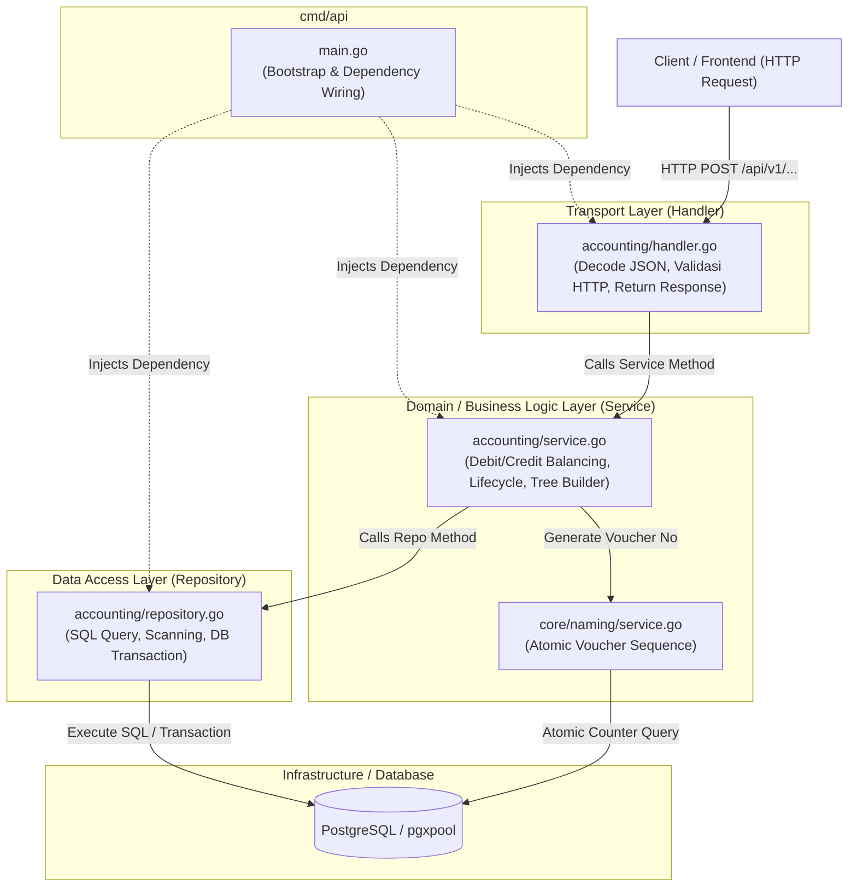
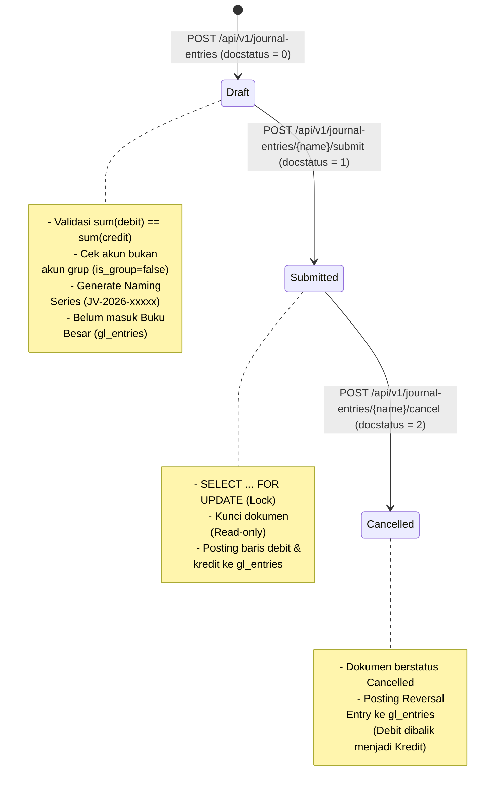

# Arsitektur Aplikasi Go: Panduan Pembelajaran Web Development (SimpleNext)

Dokumen ini disusun sebagai panduan pembelajaran arsitektur dan pola desain perangkat lunak (*software design patterns*) berbasis **Golang** yang diterapkan pada proyek **SimpleNext**.

---

## 1. Filosofi & Pendekatan Arsitektur

Go adalah bahasa pemrograman yang mengedepankan **kesederhanaan (*simplicity*)**, **eksplisit (*explicit over implicit*)**, dan **performa tinggi**. Berbeda dengan ekosistem bahasa lain yang sering mengandalkan *full-fledged framework* serba otomatis (seperti Spring Boot, Laravel, atau Django), pengembangan web di Go umumnya mengadopsi:

1. **Standard Library & Minimalist Routing:** Menggunakan pustaka standar Go (`net/http`) yang diperkuat dengan router HTTP berkecepatan tinggi dan kompatibel (`go-chi/chi`).
2. **Layered / Clean Architecture:** Memisahkan kode secara ketat antara representasi HTTP (*transport*), logika bisnis (*business domain*), dan akses basis data (*data access*).
3. **Manual Dependency Injection (DI):** Komposisi komponen dihubungkan secara eksplisit melalui fungsi *constructor* tanpa *reflection magic* atau *container framework* yang rumit.
4. **Prinsip `internal/` Package:** Memanfaatkan fitur bawaan compiler Go di mana direktori `internal/` tidak dapat diimpor oleh paket di luar modul ini, memastikan keamanan enkapsulasi kode.

---

## 2. Struktur Proyek (Standard Go Project Layout)

Proyek ini mengadopsi [Standard Go Project Layout](https://github.com/golang-standards/project-layout) yang menjadi standar *de facto* industri:

```text
simplenext/
├── cmd/                          # Entry point aplikasi yang dapat dieksekusi (binary)
│   └── api/
│       └── main.go               # Inisialisasi konfigurasi, koneksi DB, dependency injection, & HTTP server
├── internal/                     # Kode privat aplikasi (tidak dapat di-import oleh module luar)
│   ├── accounting/               # Modul Domain Accounting (Bagan Akun, Journal Entry, Buku Besar)
│   │   ├── handler.go            # Lapisan Transport / HTTP Controller (REST API)
│   │   ├── model.go              # Entitas data, DTO (Data Transfer Object), & representasi JSON
│   │   ├── repository.go         # Lapisan Database (SQL Queries & pgx driver)
│   │   ├── service.go            # Lapisan Logika Bisnis & Validasi Akuntansi
│   │   ├── service_test.go       # Unit test untuk logika bisnis murni
│   │   └── integration_test.go   # Integration test siklus transaksi akuntansi
│   ├── core/                     # Shared domain logic untuk platform
│   │   ├── naming/               # Naming Series Generator atomik (ala ERPNext)
│   │   └── types/                # Shared custom types (e.g., DocStatus)
│   └── platform/                 # Infrastruktur teknis & driver eksternal
│       └── database/             # Inisialisasi pgxpool (PostgreSQL connection pool)
├── migrations/                   # File skema DDL SQL untuk migrasi database
├── docker-compose.yml            # Konfigurasi container PostgreSQL untuk lingkungan lokal
├── Makefile                      # Kumpulan perintah kerja cepat (run, test, migrate)
├── IMPLEMENTATION_PLAN.md        # Rencana & spesifikasi fitur modul
└── ARCHITECTURE.md               # Dokumen ini (panduan arsitektur)
```

---

## 3. Diagram Alur & Pemisahan Lapisan (Layered Architecture)

Arsitektur dibagi menjadi **4 Lapisan Utama**:



### 1. Lapisan Entry Point (`cmd/api/main.go`)
- **Tanggung Jawab:**
  - Membaca konfigurasi (Environment variables seperti `DATABASE_URL`, `PORT`).
  - Menyiapkan *connection pool* basis data via [`database.NewPool`](file:///home/sandi/workspace/simplenext/internal/platform/database/postgres.go#L12).
  - Merakit (*wiring*) dependensi dari bawah ke atas:
    $$\text{Database Pool} \rightarrow \text{Repository} \rightarrow \text{Service} \rightarrow \text{Handler}$$
  - Mendaftarkan *middleware* umum (Request ID, Logger, Recoverer, Timeout).
  - Menjalankan HTTP Server secara asinkron (*goroutine*) dan menangani **Graceful Shutdown** via OS signal (`SIGINT`, `SIGTERM`).

### 2. Lapisan Transport / Handler (`internal/accounting/handler.go`)
- **Tanggung Jawab:**
  - Hanya mengurusi protokol HTTP.
  - Membaca parameter URL (`chi.URLParam`) dan query string.
  - Melakukan *decode* request body JSON ke dalam struct DTO ([`CreateJournalEntryRequest`](file:///home/sandi/workspace/simplenext/internal/accounting/model.go#L68)).
  - Memanggil method di [`Service`](file:///home/sandi/workspace/simplenext/internal/accounting/service.go#L13).
  - Mengembalikan respons HTTP dengan format JSON standar beserta status code yang tepat (`200 OK`, `201 Created`, `400 Bad Request`, `404 Not Found`, `500 Internal Server Error`).
- **Aturan Pembelajaran:** Handler **tidak boleh** memuat query database (SQL) dan **tidak boleh** memuat kalkulasi bisnis akuntansi.

### 3. Lapisan Bisnis / Service (`internal/accounting/service.go`)
- **Tanggung Jawab:**
  - Inti dari aplikasi (*Core Domain Logic*).
  - Memastikan aturan pembukuan *Double-Entry* terpenuhi:
    $$\sum \text{Debit} == \sum \text{Kredit}$$
  - Memvalidasi bahwa transaksi hanya boleh dicatat pada akun *leaf* (`is_group == false`).
  - Mengubah struktur data datar menjadi representasi pohon hierarkis ([`BuildAccountTree`](file:///home/sandi/workspace/simplenext/internal/accounting/service.go#L26)).
  - Mengoordinasikan pembuatan kode voucher unik berurutan via [`naming.Service`](file:///home/sandi/workspace/simplenext/internal/core/naming/service.go#L12).
- **Aturan Pembelajaran:** Service tidak peduli apakah request datang dari REST API, CLI, gRPC, atau Message Queue. Service murni menerima parameter Go dan mengembalikan error/data Go.

### 4. Lapisan Akses Data / Repository (`internal/accounting/repository.go`)
- **Tanggung Jawab:**
  - Menangani komunikasi langsung dengan PostgreSQL menggunakan driver [`pgx/v5`](https://github.com/jackc/pgx).
  - Menulis query SQL eksplisit (bukan ORM) untuk performa dan visibilitas penuh.
  - Mengelola siklus transaksi database (`tx.Begin`, `tx.Commit`, `tx.Rollback`) untuk operasi mutasi multi-tabel (header `journal_entries`, child items `journal_entry_accounts`, dan buku besar `gl_entries`).
  - Melakukan scanning dari baris database (`rows.Scan`) ke entitas struct Go.
- **Aturan Pembelajaran:** Semua urusan SQL, penguncian baris (`FOR UPDATE`), dan persistensi data diisolasi di sini.

---

## 4. Konsep Kunci & Pola Idiomatis Go yang Diterapkan

### A. Manual Dependency Injection (Constructor Functions)
Dalam Go idiomatik, *dependency injection* dilakukan secara eksplisit tanpa *framework container* pihak ketiga:
```go
// 1. Inisialisasi pool database
dbPool, _ := database.NewPool(ctx, dbURL)

// 2. Inject pool ke repository
repo := accounting.NewRepository(dbPool)

// 3. Inject repository dan naming service ke service bisnis
service := accounting.NewService(repo, namingService)

// 4. Inject service ke HTTP handler
handler := accounting.NewHandler(service)
```
**Keuntungan untuk Pembelajaran:**
- Aliran dependensi sangat jelas dan mudah dilacak (*traceable*).
- Sangat mudah diuji (*testable*), karena dependensi dapat diganti dengan *mock* atau *stub*.

### B. Pola Transaksi Atomik (Database Transactions)
Pada operasi seperti [`SubmitJournalEntry`](file:///home/sandi/workspace/simplenext/internal/accounting/repository.go#L155):
1. Transaksi dimulai dengan `tx, err := r.db.Begin(ctx)`.
2. Dipasang pengaman `defer tx.Rollback(ctx)` (otomatis dibatalkan jika terjadi error atau *panic* sebelum *commit*).
3. Baris dokumen dikunci dengan `SELECT ... FOR UPDATE` untuk mencegah *race condition*.
4. Status dokumen diperbarui ke `Submitted` (`docstatus = 1`).
5. Baris buku besar di-*insert* ke `gl_entries`.
6. Seluruh perubahan disahkan secara atomik dengan `tx.Commit(ctx)`.

### C. Naming Series Generator Atomik (`internal/core/naming`)
Untuk menghasilkan nomor dokumen berurutan seperti `JV-2026-00001` dalam kondisi konkurensi tinggi, digunakan perintah SQL `UPSERT` yang atomik:
```sql
INSERT INTO series_counters (prefix, current_value)
VALUES ($1, 1)
ON CONFLICT (prefix)
DO UPDATE SET current_value = series_counters.current_value + 1
RETURNING current_value;
```
Pendekatan ini menjamin nomor dokumen tidak akan duplikat meskipun ratusan *request* masuk secara bersamaan dalam satuan milidetik, tanpa membutuhkan *distributed lock* tambahan.

### D. Tipe Data Domain & Type Safety (`internal/core/types`)
Alih-alih menggunakan angka mentah `int16` di seluruh aplikasi, dibuat tipe data domain [`DocStatus`](file:///home/sandi/workspace/simplenext/internal/core/types/docstatus.go#L6):
```go
type DocStatus int16

const (
    DocStatusDraft     DocStatus = 0
    DocStatusSubmitted DocStatus = 1
    DocStatusCancelled DocStatus = 2
)
```
Tipe ini mengimplementasikan method `String()`, `IsDraft()`, `IsSubmitted()`, dan `IsCancelled()`. Hal ini mencegah kesalahan *magic numbers* dan meningkatkan keterbacaan kode.

### E. Penanganan Error yang Eksplisit & Error Wrapping
Go tidak menggunakan `try-catch`, melainkan pengembalian nilai `error` sebagai nilai balik (*return value*). Pada proyek ini diterapkan pola *error wrapping* standar Go (`%w`):
```go
if err != nil {
    return nil, fmt.Errorf("gagal query account by name: %w", err)
}
```
Pola ini mempertahankan jejak konteks error saat naik dari lapisan *Repository* ke *Service* hingga ke *Handler*.

### F. Asynchronous Server & Graceful Shutdown
Di [`cmd/api/main.go`](file:///home/sandi/workspace/simplenext/cmd/api/main.go#L69-L101), server HTTP dijalankan pada sebuah *goroutine* independen, sedangkan alur utama mendengarkan sinyal penghentian dari sistem operasi (`os.Interrupt`, `syscall.SIGTERM`).
Ketika sinyal diterima:
1. Server berhenti menerima koneksi baru.
2. Diberikan batas waktu toleransi (*grace period* 10 detik via `context.WithTimeout`) untuk menyelesaikan request yang sedang berjalan sebelum proses benar-benar ditutup.

---

## 5. Strategi Pengujian (Testing Strategy)

Proyek ini menerapkan dua tingkatan pengujian otomatis:

### 1. Unit Test Murni ([`service_test.go`](file:///home/sandi/workspace/simplenext/internal/accounting/service_test.go))
- **Fokus:** Menguji fungsi matematika dan logika bisnis tanpa membutuhkan database atau jaringan.
- **Pola:** *Table-Driven Tests* (idiom standar Go) untuk menguji berbagai skenario input positif dan negatif secara sistematis:
  - Validasi keseimbangan debit dan kredit ([`TestValidateDebitCreditBalance`](file:///home/sandi/workspace/simplenext/internal/accounting/service_test.go#L8)).
  - Perhitungan saldo normal akun ([`TestCalculateNetBalance`](file:///home/sandi/workspace/simplenext/internal/accounting/service_test.go#L118)).
  - Penyusunan pohon hierarki akun ([`TestBuildAccountTree`](file:///home/sandi/workspace/simplenext/internal/accounting/service_test.go#L173)).
- **Kecepatan:** Berjalan dalam hitungan milidetik:
  ```bash
  make test-unit
  ```

### 2. Integration Test ([`integration_test.go`](file:///home/sandi/workspace/simplenext/internal/accounting/integration_test.go))
- **Fokus:** Menguji alur lengkap (*End-to-End*) dari tingkat HTTP endpoint hingga transaksi di PostgreSQL:
  1. Membuat draft jurnal.
  2. Menguji validasi penolakan transaksi tidak seimbang (harus mengembalikan `400 Bad Request`).
  3. Men-submit jurnal dan memastikan mutasi tercatat di `gl_entries`.
  4. Membatalkan (*Cancel*) jurnal dan memastikan saldo kembali seimbang melalui *reversal entry*.
- **Pola:** Menggunakan `httptest.NewRecorder` dan `httptest.NewRequest` tanpa perlu menjalankan server HTTP secara fisik di port jaringan.
- **Perintah:**
  ```bash
  make test-integration
  ```

---

## 6. Siklus Hidup Transaksi Akuntansi (Accounting Lifecycle)



---

## 7. Panduan Menambahkan Modul Baru (Step-by-Step)

Jika Anda ingin memperluas aplikasi ini (misalnya menambahkan modul `inventory` atau `sales`), ikuti pola arsitektur yang sama:

1. **Definisikan Skema Database:**
   Buat file DDL di `migrations/` (misal: tabel `items`, `stock_ledger_entries`).
2. **Buat Direktori Domain di `internal/`:**
   Buat folder baru, contoh: `internal/inventory/`.
3. **Definisikan Model & DTO (`model.go`):**
   Buat struct representasi data tabel dan request/response JSON.
4. **Buat Lapisan Akses Data (`repository.go`):**
   Definisikan `type Repository struct { db *pgxpool.Pool }` dan method query SQL.
5. **Buat Lapisan Bisnis (`service.go`):**
   Definisikan `type Service struct { repo *Repository, naming *naming.Service }` beserta validasi dan alur bisnis.
6. **Buat Lapisan HTTP (`handler.go`):**
   Definisikan `type Handler struct { service *Service }` dan method `RegisterRoutes(r chi.Router)`.
7. **Daftarkan di `cmd/api/main.go`:**
   Inisialisasi `NewRepository`, `NewService`, `NewHandler`, dan panggil `handler.RegisterRoutes(r)`.
8. **Tulis Unit & Integration Test:**
   Pastikan setiap validasi memiliki unit test dan alur API memiliki integration test.
