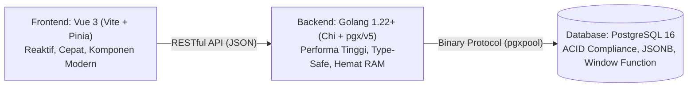
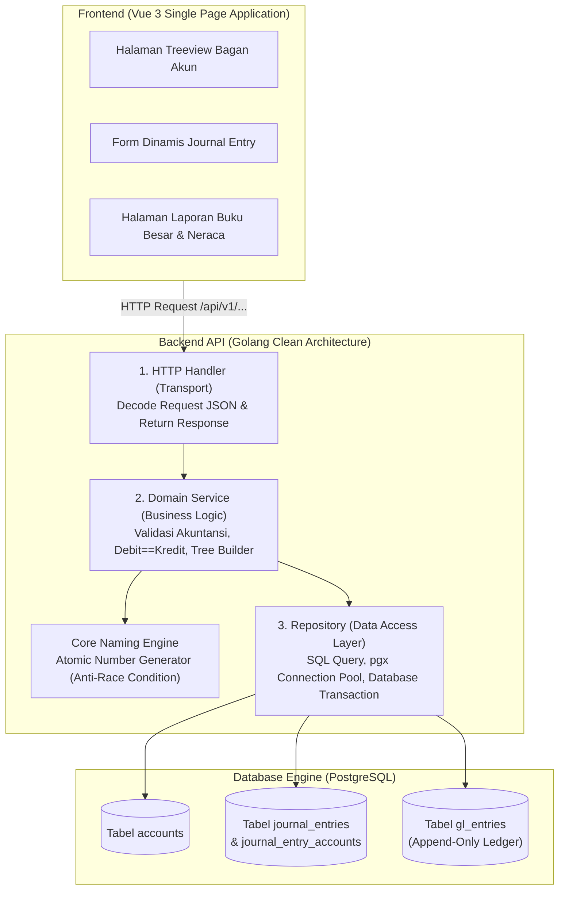
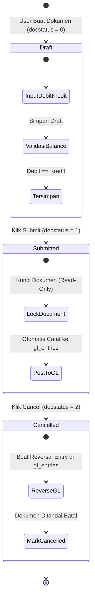

# BAB 1: PENDAHULUAN & GAMBARAN PROYEK

Halo semuanya! Selamat datang di bab pembuka dari seri e-book **Membangun Sistem ERP & Akuntansi "SimpleNext"**. 

Banyak tutorial di internet hanya mengajarkan aplikasi *To-Do List*, *Blog*, atau *CRUD* sederhana yang tidak mencerminkan kompleksitas aplikasi dunia kerja sesungguhnya. Dalam buku ini, kita akan melompat lebih jauh: kita akan membangun sebuah sistem inti **ERP (Enterprise Resource Planning) & Akuntansi Finansial** bernama **SimpleNext** dari baris kode pertama hingga siap dirilis ke server produksi!

---

## 1.1 Apa Itu SimpleNext & Siapa Penggunanya?

**SimpleNext** adalah aplikasi manajemen keuangan dan pencatatan transaksi terstandar yang mengadopsi filosofi sistem ERP kelas dunia (seperti *ERPNext/Frappe*). 

Dalam bisnis nyata, kesalahan pencatatan uang bernilai fatal. Oleh karena itu, SimpleNext tidak menggunakan sistem CRUD biasa yang memperbolehkan sembarang ubah (*update*) atau hapus (*delete*). Sebaliknya, SimpleNext menerapkan prinsip:
1. **Double-Entry Bookkeeping (Pembukuan Berpasangan):** Setiap transaksi keuangan selalu memiliki sisi **Debit** dan sisi **Kredit** dengan nilai total yang harus seimbang ($\sum \text{Debit} == \sum \text{Kredit}$).
2. **Document Lifecycle:** Dokumen tidak langsung mengikat keuangan perusahaan, melainkan melewati tahap persetujuan:
   - `Draft (0)`: Konsep awal, masih bisa diperbaiki dan diubah.
   - `Submitted (1)`: Dokumen resmi yang terkunci, otomatis membukukan saldo ke Buku Besar (*General Ledger*).
   - `Cancelled (2)`: Dokumen yang dibatalkan, otomatis menerbitkan jurnal pembalik (*reversal entry*) agar riwayat audit tidak hilang.
3. **Immutable Ledger (Buku Besar Anti-Manipulasi):** Catatan di buku besar bersifat *append-only*. Tidak ada data yang dihapus (*hard-delete*), melainkan dibalikkan dengan transaksi baru demi keamanan jejak audit (*audit trail*).

```
+-----------------------------------------------------------------------+
|                           SASARAN PENGGUNA                            |
+-----------------------------------------------------------------------+
| 1. Staff Akuntan (Accountant) : Membuat draft transaksi, cek balance |
| 2. Manager Keuangan (Manager) : Menyetujui (Submit) / Membatalkan (Cancel) |
| 3. Auditor Internal (Auditor) : Memeriksa jejak audit & buku besar    |
| 4. Direktur Bisnis (Executive): Memantau laba-rugi & neraca realtime  |
+-----------------------------------------------------------------------+
```

> 💡 **[CATATAN/TIPS]**  
> Mengapa aplikasi ini dinamai **SimpleNext**? Karena aplikasi ini mengambil inspirasi logika bisnis terbaik dari arsitektur ERPNext, namun dibangun dengan pendekatan *Go-idiomatic* yang jauh lebih sederhana (*simple*), ringan (*lightweight*), dan tanpa dependensi framework raksasa yang membingungkan.

---

## 1.2 Tech Stack: Mengapa Golang, Postgres, & Vue 3?

Kombinasi teknologi yang dipilih untuk proyek ini dirancang agar sangat efisien, cepat, dan mudah di-maintain:



1. **Golang (Go 1.22+):**
   - **Kompilasi ke Single Binary:** Tidak membutuhkan runtime besar seperti Node.js atau Java Virtual Machine di server.
   - **Performa & Hemat Memori:** Konsumsi RAM backend Go untuk menangani ribuan transaksi per detik biasanya di bawah 30 MB.
   - **Eksplisit & Type-Safe:** Menghindarkan kita dari *runtime bug* perhitungan angka atau tipe data yang tidak cocok.
2. **PostgreSQL 16:**
   - Database *relational* paling matang dan terpercaya untuk aplikasi finansial.
   - Memiliki dukungan tipe data `NUMERIC(18, 4)` yang presisi tanpa pembulatan mengambang (*floating point error*).
   - Fitur *Locking row-level* (`SELECT ... FOR UPDATE`) dan operasi atomik yang handal.
3. **Vue 3 + Vite:**
   - Menggunakan *Composition API* (`<script setup>`) yang sangat bersih dan mudah dipahami.
   - Sangat cepat saat proses *development* berkat Vite.
   - *State management* elegan menggunakan **Pinia**.

> ⚠️ **[PERINGATAN]**  
> Hindari selalu menggunakan tipe data `FLOAT` atau `DOUBLE` untuk nilai mata uang di database maupun bahasa pemrograman! Angka `0.1 + 0.2` pada tipe float bisa menghasilkan `0.30000000000000004` yang berakibat fatal pada audit keuangan. Kita akan menggunakan tipe `NUMERIC` di Postgres dan `string` / `math/big` / pustaka desimal di Go.

---

## 1.3 Arsitektur Sistem & Diagram Alur Dokumen

Aplikasi backend SimpleNext dibangun menggunakan **Clean / Layered Architecture** yang memisahkan tanggung jawab kode ke dalam 3 lapisan utama (*Transport*, *Service*, dan *Repository*):



### Alur Siklus Dokumen Transaksi (Document Lifecycle Flowchart)

Salah satu hal paling menarik yang akan Anda pelajari adalah alur siklus hidup dokumen berikut:



Penjelasan alur:
- **Draft (`0`):** Pengguna dapat menambah baris debit/kredit, mengubah nominal, atau memperbaiki akun. Belum ada saldo yang bertambah atau berkurang di buku besar.
- **Submit (`1`):** Sistem memvalidasi apakah $\sum \text{Debit} == \sum \text{Kredit}$. Jika seimbang, dokumen dikunci permanen, nomor seri resmi diterbitkan (`JV-2026-10-00001`), dan baris transaksi otomatis diposting ke tabel `gl_entries`.
- **Cancel (`2`):** Jika terjadi kesalahan pada dokumen yang sudah di-submit, dokumen **tidak boleh dihapus dari database**. Dokumen ditandai batal, dan sistem membuat baris jurnal pembalik (*reversal*) di `gl_entries` dengan tanda `is_cancelled = true`.

---

## 1.4 Fitur-Fitur Utama yang Akan Anda Bangun

Di akhir e-book ini, Anda akan memiliki aplikasi fullstack lengkap dengan fitur-fitur berikut:

1. **Autentikasi & Role-Based Access Control (RBAC):**
   - Registrasi, Login, dan Proteksi Rute menggunakan JSON Web Token (JWT).
   - Hak akses pengguna (*Admin*, *Accountant*, *Viewer*).
2. **Bagan Akun Hierarkis (Chart of Accounts Treeview):**
   - Pengelompokan akun ke 5 tipe dasar: Aset (*Asset*), Kewajiban (*Liability*), Ekuitas (*Equity*), Pendapatan (*Income*), dan Beban (*Expense*).
   - Antarmuka pohon (*treeview*) interaktif untuk melihat induk dan anak akun.
   - Validasi keamanan: Akun bertipe *Group* dilarang menerima transaksi langsung.
3. **Atomic Naming Series Engine:**
   - Generator nomor dokumen otomatis (contoh: `JV-2026-10-00001`) yang aman dari *race condition* meski diakses ribuan pengguna bersamaan.
4. **Jurnal Umum Dinamis (Journal Entry):**
   - Form input transaksi dengan kemampuan tambah/hapus baris secara dinamis di Vue 3.
   - Pengecekan otomatis keseimbangan Debit vs Kredit secara *realtime*.
   - Tombol aksi transisi status: *Save Draft*, *Submit*, dan *Cancel Document*.
5. **Buku Besar & Laporan Keuangan Realtime:**
   - **General Ledger Report:** Melihat mutasi debit, kredit, dan saldo berjalan (*running balance*) per akun.
   - **Trial Balance (Neraca Saldo):** Rekapitulasi seluruh saldo akun untuk memastikan pembukuan selalu seimbang.
   - Fitur ekspor laporan ke format CSV dan cetak PDF.
6. **Dashboard Analitik Keuangan:**
   - Ringkasan posisi kas, total piutang, hutang, dan grafik laba kotor.
7. **Containerization & Deployment Production:**
   - Dockerfile multi-stage untuk backend Go (ukuran file binary di bawah 25 MB).
   - Nginx untuk melayani frontend Vue 3 dan bertindak sebagai Reverse Proxy.

---

## 1.5 Roadmap Belajar & Progres Langkah Demi Langkah

Untuk menyelesaikan proyek ini tanpa rasa kewalahan (*overwhelmed*), kita akan mengikuti tahapan pengerjaan bertahap:

```
[Bab 2] Desain Database & ERD
   ↓
[Bab 3] Setup Environment (Go, Postgres Docker, Vue 3 Vite)
   ↓
[Bab 4] Otentikasi & RBAC (JWT & Route Guard)
   ↓
[Bab 5] Database Migration & Seeder Akuntansi
   ↓
[Bab 6] Modul 1: Atomic Naming Series
   ↓
[Bab 7] Modul 2: Chart of Accounts & Treeview UI
   ↓
[Bab 8] Modul 3: Journal Entry & Siklus Transaksi
   ↓
[Bab 9] Modul 4: Buku Besar & Laporan Keuangan
   ↓
[Bab 10] Modul 5: Dashboard Finansial
   ↓
[Bab 11] Production & Deployment ke Server
```

---

## 🔍 [PENGUJIAN & CEK KESIAPAN]

Sebelum kita melangkah ke **BAB 2: PERANCANGAN DATABASE & RELASI**, pastikan Anda telah menyiapkan terminal kerja Anda.

Jalankan perintah berikut di terminal untuk memastikan perangkat Anda siap:

```bash
# 1. Periksa versi Go
go version
# Rekomendasi output: go version go1.22.x atau lebih baru

# 2. Periksa versi Node.js
node -v
# Rekomendasi output: v20.x.x atau lebih baru

# 3. Periksa Docker
docker --version
# Rekomendasi output: Docker version 24.x.x atau lebih baru
```

Jika semua versi di atas sudah sesuai, selamat! Anda siap melangkah ke bab berikutnya untuk mulai merancang arsitektur basis data PostgreSQL yang solid dan anti-bocor untuk sistem akuntansi kita.

---

➡️ **Langkah Berikutnya:** Lanjutkan ke [**BAB 2: PERANCANGAN DATABASE & RELASI (POSTGRESQL)**](file:///home/sandi/workspace/simplenext/docs/ebook/BAB_02_DATABASE_DESIGN.md).
