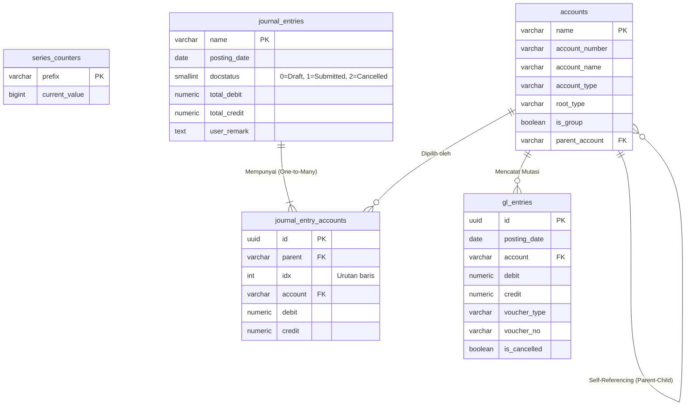

# BAB 2: PERANCANGAN DATABASE & RELASI (POSTGRESQL)

Halo semuanya! Di bab ini, kita akan masuk ke pondasi paling krusial dari setiap aplikasi finansial: **Database**.

Dalam membangun sistem akuntansi, kita tidak boleh sembarangan membuat tabel. Kesalahan kecil pada tipe data (misal: memakai `FLOAT` untuk uang) atau relasi tabel yang lemah bisa menyebabkan kerugian miliaran rupiah di dunia nyata! Oleh karena itu, kita akan menggunakan **PostgreSQL**, database relasional (SQL) *open-source* paling canggih saat ini.

---

## 2.1 Prinsip Desain Data Akuntansi & Integritas Keuangan

Sebelum menulis tabel, ada tiga aturan emas dalam desain database sistem ERP (Enterprise Resource Planning):

1. **Anti Hard-Delete (Immutable Ledger):**  
   Data transaksi keuangan (seperti *Jurnal* atau *Buku Besar*) **DILARANG KERAS** dihapus dari database (`DELETE FROM ...`). Jika ada salah input, kita harus membatalkan dokumen tersebut (merubah status) dan sistem akan membuat transaksi pembalik otomatis. Ini disebut *Audit Trail* (Jejak Audit).
2. **Presisi Desimal (Gunakan NUMERIC, BUKAN FLOAT):**  
   Tipe data `FLOAT` atau `DOUBLE` memiliki kelemahan *floating-point error* (contoh: 0.1 + 0.2 bisa menjadi 0.30000004). Untuk menyimpan nilai mata uang, kita **WAJIB** menggunakan tipe data `NUMERIC(18, 4)`. Artinya: maksimal 18 digit angka, dengan 4 digit di belakang koma.
3. **Double-Entry Balance (Keseimbangan Ganda):**  
   Total Debit harus selalu sama dengan Total Kredit. Database kita akan merancang tabel *Header* (Total) dan tabel *Child* (Rincian Baris) untuk menampung aturan ini.

---

## 2.2 Perancangan Skema Tabel Inti

Proyek SimpleNext akan memiliki **5 Tabel Utama**. Mari kita bedah fungsinya satu per satu.

### 1. Tabel `series_counters` (Generator Nomor Urut Dokumen)
Pernahkah Anda bertanya bagaimana sistem ERP menghasilkan nomor dokumen seperti `JV-2026-10-00001` secara otomatis tanpa bentrok walau diakses 100 kasir bersamaan? Tabel ini adalah kuncinya.
- `prefix`: Prefix seri (contoh: `JV-2026-10-`)
- `current_value`: Angka urutan terakhir

### 2. Tabel `accounts` (Bagan Akun / Chart of Accounts)
Tabel ini menyimpan daftar akun akuntansi perusahaan (seperti Kas, Bank, Piutang, Modal). Menariknya, tabel ini berelasi dengan dirinya sendiri (*Self-Referencing*) untuk membentuk pohon hierarki (*Tree*).
- `name`: Primary Key, ID unik (contoh: `1110 - Kas Kecil`)
- `account_type`: Jenis akun (Asset, Liability, Equity, Income, Expense, Bank, Cash, dll)
- `root_type`: Kategori akar (Asset, Liability, Equity, Income, Expense)
- `is_group`: Boolean (`TRUE` jika ini hanya map folder / grup, `FALSE` jika ini akun buku besar yang bisa menerima transaksi)
- `parent_account`: Foreign Key merujuk kembali ke tabel `accounts.name`

### 3. Tabel `journal_entries` (Header Jurnal Umum)
Ini adalah map / sampul dari sebuah dokumen transaksi.
- `name`: Nomor voucher (contoh: `JV-00001`)
- `posting_date`: Tanggal pembukuan transaksi
- `docstatus`: Status siklus dokumen (0 = Draft, 1 = Submitted, 2 = Cancelled)
- `total_debit` & `total_credit`: Total ringkasan (harus sama)

### 4. Tabel `journal_entry_accounts` (Detail Baris Jurnal Umum)
Ini adalah isi dari map dokumen di atas. Satu `journal_entries` bisa memiliki banyak baris `journal_entry_accounts` (Relasi One-to-Many).
- `id`: UUID (Primary Key)
- `parent`: Foreign Key ke `journal_entries.name`
- `account`: Foreign Key ke `accounts.name` (Akun yang dituju)
- `debit` & `credit`: Nominal transaksi

### 5. Tabel `gl_entries` (Buku Besar / General Ledger)
Tabel suci yang tidak boleh dimanipulasi sembarangan. Setiap kali *Journal Entry* di-submit (`docstatus = 1`), sistem akan menyalin data dari `journal_entry_accounts` ke tabel ini secara permanen.
- `id`: UUID
- `posting_date`: Tanggal pembukuan
- `account`: Akun yang terpengaruh
- `debit` & `credit`: Nominal mutasi
- `voucher_type` & `voucher_no`: Referensi ke dokumen asal (contoh: `Journal Entry` dan `JV-00001`)
- `is_cancelled`: Tanda apakah entri ini sudah dibatalkan oleh transaksi pembalik.

> 💡 **[CATATAN/TIPS]**  
> Mengapa kita memisahkan tabel `journal_entry_accounts` dengan `gl_entries`?  
> Karena `journal_entries` adalah **Dokumen Operasional** (Draft, Review, Cetak Form). Sedangkan `gl_entries` adalah **Catatan Audit Murni**. Memisahkan keduanya adalah standar industri ERP untuk mempercepat query laporan keuangan (*Buku Besar* dan *Neraca Saldo*).

---

## 2.3 Diagram Entity Relationship (ERD)

Untuk memudahkan visualisasi, berikut adalah diagram relasi antar tabel (ERD) yang akan kita bangun di PostgreSQL:

### Penjelasan Relasi & Constraint (Aturan Integritas):
1. **Cascade Delete pada Jurnal (One-to-Many):** Jika sebuah *Journal Entry* (Draft) dihapus (sebelum di-submit), maka seluruh baris *Journal Entry Accounts* miliknya harus ikut terhapus. Kita akan menggunakan fitur `ON DELETE CASCADE` di PostgreSQL pada Foreign Key `parent`.
2. **Restrict Delete pada Akun:** Sebuah akun di tabel `accounts` **TIDAK BOLEH** dihapus jika sudah pernah digunakan di dalam transaksi jurnal (`journal_entry_accounts` atau `gl_entries`). Postgres akan secara default mencegah ini berkat Foreign Key constraint standar.

---

## 2.4 Kesiapan Migrasi Database

Sekarang kita sudah paham **Tabel Apa** dan **Mengapa** tabel tersebut dibuat. Pada bab selanjutnya, kita tidak akan membuat tabel ini secara manual dengan klik-klik di DBeaver atau pgAdmin.

Sebagai *Software Engineer* modern, kita akan menggunakan teknik **Database Migration as Code (DDL)**. Artinya, struktur tabel ini akan kita tulis dalam bentuk file `.sql` yang tersimpan rapi di dalam proyek Go kita. 

> 🔍 **[PENGUJIAN MENTAL MODEL]**  
> Sebelum lanjut, mari kita tes logika Anda!  
> **Skenario:** Kasir A membuat Jurnal "Membayar Listrik dengan Kas" senilai Rp 500.000.  
> **Pertanyaan:** Tabel mana saja yang akan terisi datanya ketika jurnal masih status `Draft (0)`? Dan tabel mana yang akan bertambah datanya saat tombol `Submit` ditekan?  
> **Jawaban:** Saat `Draft`, data hanya masuk ke `journal_entries` dan `journal_entry_accounts`. Saat `Submit`, sistem akan menyalin mutasi tersebut secara permanen ke `gl_entries`. Keren kan?

---

➡️ **Langkah Berikutnya:** Mari kita siapkan alat kerjanya! Lanjutkan ke [**BAB 3: PERSIAPAN LINGKUNGAN, DOCKER, & INISIALISASI PROYEK**](file:///home/sandi/workspace/simplenext/docs/ebook/BAB_03_SETUP_PROJECT.md).
