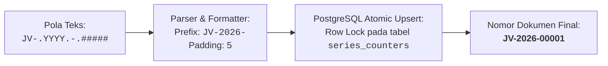
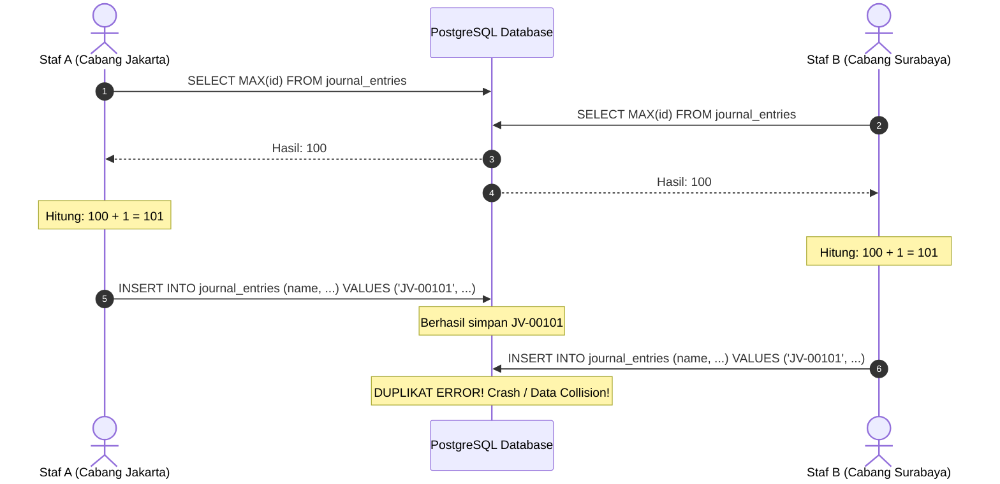

# BAB 6: MODUL 1 - ATOMIC NAMING SERIES GENERATOR (CORE ENGINE)

Halo semuanya! Selamat datang di modul logika bisnis pertama kita. Di bab ini, kita akan membangun salah satu komponen paling vital dalam arsitektur Enterprise Resource Planning (ERP): **Atomic Naming Series Generator** (Mesin Pembuat Nomor Seri Dokumen Otomatis).

Sebagai calon perancang perangkat lunak enterprise, Anda akan sering berhadapan dengan masalah klasik pemrograman *multi-user*: **Race Condition (Kondisi Balapan)** saat mencetak nomor dokumen. 

Mari kita telaah mengapa fitur ini begitu penting, mengapa cara yang biasa diajarkan di tutorial pemula sangat berbahaya di dunia nyata, dan bagaimana kita menulis kodenya langkah demi langkah dengan pemahaman yang utuh.

---

## 6.1 Mengapa Kita Butuh Naming Series Khusus?

Dalam aplikasi sederhana seperti blog atau to-do list, kita biasanya cukup mengandalkan ID numerik bawaan database (`1, 2, 3...`) atau `UUID` acak seperti `c4a13bf7-9d7a-4c28-98e3-47a32d18471b`.

Namun, dalam sistem akuntansi dan ERP profesional:
1. **Regulasi Finansial & Standar Audit:** Otoritas pajak dan auditor eksternal mewajibkan nomor transaksi (seperti Faktur Penjualan, Bukti Kas Keluar, dan Voucher Jurnal) memiliki urutan kronologis yang jelas, tidak boleh acak (*UUID* dilarang), dan tidak boleh ada nomor yang terlompat (*no gaps*) tanpa jejak pembatalan.
2. **Keterbacaan Manusia (Human Readability):** Staf akuntansi lebih mudah mencari dokumen `JV-2026-10-00042` (Journal Voucher bulan Oktober 2026 nomor urut 42) dibandingkan deretan angka tanpa konteks.
3. **Format Dinamis Berbasis Tanggal:** Pola penomoran harus dapat mereset urutan atau berganti awalan secara otomatis ketika berganti tahun atau bulan (contoh: dari `JV-2026-12-00999` menjadi `JV-2027-01-00001`).



---

## 6.2 Bahaya Race Condition pada Sistem Multi-User

Bayangkan skenario berikut: Perusahaan Anda memiliki 100 kasir atau staf akuntansi yang bekerja serentak pada penutupan buku akhir bulan. Di detik dan milidetik yang sama persis, staf A dan staf B sama-sama menekan tombol *"Simpan Jurnal"*.

### Cara Buruk yang Sering Digunakan Pemula:
```sql
-- JANGAN PERNAH GUNAKAN CARA INI DI SISTEM PRODUKSI!
SELECT MAX(id) FROM journal_entries;
-- Kemudian di kode aplikasi:
-- nomor_baru = hasil_max + 1
```

Mari kita lihat apa yang terjadi secara simultan di database:



**Bencana yang terjadi:**
- Staf B mendapatkan pesan kegagalan sistem (*crash* atau *Unique Constraint Violation*), padahal pekerjaannya mendesak.
- Lebih buruk lagi, jika tabel tidak memiliki indeks unik, kedua staf akan menyimpan transaksi berbeda dengan nomor yang sama persis. Ini adalah pelanggaran integritas data keuangan yang sangat fatal.

### Solusi SimpleNext: Tabel `series_counters` & Atomic Upsert
Di Bab 2 dan Bab 5, kita telah membuat skema tabel pendukung pada berkas [migrations/000001_init_schema.up.sql](file:///home/sandi/workspace/simplenext/migrations/000001_init_schema.up.sql#L6-L9):

```sql
CREATE TABLE IF NOT EXISTS series_counters (
    prefix VARCHAR(50) PRIMARY KEY,
    current_value BIGINT NOT NULL DEFAULT 0
);
```

Tabel ini hanya memiliki dua kolom:
- `prefix`: Awalan unik penomoran (misal: `JV-2026-` atau `INV-26-10-`). Karena kolom ini adalah **PRIMARY KEY**, PostgreSQL akan otomatis membuat indeks unik B-Tree dan mengunci baris ini saat ada transaksi yang mengubahnya.
- `current_value`: Angka integer urutan terakhir dokumen untuk prefix tersebut.

Dengan mekanisme *Atomic Upsert* (`INSERT ... ON CONFLICT DO UPDATE`), database menangani penambahan angka (`+ 1`) di tingkat *kernel storage engine* dengan mengunci baris spesifik (*Row-Level Lock*). Permintaan lain yang datang bersamaan akan mengantre selama sepersekian milidetik. Tidak akan pernah ada dua permintaan yang mendapat angka sama!

---

## 6.3 Prinsip Desain Kode: Memisahkan Logika Murni dari Akses Database

Sebelum menulis kode Go, perhatikan keputusan arsitektur penting berikut:

Mengapa kita tidak menyatukan kode manipulasi teks tanggal dan query SQL dalam satu fungsi raksasa?
Jawabannya adalah **Kemudahan Pengujian (Testability)** dan **Kejelasan Tanggung Jawab (Single Responsibility Principle)**.

Kita membagi sistem ini menjadi 3 komponen:
1. [ParsePattern](file:///home/sandi/workspace/simplenext/internal/core/naming/service.go#L22-L43): **Fungsi Murni (Pure Function)**. Menerjemahkan pola string menjadi prefix teks dan panjang angka nol. Fungsi ini tidak menyentuh database sama sekali dan dapat diuji dalam hitungan mikrodetik.
2. [FormatSeries](file:///home/sandi/workspace/simplenext/internal/core/naming/service.go#L46-L48): **Fungsi Murni (Pure Function)**. Menggabungkan prefix teks dengan angka urut menggunakan padding nol di depan.
3. [Generate](file:///home/sandi/workspace/simplenext/internal/core/naming/service.go#L52-L70): **Stateful Method**. Mengorkestrasi pemanggilan parser, mengeksekusi query atomik ke database, dan mengembalikan string nomor final.

---

## 6.4 Langkah demi Langkah Penulisan Kode `service.go`

Sekarang, buka berkas [internal/core/naming/service.go](file:///home/sandi/workspace/simplenext/internal/core/naming/service.go). Mari kita tulis kodenya bagian per bagian sambil memahami alasan di balik setiap barisnya.

### Langkah 1: Struktur Package, Import, dan Struct Service

Tulis blok pembuka berikut:

```go
package naming

import (
	"context"
	"fmt"
	"strings"
	"time"

	"github.com/jackc/pgx/v5/pgxpool"
)

// Service bertanggung jawab mengelola pembuatan nomor dokumen berurutan.
type Service struct {
	db *pgxpool.Pool
}

// NewService adalah fungsi konstruktor untuk menginisialisasi Service dengan koneksi database.
func NewService(db *pgxpool.Pool) *Service {
	return &Service{db: db}
}
```

#### 🔍 Mengapa Kode di Langkah 1 Ditulis Seperti Ini?
1. **Nama Package `naming`:** Paket ini diletakkan di dalam folder `internal/core/naming` agar menjadi pustaka inti (*core engine*) yang bisa digunakan oleh berbagai domain (akuntansi, penjualan, pembelian, penggajian) tanpa terjadi impor sirkular (*circular dependency*).
2. **Penggunaan `*pgxpool.Pool`:** Kita menggunakan *Connection Pool* dari driver `pgx/v5`, bukan koneksi tunggal (`*pgx.Conn`). Connection pool memungkinkan aplikasi Go melayani ratusan goroutine bersamaan secara aman dan efisien.
3. **Pola Dependency Injection via `NewService`:** Alih-alih membuat koneksi database baru di dalam package ini, kita menyuntikkan pool database dari luar. Hal ini memudahkan kita mengontrol siklus hidup koneksi dari berkas utama aplikasi (`main.go`).

---

### Langkah 2: Menguraikan Pola Seri dengan `ParsePattern`

Di sistem ERP modern seperti ERPNext, pengguna sering mengonfigurasi pola seri seperti:
- `JV-.YYYY.-.#####` (Untuk Voucher Jurnal: `JV-2026-00001`)
- `INV-.YY.-.MM.-.####` (Untuk Faktur: `INV-26-10-0001`)
- `ACC-#####` (Untuk Akun tanpa tanggal: `ACC-00001`)

Tulis fungsi [ParsePattern](file:///home/sandi/workspace/simplenext/internal/core/naming/service.go#L22-L43) di bawah kode sebelumnya:

```go
// ParsePattern mem-parse pola seri dan mengembalikan prefix serta jumlah padding angka.
// Contoh: "JV-.YYYY.-.#####" -> prefix: "JV-2026-", padLen: 5
func ParsePattern(seriesPattern string, now time.Time) (prefix string, padLen int) {
	padLen = 0
	trimmedPattern := seriesPattern

	// 1. Hitung jumlah simbol '#' di akhir pola
	for strings.HasSuffix(trimmedPattern, "#") {
		padLen++
		trimmedPattern = trimmedPattern[:len(trimmedPattern)-1]
	}

	// 2. Jika tidak ada simbol '#', gunakan default 5 digit
	if padLen == 0 {
		padLen = 5
	}

	// 3. Bersihkan tanda titik pemisah sebelum deretan angka jika ada
	trimmedPattern = strings.TrimSuffix(trimmedPattern, ".")

	prefix = trimmedPattern

	// 4. Ganti token tanggal dinamis dengan nilai kalender yang diberikan
	prefix = strings.ReplaceAll(prefix, ".YYYY.", fmt.Sprintf("%04d", now.Year()))
	prefix = strings.ReplaceAll(prefix, ".YY.", fmt.Sprintf("%02d", now.Year()%100))
	prefix = strings.ReplaceAll(prefix, ".MM.", fmt.Sprintf("%02d", int(now.Month())))
	prefix = strings.ReplaceAll(prefix, ".DD.", fmt.Sprintf("%02d", now.Day()))

	// 5. Bersihkan sisa titik pembatas agar prefix rapi
	prefix = strings.ReplaceAll(prefix, ".-.", "-")
	prefix = strings.ReplaceAll(prefix, "..", ".")

	return prefix, padLen
}
```

#### 🔍 Mengapa Kode di Langkah 2 Ditulis Seperti Ini?

1. **Parameter `now time.Time` (Kunci Determinisme Unit Test):**
   - Perhatikan baik-baik! Kita **sengaja tidak memanggil `time.Now()` di dalam fungsi**.
   - *Alasannya:* Jika kita memanggil `time.Now()` langsung di dalam fungsi, hasil keluaran fungsi akan berubah setiap tahun, bulan, atau hari. Akibatnya, pengujian otomatis (*Unit Test*) yang kita tulis hari ini bisa gagal (*flaky*) saat dijalankan beberapa bulan mendatang. Dengan menerima parameter `now time.Time`, kita bisa menyuntikkan tanggal tetap saat testing!
2. **Loop `strings.HasSuffix(trimmedPattern, "#")`:**
   - Simbol tanda pagar (`#`) menandakan berapa digit nomor urut yang diinginkan.
   - Loop ini membaca string dari kanan ke kiri. Setiap kali menemukan `#`, variabel `padLen` bertambah 1, dan karakter tersebut dipotong dengan slicing string `[:len(trimmedPattern)-1]`.
3. **Pemberian Fallback `if padLen == 0 { padLen = 5 }`:**
   - Mencegah kesalahan fatal. Jika administrator sistem salah mengetik pola (misalnya hanya menulis `JV-.YYYY.-` tanpa tanda pagar), sistem tidak akan macet atau menghasilkan nomor tanpa padding, melainkan tetap memberikan format standar 5 digit angka (`00001`).
4. **Token Bertanda Titik (`.YYYY.`, `.YY.`, `.MM.`, `.DD.`):**
   - Mengapa kita membungkus nama token dengan titik, bukan sekadar kata `YYYY` biasa?
   - *Alasannya:* Menghindari penggantian teks yang tidak disengaja (*Accidental Substring Replacement*). Bayangkan jika ada dokumen dengan kode `PAYMENT-####`. Jika kita mengganti huruf `MM` secara polos, kata `PAYMENT` akan rusak karena memiliki huruf `M`. Dengan format `.MM.`, penggantian hanya terjadi pada token khusus.
5. **Operasi Modulo `now.Year() % 100`:**
   - Tahun 2026 jika di-modulo 100 akan menghasilkan angka 26. Diformat dengan `%02d`, menghasilkan string `"26"`.
6. **Casting `int(now.Month())`:**
   - Di Go, `now.Month()` bertipe `time.Month` (enum), bukan integer biasa. Kita melakukan konversi ke `int` agar bisa diformat menjadi dua digit dengan awalan nol (`01` hingga `12`) menggunakan `%02d`.

---

### Langkah 3: Menambahkan Padding Angka dengan `FormatSeries`

Setelah mendapatkan teks prefix dan angka urut dari database, kita perlu menggabungkannya. Tulis fungsi [FormatSeries](file:///home/sandi/workspace/simplenext/internal/core/naming/service.go#L46-L48):

```go
// FormatSeries memformat prefix, panjang padding nol, dan nilai urut angka menjadi string kode dokumen.
func FormatSeries(prefix string, padLen int, currentValue int64) string {
	return fmt.Sprintf("%s%0*d", prefix, padLen, currentValue)
}
```

#### 🔍 Mengapa Kode di Langkah 3 Ditulis Seperti Ini?

Perhatikan format string yang tampak misterius ini: `"%s%0*d"`. Mari kita bedah:
- `%s`: Menampilkan string `prefix` (misal `"JV-2026-"`).
- `%0*d`: Ini adalah sintaks sakti `fmt.Sprintf` di Go (diadopsi dari pustaka standar bahasa C):
  - Karakter `*` (asterisk) menandakan bahwa **lebar padding bersifat dinamis**, dan nilainya diambil dari argumen berikutnya (`padLen`).
  - Karakter `0` memerintahkan Go untuk mengisi ruang kosong di sebelah kiri angka dengan karakter nol.
  - Karakter `d` menandakan format angka desimal integer (`currentValue`).

**Simulasi Eksekusi:**
- Jika `padLen = 5` dan `currentValue = 1` ➡️ Output: `"00001"`
- Jika `padLen = 5` dan `currentValue = 42` ➡️ Output: `"00042"`
- Jika `padLen = 3` dan ternyata dokumen sudah mencapai `1234` (*Overflow*) ➡️ Output: `"1234"`. Go secara cerdas tidak akan memotong angka penting Anda!

Kita tidak perlu menulis loop manual yang panjang untuk merangkai string nol. Satu baris fungsi ini menyelesaikan semuanya secara instan dan sangat hemat alokasi memori.

---

### Langkah 4: Eksekusi Atomic Upsert di Method `Generate`

Sekarang kita tiba pada method inti yang menghubungkan logika di atas dengan database. Tulis method [Generate](file:///home/sandi/workspace/simplenext/internal/core/naming/service.go#L52-L70):

```go
// Generate menghasilkan kode dokumen berikutnya berdasarkan pola ERPNext secara atomik.
// Contoh pola: "JV-.YYYY.-.#####" -> "JV-2026-00001"
func (s *Service) Generate(ctx context.Context, seriesPattern string) (string, error) {
	// 1. Ekstrak prefix dan panjang padding menggunakan waktu server saat ini
	prefix, padLen := ParsePattern(seriesPattern, time.Now())

	// 2. Query Atomic Upsert PostgreSQL
	query := `
		INSERT INTO series_counters (prefix, current_value)
		VALUES ($1, 1)
		ON CONFLICT (prefix)
		DO UPDATE SET current_value = series_counters.current_value + 1
		RETURNING current_value;
	`

	// 3. Eksekusi query dengan proteksi context timeout
	var currentValue int64
	err := s.db.QueryRow(ctx, query, prefix).Scan(&currentValue)
	if err != nil {
		return "", fmt.Errorf("gagal generate sequence untuk prefix '%s': %w", prefix, err)
	}

	// 4. Kembalikan nomor seri yang sudah rapi
	return FormatSeries(prefix, padLen, currentValue), nil
}
```

#### 🔍 Mengapa Kode di Langkah 4 Ditulis Seperti Ini?

1. **Parameter `ctx context.Context`:**
   - Dalam aplikasi web modern, sebuah request HTTP bisa dibatalkan oleh pengguna (misal: browser ditutup tiba-tiba) atau terkena batas waktu (*timeout*). Dengan menyertakan `ctx`, query database akan otomatis dibatalkan jika konteks request sudah kedaluwarsa, menghemat sumber daya server.
2. **Bedah Mendalam Query SQL:**
   - `INSERT INTO series_counters (prefix, current_value) VALUES ($1, 1)`:
     Jika dokumen dengan prefix ini (misal `JV-2026-`) baru pertama kali dibuat dalam sejarah sistem, database akan membuat baris baru dengan nilai awal `1`.
   - `ON CONFLICT (prefix)`:
     PostgreSQL mendeteksi apakah baris dengan kunci `prefix` tersebut sudah ada.
   - `DO UPDATE SET current_value = series_counters.current_value + 1`:
     Jika sudah ada baris yang sama, database **tidak akan membuang error**, melainkan langsung menambah nilainya sebesar `1`. Proses ini dilindungi oleh kunci eksklusif per baris (*Row-Level Lock*) PostgreSQL.
   - `RETURNING current_value;`:
     Ini adalah fitur emas PostgreSQL! Tanpa klausa ini, kita harus mengeksekusi query kedua (`SELECT current_value ...`) yang berisiko memakan waktu bolak-balik jaringan (*network round-trip*) serta rentan race condition. Dengan `RETURNING`, nilai terbaru langsung dikembalikan dalam transaksi atomik yang sama.
3. **Penggunaan `QueryRow(...).Scan(&currentValue)`:**
   - Karena query menghasilkan tepat 1 baris dan 1 kolom, metode `QueryRow` adalah pilihan paling efisien di driver `pgx`.
4. **Error Wrapping dengan `%w`:**
   - Menggunakan `fmt.Errorf("...: %w", err)` membungkus error asli tanpa menghilangkan informasi asal (*call stack*), sangat berguna saat debugging di log sistem.

---

## 6.5 Menulis Unit Test Komprehensif (`service_test.go`)

Sebagaimana prinsip perangkat lunak handal, kode tidak dianggap selesai sebelum diuji. Karena kita telah merancang fungsi [ParsePattern](file:///home/sandi/workspace/simplenext/internal/core/naming/service.go#L22-L43) dan [FormatSeries](file:///home/sandi/workspace/simplenext/internal/core/naming/service.go#L46-L48) sebagai fungsi murni, kita bisa menguji seluruh kemungkinan pola tanpa perlu menyalakan database PostgreSQL!

Buka atau buat berkas pengujian di [internal/core/naming/service_test.go](file:///home/sandi/workspace/simplenext/internal/core/naming/service_test.go).

### Pola Idiomatis Go: Table-Driven Tests
Komunitas Golang memiliki konvensi baku untuk pengujian: **Table-Driven Tests**. Alih-alih menulis banyak fungsi pengujian terpisah, kita mendefinisikan sebuah irisan (*slice*) dari struct skenario uji lalu mengulanginya dengan loop.

Tulis kode pengujian lengkap berikut:

```go
package naming

import (
	"testing"
	"time"
)

func TestParsePattern(t *testing.T) {
	// Kunci waktu pengujian agar hasil selalu konsisten kapan pun dijalankan
	fixedTime := time.Date(2026, time.March, 15, 10, 0, 0, 0, time.UTC)

	// Tabel skenario kasus uji
	tests := []struct {
		name           string
		pattern        string
		expectedPrefix string
		expectedPadLen int
	}{
		{
			name:           "Standard JV Pattern",
			pattern:        "JV-.YYYY.-.#####",
			expectedPrefix: "JV-2026-",
			expectedPadLen: 5,
		},
		{
			name:           "Short Year and Month Pattern",
			pattern:        "INV-.YY.-.MM.-.####",
			expectedPrefix: "INV-26-03-",
			expectedPadLen: 4,
		},
		{
			name:           "Full Date Pattern",
			pattern:        "PO-.YYYY.-.MM.-.DD.-.###",
			expectedPrefix: "PO-2026-03-15-",
			expectedPadLen: 3,
		},
		{
			name:           "No Date Tokens",
			pattern:        "ACC-#####",
			expectedPrefix: "ACC-",
			expectedPadLen: 5,
		},
		{
			name:           "Default PadLen When No Hash",
			pattern:        "DOC-",
			expectedPrefix: "DOC-",
			expectedPadLen: 5,
		},
	}

	for _, tc := range tests {
		t.Run(tc.name, func(t *testing.T) {
			prefix, padLen := ParsePattern(tc.pattern, fixedTime)
			if prefix != tc.expectedPrefix {
				t.Errorf("expected prefix '%s', got '%s'", tc.expectedPrefix, prefix)
			}
			if padLen != tc.expectedPadLen {
				t.Errorf("expected padLen %d, got %d", tc.expectedPadLen, padLen)
			}
		})
	}
}

func TestFormatSeries(t *testing.T) {
	tests := []struct {
		name         string
		prefix       string
		padLen       int
		currentValue int64
		expected     string
	}{
		{
			name:         "5 digit padding single digit",
			prefix:       "JV-2026-",
			padLen:       5,
			currentValue: 1,
			expected:     "JV-2026-00001",
		},
		{
			name:         "5 digit padding double digits",
			prefix:       "JV-2026-",
			padLen:       5,
			currentValue: 42,
			expected:     "JV-2026-00042",
		},
		{
			name:         "3 digit padding overflow",
			prefix:       "ACC-",
			padLen:       3,
			currentValue: 1234,
			expected:     "ACC-1234",
		},
	}

	for _, tc := range tests {
		t.Run(tc.name, func(t *testing.T) {
			got := FormatSeries(tc.prefix, tc.padLen, tc.currentValue)
			if got != tc.expected {
				t.Errorf("expected '%s', got '%s'", tc.expected, got)
			}
		})
	}
}
```

#### 🔍 Mengapa Skenario Uji Ini Sangat Penting?
1. **Kasus 1 ("Standard JV Pattern"):** Menguji parsing tahun penuh 4 digit (`2026`) dan padding 5 digit standar.
2. **Kasus 2 ("Short Year and Month Pattern"):** Menguji tahun 2 digit (`26`) dan pemformatan bulan 2 digit (`03` untuk Maret).
3. **Kasus 3 ("Full Date Pattern"):** Menguji kelengkapan token tanggal hingga hari (`15`).
4. **Kasus 4 ("No Date Tokens"):** Memastikan dokumen tanpa embel-embel tanggal (seperti kode master akun) tetap berjalan mulus.
5. **Kasus 5 ("Default PadLen When No Hash"):** Memastikan mekanisme *defensive programming* bekerja jika pengguna tidak memberikan simbol `#`.
6. **Kasus Overflow pada `TestFormatSeries`:** Memastikan bahwa jika transaksi perusahaan melebihi kapasitas padding awal (misal angka urut mencapai 1234 pada padding 3 digit), sistem tidak memotong angka menjadi 234, melainkan tetap mempertahankan nilai aslinya `ACC-1234`.

---

## 6.6 Menjalankan Pengujian & Membaca Output Terminal

Sekarang, buka terminal di root project SimpleNext dan jalankan perintah:

```bash
go test -v ./internal/core/naming
```

> [!TIP]
> Anda juga dapat menjalankan seluruh suite unit test proyek dengan perintah cepat:
> ```bash
> make test-unit
> ```

### Hasil Eksekusi di Terminal:
```text
=== RUN   TestParsePattern
=== RUN   TestParsePattern/Standard_JV_Pattern
=== RUN   TestParsePattern/Short_Year_and_Month_Pattern
=== RUN   TestParsePattern/Full_Date_Pattern
=== RUN   TestParsePattern/No_Date_Tokens
=== RUN   TestParsePattern/Default_PadLen_When_No_Hash
--- PASS: TestParsePattern (0.00s)
    --- PASS: TestParsePattern/Standard_JV_Pattern (0.00s)
    --- PASS: TestParsePattern/Short_Year_and_Month_Pattern (0.00s)
    --- PASS: TestParsePattern/Full_Date_Pattern (0.00s)
    --- PASS: TestParsePattern/No_Date_Tokens (0.00s)
    --- PASS: TestParsePattern/Default_PadLen_When_No_Hash (0.00s)
=== RUN   TestFormatSeries
=== RUN   TestFormatSeries/5_digit_padding_single_digit
=== RUN   TestFormatSeries/5_digit_padding_double_digits
=== RUN   TestFormatSeries/3_digit_padding_overflow
--- PASS: TestFormatSeries (0.00s)
    --- PASS: TestFormatSeries/5_digit_padding_single_digit (0.00s)
    --- PASS: TestFormatSeries/5_digit_padding_double_digits (0.00s)
    --- PASS: TestFormatSeries/3_digit_padding_overflow (0.00s)
PASS
ok      simplenext/internal/core/naming    0.004s
```

Semua pengujian lolos (`PASS`) hanya dalam waktu **0.004 detik**! Karena pengujian ini murni menguji logika algoritma tanpa overhead jaringan database, pengembang dapat menjalankannya setiap kali menyimpan kode (*watch mode*) tanpa mengalami jeda.

---

## 6.7 Bagaimana Modul Lain Menggunakan Engine Ini?

Agar Anda mendapatkan gambaran besar (*big picture*), perhatikan bagaimana modul [Journal Entry](file:///home/sandi/workspace/simplenext/docs/ebook/BAB_08_JOURNAL_ENTRY.md) di Bab 8 nanti akan menggunakan mesin penomoran ini:

```go
// Cuplikan konseptual pemanggilan di internal/accounting/service.go
func (s *Service) CreateJournalEntry(ctx context.Context, req *CreateJournalEntryRequest) (*JournalEntry, error) {
    // 1. Validasi saldo debit dan kredit terlebih dahulu...
    
    // 2. Minta nomor voucher baru secara atomik dari Naming Engine
    voucherNo, err := s.namingService.Generate(ctx, "JV-.YYYY.-.#####")
    if err != nil {
        return nil, fmt.Errorf("gagal membuat nomor voucher: %w", err)
    }

    // 3. Simpan header Journal Entry dengan nama voucher baru (misal: 'JV-2026-00001')
    // ...
}
```

Setiap modul di SimpleNext tinggal menyebutkan pola seri dokumennya masing-masing, dan mesin yang Anda buat di bab ini akan mengurus keunikan nomornya secara otomatis!

---

## 6.8 Checklist Pemahaman Mandiri (Self-Check)

Sebelum melangkah ke bab berikutnya, pastikan Anda dapat menjawab pertanyaan-pertanyaan refleksi ini:

- [ ] Mengapa query `SELECT MAX(id)` sangat berbahaya di lingkungan aplikasi web yang diakses banyak pengguna?
- [ ] Apa peran klausa `ON CONFLICT (prefix) DO UPDATE` di PostgreSQL dan mengapa lebih unggul dibandingkan query manual?
- [ ] Mengapa fungsi [ParsePattern](file:///home/sandi/workspace/simplenext/internal/core/naming/service.go#L22-L43) menerima parameter `now time.Time` alih-alih langsung memanggil `time.Now()` di dalam badannya?
- [ ] Apa fungsi dari format specifier `%0*d` di Go?
- [ ] Mengapa file pengujian [service_test.go](file:///home/sandi/workspace/simplenext/internal/core/naming/service_test.go) bisa berjalan sangat cepat tanpa menyalakan koneksi database?

---

➡️ **Langkah Berikutnya:** Mesin penomoran atomik kita sudah selesai dan teruji kokoh. Sekarang saatnya kita masuk ke inti struktur akuntansi: Membangun Bagan Akun (*Chart of Accounts*) hierarkis menggunakan relasi pohon (*Tree Structure*). 

Lanjutkan ke [**BAB 7: MODUL 2 - CHART OF ACCOUNTS (BAGAN AKUN HIERARKIS)**](file:///home/sandi/workspace/simplenext/docs/ebook/BAB_07_CHART_OF_ACCOUNTS.md).
