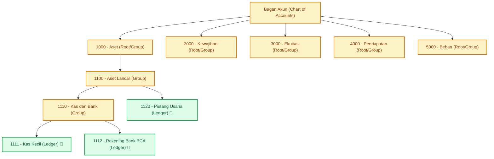

# BAB 7: MODUL 2 - CHART OF ACCOUNTS (BAGAN AKUN HIERARKIS)

Halo semuanya! Jika modul *Naming Series* di bab sebelumnya bertugas mencetak nomor urut dokumen, maka modul **Chart of Accounts (Bagan Akun / COA)** adalah "peta jalan" atau "kerangka tulang punggung" dari seluruh sistem akuntansi dan ERP kita.

Tanpa Bagan Akun yang terstruktur dengan baik, perusahaan tidak akan pernah tahu ke mana uang mengalir: Apakah digunakan untuk membayar sewa kantor, membeli inventaris komputer, membayar gaji staf, atau merupakan kas yang mengendap di bank?

Di bab ini, kita tidak akan membuat tabel akun yang datar (*flat list*) seperti aplikasi pencatat pengeluaran biasa. Kita akan membangun arsitektur hierarkis berbasis pohon (*Tree Structure*) ala sistem ERP kelas dunia (seperti ERPNext dan SAP). Kita akan membedah setiap baris kode backend Golang dan komponen rekursif Vue 3 langkah demi langkah.

---

## 7.1 Konsep Pohon Akun: Group vs Ledger & 5 Pilar Akuntansi

Dalam akuntansi standar internasional, seluruh akun dikelompokkan ke dalam **5 Pilar Utama (Root Types)**:
1. **Asset (Aset / Harta):** Semua kekayaan perusahaan (Kas, Bank, Piutang, Inventaris, Kendaraan).
2. **Liability (Kewajiban / Utang):** Semua kewajiban keuangan perusahaan ke pihak luar (Utang Usaha, Pinjaman Bank, Utang Gaji).
3. **Equity (Ekuitas / Modal):** Hak pemilik atas aset perusahaan setelah dikurangi kewajiban (Modal Disetor, Laba Ditahan).
4. **Income (Pendapatan):** Pemasukan hasil operasional bisnis (Pendapatan Penjualan, Pendapatan Jasa).
5. **Expense (Beban / Biaya):** Pengeluaran operasional bisnis (Beban Gaji, Beban Sewa, Beban Listrik).



### Aturan Emas Akuntansi: Group Account vs Ledger Account

Perhatikan dua warna kotak pada diagram di atas:

1. **Group Account (Akun Grup / Map Folder):**
   - Memiliki flag `is_group = true`.
   - **DILARANG KERAS** digunakan dalam transaksi Journal Entry secara langsung!
   - Fungsinya murni sebagai wadah agregasi laporan agar laporan Neraca (*Balance Sheet*) dan Laba Rugi (*Income Statement*) bisa diringkas per kategori.
2. **Ledger Account (Akun Buku Besar / File Dokumen):**
   - Memiliki flag `is_group = false`.
   - Inilah akun yang dipilih oleh pengguna saat mencatat transaksi debit atau kredit.

> [!IMPORTANT]
> Mengapa akun grup tidak boleh menerima transaksi langsung?
> Bayangkan jika seseorang menjurnal uang masuk ke akun folder `1110 - Kas dan Bank`. Sistem tidak akan tahu apakah uang tersebut fisik ada di brankas kasir atau tersimpan di rekening bank BCA. Akun grup hanya boleh menampung total kumulatif dari seluruh anak-anaknya.

---

## 7.2 Backend: Perancangan Model Data (`model.go`)

Mari kita buka berkas model akuntansi kita pada [internal/accounting/model.go](file:///home/sandi/workspace/simplenext/internal/accounting/model.go).

Berikut adalah deklarasi struct [Account](file:///home/sandi/workspace/simplenext/internal/accounting/model.go#L10-L20) yang merepresentasikan satu baris dalam tabel `accounts`:

```go
package accounting

import (
	"time"
)

// Account merepresentasikan satu baris dalam Bagan Akun (Chart of Accounts)
type Account struct {
	Name          string     `json:"name"`           // Primary Key (Contoh: "1111 - Kas Kecil")
	AccountNumber string     `json:"account_number"` // Kode akun numerik untuk pengurutan ("1111")
	AccountName   string     `json:"account_name"`   // Nama akun ("Kas Kecil")
	AccountType   string     `json:"account_type"`   // Tipe spesifik: "Cash", "Bank", "Receivable", dll.
	RootType      string     `json:"root_type"`      // Kategori akar: "Asset", "Liability", "Equity", "Income", "Expense"
	IsGroup       bool       `json:"is_group"`       // true jika folder pengelompokan, false jika buku besar transaksi
	ParentAccount *string    `json:"parent_account"` // Pointer ke nama akun induk di database (bisa NULL)
	CreatedAt     time.Time  `json:"created_at"`
	Children      []*Account `json:"children,omitempty"` // Array rekursif untuk struktur pohon JSON
}
```

### 🔍 Mengapa Struct `Account` Dirancang Seperti Ini?

1. **`Name string` sebagai Primary Key:**
   - Dalam SimpleNext (dan ERPNext), nama akun dirancang berformat gabungan: `[Nomor Akun] - [Nama Akun]`, contoh: `"1111 - Kas Kecil"`.
   - *Alasan:* Menjadikan string ini sebagai Primary Key membuat query di modul transaksi dan laporan buku besar sangat manusiawi dan mudah dibaca langsung oleh akuntan tanpa perlu melakukan query `JOIN` tambahan hanya untuk menampilkan nama akun.
2. **`ParentAccount *string` Menggunakan Pointer:**
   - Mengapa tidak menggunakan tipe data `string` biasa?
   - *Alasannya sangat krusial:* Di PostgreSQL, akun akar (*Root Account* seperti `"1000 - Aset"`) tidak memiliki induk sama sekali, sehingga kolom `parent_account` bernilai `NULL` di database.
   - Di bahasa Go, jika kita menggunakan `string` biasa, nilainya akan menjadi string kosong `""`. Namun, di database SQL, string kosong `""` dan `NULL` adalah dua hal yang berbeda! Jika kita menggunakan pointer `*string`, saat nilainya `nil`, driver SQL `pgx` akan otomatis memetakannya ke `NULL` di PostgreSQL.
3. **`Children []*Account` dengan Tag `json:"children,omitempty"`:**
   - Atribut ini **tidak ada di kolom tabel PostgreSQL**. Atribut ini kita tambahkan di tingkat memori Go untuk menampung anak-anak dari akun bersangkutan.
   - *Penggunaan Slice of Pointer (`[]*Account`):* Memungkinkan manipulasi objek akun di RAM tanpa perlu menyalin (*copying*) seluruh data struct berulang kali.
   - *Tag `omitempty`:* Sangat cerdas! Tag ini memberi tahu encoder JSON Go: "Jika slice `Children` ini kosong (artinya akun ini adalah akun daun / *leaf node*), jangan cetak properti `children: []` di output JSON". Hasilnya, ukuran payload API menjadi sangat ramping dan hemat kuota internet.

---

## 7.3 Backend: Lapisan Repository (`repository.go`)

Sekarang buka berkas [internal/accounting/repository.go](file:///home/sandi/workspace/simplenext/internal/accounting/repository.go). Di lapisan repository ini, kita mengeksekusi query SQL langsung ke database PostgreSQL menggunakan pool koneksi `pgx`.

Tulis implementasi [GetAllAccounts](file:///home/sandi/workspace/simplenext/internal/accounting/repository.go#L23-L48) dan [GetAccountByName](file:///home/sandi/workspace/simplenext/internal/accounting/repository.go#L51-L67):

```go
package accounting

import (
	"context"
	"fmt"

	"github.com/jackc/pgx/v5/pgxpool"
)

type Repository struct {
	db *pgxpool.Pool
}

func NewRepository(db *pgxpool.Pool) *Repository {
	return &Repository{db: db}
}

// GetAllAccounts mengambil seluruh daftar akun terurut berdasarkan nomor akun
func (r *Repository) GetAllAccounts(ctx context.Context) ([]Account, error) {
	query := `
		SELECT name, COALESCE(account_number, ''), account_name, account_type, root_type, is_group, parent_account, created_at
		FROM accounts
		ORDER BY account_number ASC, name ASC;
	`
	rows, err := r.db.Query(ctx, query)
	if err != nil {
		return nil, fmt.Errorf("gagal query accounts: %w", err)
	}
	defer rows.Close()

	var accounts []Account
	for rows.Next() {
		var a Account
		err := rows.Scan(
			&a.Name, &a.AccountNumber, &a.AccountName, &a.AccountType,
			&a.RootType, &a.IsGroup, &a.ParentAccount, &a.CreatedAt,
		)
		if err != nil {
			return nil, fmt.Errorf("gagal scan account: %w", err)
		}
		accounts = append(accounts, a)
	}
	return accounts, nil
}

// GetAccountByName mengambil detail satu akun berdasarkan nama uniknya
func (r *Repository) GetAccountByName(ctx context.Context, name string) (*Account, error) {
	query := `
		SELECT name, COALESCE(account_number, ''), account_name, account_type, root_type, is_group, parent_account, created_at
		FROM accounts
		WHERE name = $1;
	`
	var a Account
	err := r.db.QueryRow(ctx, query, name).Scan(
		&a.Name, &a.AccountNumber, &a.AccountName, &a.AccountType,
		&a.RootType, &a.IsGroup, &a.ParentAccount, &a.CreatedAt,
	)
	if err != nil {
		return nil, err
	}
	return &a, nil
}
```

### 🔍 Mengapa Kode di Repository Ditulis Seperti Ini?

1. **Penggunaan `COALESCE(account_number, '')`:**
   - Dalam PostgreSQL, jika kolom `account_number` berisi nilai `NULL`, fungsi `rows.Scan` di Go akan mengalami error jika discan ke variabel `string` biasa. Fungsi SQL `COALESCE` secara otomatis mengganti nilai `NULL` menjadi string kosong `""`, mencegah aplikasi *crash*.
2. **Klausa `ORDER BY account_number ASC, name ASC`:**
   - Menjamin urutan data akun selalu rapi berdasarkan kode numeriknya (misal akun `1000` di atas `1100`, lalu `1110`, dst). Ketika algoritma pohon merangkai akun anak, urutannya di layar akan langsung berurutan dan teratur.
3. **Pernyataan `defer rows.Close()`:**
   - Wajib ditulis segera setelah query berhasil! Objek `rows` memegang koneksi aktif dari connection pool database. Jika kita lupa menutupnya, koneksi akan terkunci (*connection leak*), dan lama-kelamaan backend akan macet (*hang*) karena kehabisan koneksi.

---

## 7.4 Backend: Service - Algoritma Pembentuk Pohon O(N) (`service.go`)

Database relasional membaca tabel dalam bentuk baris-baris daftar datar (*flat rows*). Namun, antarmuka pengguna membutuhkan data bersarang (*nested tree*):

```text
Input Database (Datar):
[
  { Name: "1000 - Aset", Parent: nil },
  { Name: "1100 - Aset Lancar", Parent: "1000 - Aset" },
  { Name: "1110 - Kas dan Bank", Parent: "1100 - Aset Lancar" }
]

Output API yang Diinginkan (Pohon Bersarang):
[
  {
    "name": "1000 - Aset",
    "children": [
      {
        "name": "1100 - Aset Lancar",
        "children": [
          { "name": "1110 - Kas dan Bank" }
        ]
      }
    ]
  }
]
```

### Mengapa Bukan Query Rekursif Database (CTE) atau Nested Loop?
- **Query Rekursif SQL (`WITH RECURSIVE`):** Membebani pemrosesan database dan sulit dipetakan langsung ke struktur JSON bertingkat di Go.
- **Nested Loop `for` di dalam `for` ($O(N^2)$):** Jika ada 1.000 akun, komputer harus melakukan 1.000.000 perbandingan! Sangat lambat dan tidak efisien.

### Solusi Terbaik: Algoritma 2-Pass Hash Map ($O(N)$)
Buka [internal/accounting/service.go](file:///home/sandi/workspace/simplenext/internal/accounting/service.go) dan tulis fungsi [BuildAccountTree](file:///home/sandi/workspace/simplenext/internal/accounting/service.go#L26-L47) serta method [GetAccountTree](file:///home/sandi/workspace/simplenext/internal/accounting/service.go#L89-L95):

```go
package accounting

import (
	"context"
)

// BuildAccountTree menyusun daftar akun datar menjadi struktur pohon (Tree) berdasarkan ParentAccount.
// Algoritma ini berjalan dalam kompleksitas waktu O(N) menggunakan Hash Map lookup.
func BuildAccountTree(accounts []Account) []*Account {
	// PASS 1: Petakan semua akun ke dalam Hash Map berdasarkan nama akun
	accountMap := make(map[string]*Account)
	for i := range accounts {
		acc := accounts[i]
		accountMap[acc.Name] = &acc
	}

	var rootAccounts []*Account

	// PASS 2: Rangkai relasi induk dan anak
	for _, acc := range accountMap {
		// Jika akun tidak memiliki induk (nil atau string kosong), maka ia adalah cabang utama (Root)
		if acc.ParentAccount == nil || *acc.ParentAccount == "" {
			rootAccounts = append(rootAccounts, acc)
		} else {
			// Jika akun memiliki induk, cari alamat memori induknya di peta
			parent, exists := accountMap[*acc.ParentAccount]
			if exists {
				// Masukkan diri sendiri ke dalam slice Children milik sang induk
				parent.Children = append(parent.Children, acc)
			} else {
				// Fallback pertahanan: jika induk tidak ditemukan di DB, jangan buang akun ini;
				// jadikan akun ini sebagai root agar tidak hilang dari pantauan akuntan.
				rootAccounts = append(rootAccounts, acc)
			}
		}
	}

	return rootAccounts
}

// GetAccountTree mengorkestrasi pengambilan akun dari repository dan menyusunnya menjadi pohon
func (s *Service) GetAccountTree(ctx context.Context) ([]*Account, error) {
	accounts, err := s.repo.GetAllAccounts(ctx)
	if err != nil {
		return nil, err
	}
	return BuildAccountTree(accounts), nil
}
```

#### 🔍 Bedah Algoritma Baris demi Baris:
1. **Pass 1 (`accountMap`):**
   - Kita membuat peta `map[string]*Account`.
   - Melalui loop pertama, kita mendaftarkan alamat pointer setiap akun berdasarkan namanya. Operasi ini memakan waktu linear $O(N)$.
2. **Pass 2 (Penyambungan Rantai Cabang):**
   - Kita membaca setiap akun di `accountMap`.
   - Mengambil data dari map di Go adalah instan ($O(1)$). Jadi saat sebuah akun memiliki `ParentAccount`, kita langsung mengambil referensi sang induk dari map dan memasukkan pointer akun anak ke slice `parent.Children`.
   - Karena `Children` adalah slice of pointer, anak-anak yang ditambahkan langsung otomatis bersarang di dalam pohon tanpa perlu fungsi rekursif yang rumit!
   - Total kompleksitas waktu: $O(N) + O(N) = O(N)$. Bahkan jika sistem memiliki 10.000 bagan akun, fungsi ini selesai dalam hitungan **pecahan milidetik**.

---

## 7.5 Backend: HTTP Handler & Dual-Mode Endpoint REST API (`handler.go`)

Sekarang kita perlu mengekspos data ini ke internet agar bisa dikonsumsi oleh aplikasi frontend. Buka berkas [internal/accounting/handler.go](file:///home/sandi/workspace/simplenext/internal/accounting/handler.go).

Berikut adalah implementasi [ListAccounts](file:///home/sandi/workspace/simplenext/internal/accounting/handler.go#L30-L49) dan pendaftaran rute [RegisterRoutes](file:///home/sandi/workspace/simplenext/internal/accounting/handler.go#L19-L28):

```go
package accounting

import (
	"encoding/json"
	"net/http"

	"github.com/go-chi/chi/v5"
)

type Handler struct {
	service *Service
}

func NewHandler(service *Service) *Handler {
	return &Handler{service: service}
}

// RegisterRoutes mendaftarkan seluruh endpoint modul Accounting ke Chi router
func (h *Handler) RegisterRoutes(r chi.Router) {
	r.Get("/api/v1/accounts", h.ListAccounts)
	// Rute jurnal dan laporan lainnya akan dibahas pada bab selanjutnya
}

// ListAccounts melayani permintaan daftar akun dengan dukungan dual-mode (Pohon atau Datar)
func (h *Handler) ListAccounts(w http.ResponseWriter, r *http.Request) {
	// Cek apakah frontend meminta format pohon via query param: /api/v1/accounts?tree=true
	asTree := r.URL.Query().Get("tree") == "true"

	if asTree {
		tree, err := h.service.GetAccountTree(r.Context())
		if err != nil {
			respondError(w, http.StatusInternalServerError, err.Error())
			return
		}
		respondJSON(w, http.StatusOK, map[string]interface{}{"data": tree})
		return
	}

	// Jika tidak, kembalikan daftar datar (flat list) untuk dropdown transaksi
	accounts, err := h.service.repo.GetAllAccounts(r.Context())
	if err != nil {
		respondError(w, http.StatusInternalServerError, err.Error())
		return
	}
	respondJSON(w, http.StatusOK, map[string]interface{}{"data": accounts})
}

// Fungsi pembantu respons JSON
func respondJSON(w http.ResponseWriter, status int, payload interface{}) {
	w.Header().Set("Content-Type", "application/json")
	w.WriteHeader(status)
	json.NewEncoder(w).Encode(payload)
}

func respondError(w http.ResponseWriter, status int, message string) {
	respondJSON(w, status, map[string]string{"error": message})
}
```

### 🔍 Mengapa Kita Membuat Endpoint Dual-Mode (`?tree=true`)?
Keputusan desain API ini sangat penting untuk efisiensi aplikasi:
1. **Mode Pohon (`/api/v1/accounts?tree=true`):** Digunakan secara khusus oleh halaman visualisasi *Chart of Accounts* untuk menampilkan struktur hierarki folder.
2. **Mode Datar (`/api/v1/accounts`):** Digunakan oleh formulir pembuatan transaksi *Journal Entry* (Bab 8). Dropdown pilihan akun (*Select Option*) di form tidak membutuhkan struktur pohon bersarang; form hanya butuh daftar linier akun buku besar yang bisa dipilih pengguna.

Dengan satu URL endpoint yang cerdas, kita melayani dua kebutuhan antarmuka sekaligus!

---

## 7.6 Unit Testing `BuildAccountTree` Tanpa Database (`service_test.go`)

Karena fungsi [BuildAccountTree](file:///home/sandi/workspace/simplenext/internal/accounting/service.go#L26-L47) adalah fungsi murni (*Pure Function*), kita dapat memverifikasi kebenaran algoritma pohon ini tanpa perlu menyalakan database atau menyiapkan koneksi internet.

Buka [internal/accounting/service_test.go](file:///home/sandi/workspace/simplenext/internal/accounting/service_test.go) dan perhatikan pengujian [TestBuildAccountTree](file:///home/sandi/workspace/simplenext/internal/accounting/service_test.go#L173-L193):

```go
package accounting

import (
	"testing"
)

func TestBuildAccountTree(t *testing.T) {
	parent := "1000 - Aset"
	accounts := []Account{
		{Name: "1000 - Aset", IsGroup: true, ParentAccount: nil},
		{Name: "1100 - Aset Lancar", IsGroup: true, ParentAccount: &parent},
	}

	tree := BuildAccountTree(accounts)

	// Verifikasi 1: Harus menghasilkan tepat 1 akun root
	if len(tree) != 1 {
		t.Fatalf("expected 1 root account, got %d", len(tree))
	}

	// Verifikasi 2: Nama akun root harus sesuai
	if tree[0].Name != "1000 - Aset" {
		t.Errorf("expected root name '1000 - Aset', got '%s'", tree[0].Name)
	}

	// Verifikasi 3: Akun root harus memiliki 1 anak di slice Children
	if len(tree[0].Children) != 1 {
		t.Fatalf("expected 1 child in root, got %d", len(tree[0].Children))
	}

	// Verifikasi 4: Nama anak harus '1100 - Aset Lancar'
	if tree[0].Children[0].Name != "1100 - Aset Lancar" {
		t.Errorf("expected child name '1100 - Aset Lancar', got '%s'", tree[0].Children[0].Name)
	}
}
```

### Eksekusi Unit Test di Terminal:
Jalankan perintah berikut:

```bash
go test -v -run TestBuildAccountTree ./internal/accounting
```

### Hasil Keluaran Terminal:
```text
=== RUN   TestBuildAccountTree
--- PASS: TestBuildAccountTree (0.00s)
PASS
ok      simplenext/internal/accounting    0.002s
```

Hanya dalam waktu **0.002 detik**, pengujian membuktikan bahwa algoritma hash map kita berhasil menyambungkan relasi anak ke dalam array `Children` milik induknya dengan sempurna.

---

## 7.7 Frontend: Komponen Rekursif Vue 3 (Treeview UI)

Sekarang mari kita pindah ke sisi *Frontend*. Tantangan terbesar saat menampilkan struktur pohon adalah: **Kita tidak tahu seberapa dalam level percabangan akun sebuah perusahaan.** Bisa jadi 3 level, 5 level, atau 10 level.

Jika kita menggunakan perulangan HTML biasa (`v-for`), kita akan terpaksa menulis tag bertingkat yang kaku.

### Solusi Elegan: Recursive Component
Di Vue 3, sebuah komponen dapat **memanggil dirinya sendiri** di dalam template miliknya.

Buat komponen pohon di: `frontend/src/components/TreeNode.vue`:

```vue
<template>
  <div class="ml-6 border-l-2 border-slate-200 pl-4 py-1">
    <!-- Header Node (Baris Akun) -->
    <div 
      class="flex items-center gap-2 cursor-pointer hover:bg-indigo-50 p-2 rounded-lg transition-colors group"
      @click="toggleExpand"
    >
      <!-- Ikon Folder (Grup) vs File Dokumen (Buku Besar) -->
      <span v-if="node.is_group" class="text-amber-500">
        <!-- Tampilkan ikon terbuka atau tertutup sesuai state expand -->
        <FolderOpenIcon v-if="isExpanded" class="w-5 h-5" />
        <FolderIcon v-else class="w-5 h-5" />
      </span>
      <span v-else class="text-emerald-500">
        <FileTextIcon class="w-5 h-5" />
      </span>
      
      <!-- Nama Akun -->
      <span 
        class="text-sm font-medium"
        :class="node.is_group ? 'text-slate-900 font-semibold' : 'text-slate-700'"
      >
        {{ node.name }}
      </span>
      
      <!-- Badge Root Type & Account Type -->
      <div class="ml-auto flex items-center gap-2">
        <span class="text-xs bg-slate-100 text-slate-600 px-2.5 py-0.5 rounded-full font-mono">
          {{ node.account_type }}
        </span>
        <span 
          v-if="node.is_group" 
          class="text-xs bg-amber-50 text-amber-700 border border-amber-200 px-2 py-0.5 rounded font-medium"
        >
          Folder
        </span>
      </div>
    </div>

    <!-- PANGGILAN REKURSIF (Komponen Memanggil Dirinya Sendiri) -->
    <div v-if="isExpanded && node.children && node.children.length > 0">
      <TreeNode 
        v-for="child in node.children" 
        :key="child.name" 
        :node="child" 
      />
    </div>
  </div>
</template>

<script setup>
import { ref } from 'vue'
import { FolderIcon, FolderOpenIcon, FileTextIcon } from 'lucide-vue-next'

// Menerima data node akun sebagai prop
const props = defineProps({
  node: {
    type: Object,
    required: true
  }
})

// State buka-tutup folder (default tertutup)
const isExpanded = ref(false)

// Fungsi klik: hanya akun grup yang bisa dibuka-tutup
const toggleExpand = () => {
  if (props.node.is_group) {
    isExpanded.value = !isExpanded.value
  }
}
</script>
```

> [!WARNING]
> **Pencegahan Infinite Recursion Loop:**  
> Saat menulis komponen rekursif di Vue, **WAJIB** ada kondisi penjaga penutup (`v-if="isExpanded && node.children && node.children.length > 0"`). Tanpa penjaga ini, Vue akan merender dirinya sendiri tanpa akhir hingga memori browser habis (*Out of Memory*) dan tab browser Anda membeku.

---

### Integrasi Halaman Utama (`AccountsView.vue`)

Sekarang, buat halaman penampung utama yang bertugas mengambil data dari backend dan merender baris-baris root akun:

`frontend/src/views/AccountsView.vue`
```vue
<template>
  <div class="p-8 max-w-6xl mx-auto">
    <div class="mb-6 flex justify-between items-center">
      <div>
        <h1 class="text-2xl font-bold text-slate-900">Chart of Accounts (Bagan Akun)</h1>
        <p class="text-slate-500 text-sm">Kelola struktur akun keuangan perusahaan Anda secara hierarkis</p>
      </div>
      <button 
        @click="loadAccountTree" 
        class="bg-indigo-600 hover:bg-indigo-700 text-white px-4 py-2 rounded-lg text-sm font-medium shadow-sm"
      >
        Segarkan Bagan
      </button>
    </div>

    <!-- Kotak Tree View -->
    <div class="bg-white rounded-xl shadow-sm border border-slate-200 p-6">
      <div v-if="loading" class="text-center py-12 text-slate-400">
        Memuat bagan akun...
      </div>
      <div v-else-if="accountTree.length === 0" class="text-center py-12 text-slate-400">
        Belum ada data bagan akun.
      </div>
      <div v-else>
        <!-- Render setiap cabang Root (1000 - Aset, 2000 - Kewajiban, dst.) -->
        <TreeNode 
          v-for="rootNode in accountTree" 
          :key="rootNode.name" 
          :node="rootNode" 
        />
      </div>
    </div>
  </div>
</template>

<script setup>
import { ref, onMounted } from 'vue'
import TreeNode from '../components/TreeNode.vue'

const accountTree = ref([])
const loading = ref(true)

const loadAccountTree = async () => {
  loading.value = true
  try {
    const res = await fetch('/api/v1/accounts?tree=true')
    const json = await res.json()
    accountTree.value = json.data || []
  } catch (err) {
    console.error('Gagal mengambil data akun:', err)
  } finally {
    loading.value = false
  }
}

onMounted(() => {
  loadAccountTree()
})
</script>
```

---

## 7.8 Pengujian & Verifikasi Endpoint API

Mari kita uji langsung integrasi antara database PostgreSQL (yang telah kita isi data awal di Bab 5), backend Golang, dan struktur JSON.

### 1. Jalankan Backend
Buka terminal dan jalankan server backend:
```bash
make run
```
Server akan aktif mendengarkan pada `http://localhost:8080`.

### 2. Uji Endpoint Pohon via cURL
Buka jendela terminal baru dan ketik perintah berikut:
```bash
curl -s "http://localhost:8080/api/v1/accounts?tree=true" | jq .
```

### 3. Hasil JSON Hierarkis yang Dikembalikan:
```json
{
  "data": [
    {
      "name": "1000 - Aset",
      "account_number": "1000",
      "account_name": "Aset",
      "account_type": "Asset",
      "root_type": "Asset",
      "is_group": true,
      "parent_account": null,
      "children": [
        {
          "name": "1100 - Aset Lancar",
          "account_number": "1100",
          "account_name": "Aset Lancar",
          "account_type": "Asset",
          "root_type": "Asset",
          "is_group": true,
          "parent_account": "1000 - Aset",
          "children": [
            {
              "name": "1110 - Kas dan Bank",
              "account_number": "1110",
              "account_name": "Kas dan Bank",
              "account_type": "Asset",
              "root_type": "Asset",
              "is_group": true,
              "parent_account": "1100 - Aset Lancar",
              "children": [
                {
                  "name": "1111 - Kas Kecil",
                  "account_number": "1111",
                  "account_name": "Kas Kecil",
                  "account_type": "Cash",
                  "root_type": "Asset",
                  "is_group": false,
                  "parent_account": "1110 - Kas dan Bank"
                },
                {
                  "name": "1112 - Rekening Bank BCA",
                  "account_number": "1112",
                  "account_name": "Rekening Bank BCA",
                  "account_type": "Bank",
                  "root_type": "Asset",
                  "is_group": false,
                  "parent_account": "1110 - Kas dan Bank"
                }
              ]
            }
          ]
        }
      ]
    }
  ]
}
```

Perhatikan bagaimana `1111 - Kas Kecil` secara otomatis bersarang di dalam `1110 - Kas dan Bank`, yang berada di dalam `1100 - Aset Lancar`, yang berada di bawah `1000 - Aset`. Dan karena `1111 - Kas Kecil` adalah akun buku besar (tidak punya anak), properti `children` tidak muncul berkat tag `omitempty` di struct Go kita!

---

## 7.9 Checklist Pemahaman Mandiri (Self-Check)

Sebelum melangkah ke bab selanjutnya, pastikan Anda telah memahami konsep-konsep kunci ini:

- [ ] Mengapa Akun Grup (`is_group = true`) dilarang keras menerima transaksi jurnal secara langsung?
- [ ] Mengapa atribut `ParentAccount` di struct [Account](file:///home/sandi/workspace/simplenext/internal/accounting/model.go#L10-L20) dideklarasikan sebagai pointer `*string`, bukan `string` polos?
- [ ] Apa kegunaan tag `json:"children,omitempty"` pada representasi JSON di Go?
- [ ] Bagaimana algoritma [BuildAccountTree](file:///home/sandi/workspace/simplenext/internal/accounting/service.go#L26-L47) mampu menyelesaikan penyusunan pohon dalam kompleksitas $O(N)$ tanpa query rekursif database?
- [ ] Mengapa endpoint `/api/v1/accounts` dirancang dengan fitur dual-mode (query param `?tree=true`)?
- [ ] Mengapa komponen rekursif Vue 3 wajib memiliki kondisi terminasi `v-if`?

---

➡️ **Langkah Berikutnya:** Fondasi bagan akun kita telah tertata dengan rapi dan terhubung ke antarmuka pengguna. Di bab berikutnya, kita akan masuk ke modul paling menantang sekaligus paling memuaskan: **Journal Entry & Siklus Transaksi Dokumen**. Kita akan belajar memvalidasi keseimbangan Debit-Kredit secara matematis dan mengunci siklus dokumen (*Draft*, *Submit*, *Cancel*).

Lanjutkan ke [**BAB 8: MODUL 3 - JOURNAL ENTRY & SIKLUS TRANSAKSI DOKUMEN**](file:///home/sandi/workspace/simplenext/docs/ebook/BAB_08_JOURNAL_ENTRY.md).
