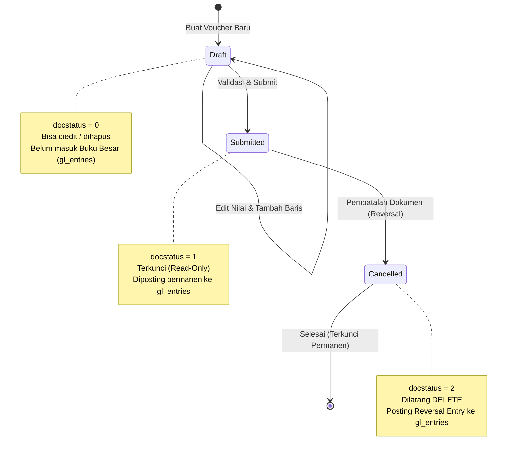

# BAB 8: MODUL 3 - JOURNAL ENTRY & SIKLUS TRANSAKSI DOKUMEN

Halo semuanya! Tiba saatnya kita mengerjakan modul paling menantang sekaligus paling memuaskan dalam sistem akuntansi: **Journal Entry (Voucher Jurnal Umum)**. Modul ini adalah jantung operasional finansial dari aplikasi SimpleNext.

Pada bab-bab sebelumnya, kita telah menyiapkan pondasi:
1. Kita membangun **Atomic Naming Series Engine** di [BAB 6](file:///home/sandi/workspace/simplenext/docs/ebook/BAB_06_NAMING_SERIES.md) untuk menghasilkan nomor voucher anti-bentrok (`JV-2026-10-00001`).
2. Kita merancang struktur **Chart of Accounts (Bagan Akun)** di [BAB 7](file:///home/sandi/workspace/simplenext/docs/ebook/BAB_07_CHART_OF_ACCOUNTS.md) sehingga kita memiliki daftar akun yang valid.

Sekarang, kita akan menyatukan keduanya untuk mencatat perpindahan nilai uang. Lebih dari sekadar menyimpan data ke database, kita akan mempelajari **Sistem Pembukuan Berpasangan (Double-Entry Bookkeeping)** dan **Siklus Hidup Dokumen (Document Lifecycle State Machine)** yang menjamin integritas data keuangan tidak dapat dicurangi (*tamper-proof*).

---

## 8.1 Filosofi Akuntansi: Mengapa Double-Entry & Immutable Ledger?

### 1. Prinsip Keseimbangan Double-Entry (Debit == Kredit)
Diciptakan oleh matematikawan Italia Luca Pacioli pada abad ke-15, prinsip dasar akuntansi menyatakan bahwa setiap transaksi keuangan selalu melibatkan minimal dua sisi:
- **Sisi yang Menerima Manfaat / Nilai (Debit)**
- **Sisi yang Memberikan Sumber Daya / Nilai (Kredit)**

Contoh: Ketika perusahaan membayar biaya listrik operasional sebesar Rp 500.000 secara tunai dari kas kecil:
- Akun `5130 - Beban Listrik dan Air` bertambah di sisi **Debit** sebesar `Rp 500.000` (Beban bertambah).
- Akun `1111 - Kas Kecil` berkurang di sisi **Kredit** sebesar `Rp 500.000` (Aset berkurang).
- **Total Debit (Rp 500.000) == Total Kredit (Rp 500.000)**. Neraca tetap seimbang!

Jika sebuah transaksi hanya mencatat pengeluaran tanpa menyebutkan dari mana uang diambil (atau nominalnya tidak seimbang), sistem akuntansi akan mengalami kebocoran data (*unbalanced ledger*).

### 2. Prinsip Anti Hard-Delete (Immutable Audit Trail)
Di aplikasi to-do list atau media sosial, jika pengguna membuat kesalahan posting, mereka cukup menekan tombol "Hapus" (`DELETE FROM ...`).

**Di sistem akuntansi dan ERP enterprise, perintah `DELETE` pada dokumen yang telah diposting DILARANG KERAS secara hukum.**
Jika seorang staf salah mencatat transaksi Rp 10.000.000, transaksi tersebut tidak boleh lenyap seolah-olah tidak pernah terjadi. Auditor eksternal dan otoritas pajak mewajibkan adanya **Jejak Audit (Audit Trail)**. Solusinya: dokumen harus dibatalkan (*Cancel*), dan sistem otomatis mencatat **Jurnal Pembalik (Reversal Entry)** untuk menetralkan saldo.

---

## 8.2 Siklus Hidup Dokumen (Document Lifecycle State Machine)

Di SimpleNext (mengadopsi arsitektur ERPNext), setiap dokumen transaksi memiliki atribut status khusus bernama [DocStatus](file:///home/sandi/workspace/simplenext/internal/core/types/docstatus.go#L6-L12).



Buka berkas tipe inti kita di [internal/core/types/docstatus.go](file:///home/sandi/workspace/simplenext/internal/core/types/docstatus.go):

```go
package types

import "fmt"

// DocStatus merepresentasikan siklus dokumen transaksi standar ERPNext
type DocStatus int16

const (
	DocStatusDraft     DocStatus = 0 // Masih dapat diedit, belum masuk buku besar
	DocStatusSubmitted DocStatus = 1 // Terkunci (read-only), sudah diposting ke GL
	DocStatusCancelled DocStatus = 2 // Dibatalkan, sudah dilakukan reversal di GL
)

func (s DocStatus) String() string {
	switch s {
	case DocStatusDraft:
		return "Draft"
	case DocStatusSubmitted:
		return "Submitted"
	case DocStatusCancelled:
		return "Cancelled"
	default:
		return fmt.Sprintf("Unknown(%d)", s)
	}
}

func (s DocStatus) IsDraft() bool     { return s == DocStatusDraft }
func (s DocStatus) IsSubmitted() bool { return s == DocStatusSubmitted }
func (s DocStatus) IsCancelled() bool { return s == DocStatusCancelled }
```

### 🔍 Mengapa `DocStatus` Dibuat Sebagai Tipe Khusus?
- Menggunakan `DocStatus int16` alih-alih angka integer biasa memberikan keamanan tipe data (*type safety*) di Go.
- Method pembantu seperti `IsDraft()` dan `String()` mencegah kesalahan logika (*hardcoded string error*) di seluruh backend.

---

## 8.3 Backend: Validasi Ketat Double-Entry (`service.go`)

Sebuah prinsip perangkat lunak yang baik adalah: **Validasi perhitungan matematika harus berupa fungsi murni (Pure Function)** sebelum menyentuh koneksi database.

Buka berkas [internal/accounting/service.go](file:///home/sandi/workspace/simplenext/internal/accounting/service.go) dan perhatikan fungsi [ValidateDebitCreditBalance](file:///home/sandi/workspace/simplenext/internal/accounting/service.go#L50-L78):

```go
package accounting

import (
	"fmt"
	"math"
)

// ValidateDebitCreditBalance memeriksa validitas baris akun transaksi jurnal dan memastikan Total Debit == Total Credit
func ValidateDebitCreditBalance(items []CreateJournalEntryItemRequest) (totalDebit float64, totalCredit float64, err error) {
	// 1. Aturan Baris Minimum: Transaksi harus memiliki minimal 2 baris akun
	if len(items) < 2 {
		return 0, 0, fmt.Errorf("jurnal harus memiliki minimal 2 baris akun")
	}

	for i, item := range items {
		// 2. Akun tidak boleh kosong
		if item.Account == "" {
			return 0, 0, fmt.Errorf("baris ke-%d: akun tidak boleh kosong", i+1)
		}

		// 3. Nilai nominal tidak boleh negatif
		if item.Debit < 0 || item.Credit < 0 {
			return 0, 0, fmt.Errorf("baris ke-%d: nilai debit atau kredit tidak boleh negatif", i+1)
		}

		// 4. Salah satu harus memiliki nilai (tidak boleh keduanya 0)
		if item.Debit == 0 && item.Credit == 0 {
			return 0, 0, fmt.Errorf("baris ke-%d: salah satu dari debit atau kredit harus lebih besar dari 0", i+1)
		}

		// 5. Satu baris tidak boleh memiliki nilai Debit dan Kredit sekaligus
		if item.Debit > 0 && item.Credit > 0 {
			return 0, 0, fmt.Errorf("baris ke-%d: satu baris tidak boleh memiliki nilai debit dan kredit sekaligus", i+1)
		}

		totalDebit += item.Debit
		totalCredit += item.Credit
	}

	// 6. Validasi Keseimbangan dengan toleransi presisi desimal
	if math.Abs(totalDebit-totalCredit) > 0.0001 {
		return totalDebit, totalCredit, fmt.Errorf("jurnal tidak seimbang: Total Debit (%.2f) != Total Kredit (%.2f)", totalDebit, totalCredit)
	}

	return totalDebit, totalCredit, nil
}
```

### 🔍 Mengapa Aturan Validasi Ini Ditulis Seperti Ini?

1. **`len(items) < 2`:**
   - Dalam akuntansi berpasangan, tidak ada transaksi sepihak. Harus ada akun yang didebit dan akun yang dikredit. Minimal baris adalah 2.
2. **`item.Debit < 0 || item.Credit < 0`:**
   - Akuntansi tidak mengenal angka negatif dalam jurnal umum. Jika ingin mengurangi aset atau beban, kita mencatatnya di kolom Kredit, bukan menulis minus di kolom Debit!
3. **`item.Debit > 0 && item.Credit > 0`:**
   - Setiap baris akun hanya boleh memiliki satu arah pergerakan uang: Debit ATAU Kredit, tidak boleh keduanya sekaligus.
4. **`math.Abs(totalDebit-totalCredit) > 0.0001` (Kunci Floating-Point Toleransi):**
   - *Mengapa kita tidak menulis `if totalDebit != totalCredit`?*
   - Di semua bahasa pemrograman modern (termasuk Go), tipe bilangan berkoma (`float64`) menggunakan standar IEEE-754. Perhitungan pecahan desimal di CPU dapat menghasilkan selisih mikro tak terduga (contoh: `0.1 + 0.2` menghasilkan `0.30000000000000004`). Jika dibandingkan langsung dengan operator `!=`, transaksi yang sebenarnya seimbang bisa ditolak sistem!
   - Dengan memeriksa selisih mutlak `math.Abs(...) > 0.0001`, kita menjamin keakuratan hingga 4 angka desimal tanpa terganggu galat mikro floating point.

---

## 8.4 Backend: Menyimpan Dokumen Draft (Status 0)

Setelah validasi matematika lolos, sistem melakukan dua hal:
1. Memvalidasi keberadaan akun di database dan memastikan akun yang dipilih **bukan Akun Grup/Folder** (aturan dari Bab 7).
2. Meminta nomor urut voucher baru secara atomik dari **Naming Engine** (Bab 6).

Buka [internal/accounting/service.go](file:///home/sandi/workspace/simplenext/internal/accounting/service.go) dan teliti method [CreateJournalEntry](file:///home/sandi/workspace/simplenext/internal/accounting/service.go#L98-L158):

```go
// CreateJournalEntry memvalidasi dan menyimpan draft Journal Entry
func (s *Service) CreateJournalEntry(ctx context.Context, req *CreateJournalEntryRequest) (*JournalEntry, error) {
	// 1. Validasi perhitungan matematika debit & kredit
	totalDebit, totalCredit, err := ValidateDebitCreditBalance(req.Accounts)
	if err != nil {
		return nil, err
	}

	// 2. Parsing tanggal posting (default hari ini jika tidak ditentukan)
	postingDate := time.Now()
	if req.PostingDate != "" {
		parsedDate, err := time.Parse("2006-01-02", req.PostingDate)
		if err != nil {
			return nil, fmt.Errorf("format posting_date tidak valid (gunakan YYYY-MM-DD): %w", err)
		}
		postingDate = parsedDate
	}

	var childRows []JournalEntryAccount

	// 3. Validasi setiap akun ke database
	for i, item := range req.Accounts {
		acc, err := s.repo.GetAccountByName(ctx, item.Account)
		if err != nil {
			return nil, fmt.Errorf("gagal memeriksa akun '%s': %w", item.Account, err)
		}
		if acc == nil {
			return nil, fmt.Errorf("akun '%s' tidak ditemukan dalam sistem", item.Account)
		}
		// ATURAN PENTING BAB 7: Dilarang menjurnal pada akun grup!
		if acc.IsGroup {
			return nil, fmt.Errorf("transaksi tidak dapat dilakukan pada akun grup/induk ('%s')", item.Account)
		}

		childRows = append(childRows, JournalEntryAccount{
			Idx:        i + 1,
			Account:    item.Account,
			Debit:      item.Debit,
			Credit:     item.Credit,
			UserRemark: item.UserRemark,
		})
	}

	// 4. Minta nomor voucher unik secara atomik dari Naming Engine Bab 6
	voucherNo, err := s.namingService.Generate(ctx, "JV-.YYYY.-.#####")
	if err != nil {
		return nil, fmt.Errorf("gagal generate nomor voucher: %w", err)
	}

	// 5. Susun entitas JournalEntry berstatus Draft (0)
	entry := &JournalEntry{
		Name:        voucherNo,
		PostingDate: postingDate,
		DocStatus:   types.DocStatusDraft,
		TotalDebit:  totalDebit,
		TotalCredit: totalCredit,
		UserRemark:  req.UserRemark,
		Accounts:    childRows,
	}

	// 6. Simpan header dan child items ke PostgreSQL
	if err := s.repo.CreateJournalEntry(ctx, entry); err != nil {
		return nil, err
	}

	return s.repo.GetJournalEntryByName(ctx, voucherNo)
}
```

### Penyimpanan Atomik di Repository (`repository.go`)
Sekarang buka [internal/accounting/repository.go](file:///home/sandi/workspace/simplenext/internal/accounting/repository.go) pada method [CreateJournalEntry](file:///home/sandi/workspace/simplenext/internal/accounting/repository.go#L72-L106):

```go
// CreateJournalEntry menyimpan draft voucher jurnal dan child items-nya dalam transaksi DB
func (r *Repository) CreateJournalEntry(ctx context.Context, entry *JournalEntry) error {
	// Memulai Transaksi SQL
	tx, err := r.db.Begin(ctx)
	if err != nil {
		return fmt.Errorf("gagal memulai db transaction: %w", err)
	}
	defer tx.Rollback(ctx) // Jaminan rollback jika terjadi error sebelum tx.Commit()

	// 1. Simpan Header ke tabel journal_entries
	headerQuery := `
		INSERT INTO journal_entries (name, posting_date, docstatus, total_debit, total_credit, user_remark, created_at, updated_at)
		VALUES ($1, $2, $3, $4, $5, $6, NOW(), NOW());
	`
	_, err = tx.Exec(ctx, headerQuery,
		entry.Name, entry.PostingDate, entry.DocStatus, entry.TotalDebit, entry.TotalCredit, entry.UserRemark,
	)
	if err != nil {
		return fmt.Errorf("gagal insert journal_entries header: %w", err)
	}

	// 2. Simpan Child Items ke tabel journal_entry_accounts
	itemQuery := `
		INSERT INTO journal_entry_accounts (parent, idx, account, debit, credit, user_remark)
		VALUES ($1, $2, $3, $4, $5, $6);
	`
	for i, item := range entry.Accounts {
		_, err = tx.Exec(ctx, itemQuery,
			entry.Name, i+1, item.Account, item.Debit, item.Credit, item.UserRemark,
		)
		if err != nil {
			return fmt.Errorf("gagal insert journal_entry_accounts baris ke-%d: %w", i+1, err)
		}
	}

	// Commit transaksi: simpan permanen kedua tabel sekaligus!
	return tx.Commit(ctx)
}
```

#### 🔍 Mengapa Harus Menggunakan `pgx.Tx` (Database Transaction)?
Sebuah dokumen Jurnal terdiri dari 1 baris *Header* dan banyak baris *Child Items*.
Jika kita tidak menggunakan transaksi database (`tx`), bayangkan jika baris header berhasil disimpan, namun jaringan terputus saat menyimpan baris anak ke-3. Database akan menyimpan dokumen cacat tanpa rincian akun (*orphan document*). Dengan `tx.Begin`, `defer tx.Rollback`, dan `tx.Commit`, prinsip **ACID (Atomicity)** terpenuhi 100%: Simpan semuanya atau batalkan semuanya.

---

## 8.5 Backend: Transaksi Submit & Posting ke Buku Besar (`gl_entries`)

Ketika dokumen disetujui (*Approved*) oleh manajer keuangan atau akuntan senior, dokumen tersebut di-**Submit** (`DocStatus: 0 -> 1`).

Perhatikan apa yang harus terjadi:
1. Status dokumen berubah menjadi `1` (*Submitted*) dan **dikunci dari pengeditan**.
2. Setiap baris transaksi di `journal_entry_accounts` **disalin secara permanen ke tabel `gl_entries` (General Ledger)**.

Buka [internal/accounting/repository.go](file:///home/sandi/workspace/simplenext/internal/accounting/repository.go) dan bedah method [SubmitJournalEntry](file:///home/sandi/workspace/simplenext/internal/accounting/repository.go#L155-L257):

```go
// SubmitJournalEntry mengubah status menjadi Submitted dan memposting ke Buku Besar (gl_entries)
func (r *Repository) SubmitJournalEntry(ctx context.Context, name string) error {
	tx, err := r.db.Begin(ctx)
	if err != nil {
		return fmt.Errorf("gagal memulai transaksi database: %w", err)
	}
	defer tx.Rollback(ctx)

	// LANGKAH 1: Kunci dokumen secara eksklusif menggunakan FOR UPDATE
	var docStatus types.DocStatus
	var postingDate time.Time
	var userRemark string

	lockQuery := `
		SELECT docstatus, posting_date, COALESCE(user_remark, '')
		FROM journal_entries
		WHERE name = $1
		FOR UPDATE;
	`
	err = tx.QueryRow(ctx, lockQuery, name).Scan(&docStatus, &postingDate, &userRemark)
	if err != nil {
		if err == pgx.ErrNoRows {
			return fmt.Errorf("dokumen '%s' tidak ditemukan", name)
		}
		return fmt.Errorf("gagal mengunci dokumen: %w", err)
	}

	// Dokumen hanya boleh disubmit jika status saat ini adalah Draft (0)
	if docStatus != types.DocStatusDraft {
		return fmt.Errorf("hanya dokumen berstatus Draft (0) yang dapat di-Submit. Status saat ini: %s", docStatus)
	}

	// LANGKAH 2: Ambil seluruh baris rincian akun
	itemsQuery := `
		SELECT account, debit, credit, COALESCE(user_remark, '')
		FROM journal_entry_accounts
		WHERE parent = $1
		ORDER BY idx ASC;
	`
	rows, err := tx.Query(ctx, itemsQuery, name)
	if err != nil {
		return fmt.Errorf("gagal mengambil baris akun: %w", err)
	}
	defer rows.Close()

	type itemRow struct {
		account string
		debit   float64
		credit  float64
		remark  string
	}
	var items []itemRow
	for rows.Next() {
		var item itemRow
		if err := rows.Scan(&item.account, &item.debit, &item.credit, &item.remark); err != nil {
			return fmt.Errorf("gagal scan baris akun: %w", err)
		}
		items = append(items, item)
	}
	rows.Close()

	// LANGKAH 3: Validasi ulang integritas saldo sebelum posting (Defense in Depth)
	if len(items) < 2 {
		return fmt.Errorf("transaksi jurnal harus memiliki minimal 2 baris akun")
	}

	var sumDebit, sumCredit float64
	for _, item := range items {
		sumDebit += item.debit
		sumCredit += item.credit
	}
	if math.Abs(sumDebit-sumCredit) > 0.0001 {
		return fmt.Errorf("transaksi tidak seimbang: Total Debit (%.2f) != Total Kredit (%.2f)", sumDebit, sumCredit)
	}

	// LANGKAH 4: Update status header dokumen menjadi Submitted (1)
	updateQuery := `
		UPDATE journal_entries
		SET docstatus = $1, updated_at = NOW()
		WHERE name = $2;
	`
	_, err = tx.Exec(ctx, updateQuery, types.DocStatusSubmitted, name)
	if err != nil {
		return fmt.Errorf("gagal update status dokumen: %w", err)
	}

	// LANGKAH 5: Posting ke tabel Buku Besar (gl_entries)
	glInsertQuery := `
		INSERT INTO gl_entries (posting_date, account, debit, credit, voucher_type, voucher_no, is_cancelled, remarks, created_at)
		VALUES ($1, $2, $3, $4, 'Journal Entry', $5, FALSE, $6, NOW());
	`
	for _, item := range items {
		remarks := item.remark
		if remarks == "" {
			remarks = userRemark
		}
		_, err = tx.Exec(ctx, glInsertQuery,
			postingDate, item.account, item.debit, item.credit, name, remarks,
		)
		if err != nil {
			return fmt.Errorf("gagal posting ke gl_entries untuk akun '%s': %w", item.account, err)
		}
	}

	// Kunci perubahan di seluruh tabel
	return tx.Commit(ctx)
}
```

#### 🔍 Mengapa Ada Klausa `FOR UPDATE` di Langkah 1?
Klausa `SELECT ... FOR UPDATE` adalah fitur penguncian baris (*Row-Level Pessimistic Lock*) di PostgreSQL.
Bayangkan jika dua staf akuntan membuka dokumen yang sama dan menekan tombol "Submit" di detik yang sama. Tanpa `FOR UPDATE`, kedua transaksi bisa membaca `docstatus = 0` secara bersamaan, sehingga baris buku besar akan terposting **dua kali lipat (Double Posting)**! 
Dengan `FOR UPDATE`, PostgreSQL memaksa permintaan kedua mengantre hingga transaksi pertama selesai. Saat transaksi kedua membaca status, nilainya sudah menjadi `1`, dan sistem akan langsung menolaknya.

---

## 8.6 Backend: Mekanisme Pembatalan (Cancel) & Reversal Entry

Bagaimana jika dokumen yang sudah di-Submit ternyata salah catat nominal?
Ingat Aturan Emas Akuntansi: **Dilarang DELETE**.

Solusi SimpleNext:
1. Status dokumen diubah dari `1` (*Submitted*) menjadi `2` (*Cancelled*).
2. Sistem secara otomatis mencatat **Jurnal Pembalik (Reversal Entry)** ke tabel `gl_entries` dengan **menukar posisi Debit dan Kredit**.

Buka [internal/accounting/repository.go](file:///home/sandi/workspace/simplenext/internal/accounting/repository.go) dan bedah method [CancelJournalEntry](file:///home/sandi/workspace/simplenext/internal/accounting/repository.go#L260-L345):

```go
// CancelJournalEntry membatalkan voucher dan memposting reversal entry ke gl_entries
func (r *Repository) CancelJournalEntry(ctx context.Context, name string) error {
	tx, err := r.db.Begin(ctx)
	if err != nil {
		return fmt.Errorf("gagal memulai transaksi database: %w", err)
	}
	defer tx.Rollback(ctx)

	// 1. Kunci baris dokumen
	var docStatus types.DocStatus
	var postingDate time.Time

	lockQuery := `
		SELECT docstatus, posting_date
		FROM journal_entries
		WHERE name = $1
		FOR UPDATE;
	`
	err = tx.QueryRow(ctx, lockQuery, name).Scan(&docStatus, &postingDate)
	if err != nil {
		if err == pgx.ErrNoRows {
			return fmt.Errorf("dokumen '%s' tidak ditemukan", name)
		}
		return fmt.Errorf("gagal mengunci dokumen: %w", err)
	}

	// Hanya dokumen Submitted (1) yang dapat dibatalkan
	if docStatus != types.DocStatusSubmitted {
		return fmt.Errorf("hanya dokumen berstatus Submitted (1) yang dapat di-Cancel. Status saat ini: %s", docStatus)
	}

	// 2. Ambil baris jurnal asli
	itemsQuery := `
		SELECT account, debit, credit
		FROM journal_entry_accounts
		WHERE parent = $1
		ORDER BY idx ASC;
	`
	rows, err := tx.Query(ctx, itemsQuery, name)
	if err != nil {
		return fmt.Errorf("gagal mengambil baris akun: %w", err)
	}
	defer rows.Close()

	type itemRow struct {
		account string
		debit   float64
		credit  float64
	}
	var items []itemRow
	for rows.Next() {
		var item itemRow
		if err := rows.Scan(&item.account, &item.debit, &item.credit); err != nil {
			return fmt.Errorf("gagal scan baris akun: %w", err)
		}
		items = append(items, item)
	}
	rows.Close()

	// 3. Update status dokumen menjadi Cancelled (2)
	updateQuery := `
		UPDATE journal_entries
		SET docstatus = $1, updated_at = NOW()
		WHERE name = $2;
	`
	_, err = tx.Exec(ctx, updateQuery, types.DocStatusCancelled, name)
	if err != nil {
		return fmt.Errorf("gagal update status dokumen: %w", err)
	}

	// 4. Posting Reversal Entry ke gl_entries (TUKAR DEBIT DAN KREDIT!)
	glInsertQuery := `
		INSERT INTO gl_entries (posting_date, account, debit, credit, voucher_type, voucher_no, is_cancelled, remarks, created_at)
		VALUES ($1, $2, $3, $4, 'Journal Entry', $5, TRUE, $6, NOW());
	`
	for _, item := range items {
		reversalRemarks := fmt.Sprintf("Pembatalan (Reversal) untuk voucher %s", name)
		// Perhatikan parameter ke-3 dan ke-4:
		// item.credit diposisikan sebagai DEBIT, dan item.debit diposisikan sebagai KREDIT!
		_, err = tx.Exec(ctx, glInsertQuery,
			postingDate, item.account, item.credit, item.debit, name, reversalRemarks,
		)
		if err != nil {
			return fmt.Errorf("gagal posting reversal ke gl_entries untuk akun '%s': %w", item.account, err)
		}
	}

	return tx.Commit(ctx)
}
```

#### 🔍 Analisis Matematika: Bagaimana Saldo Kembali Menjadi Nol?
Misalkan transaksi awal:
- `Kas Kecil`: Debit 0, Kredit Rp 500.000 (Saldo Kas: -Rp 500.000).

Ketika transaksi dibatalkan:
- Sistem memposting baris baru: `Kas Kecil`: Debit Rp 500.000, Kredit 0.
- Total saldo di buku besar: `-Rp 500.000 + Rp 500.000 = Rp 0`!

Saldo kembali utuh ke posisi sebelum transaksi, dan kedua baris mutasi tetap tersimpan rapi dengan jejak audit yang transparan bagi auditor!

---

## 8.7 Backend: HTTP Handler & Routing Chi (`handler.go`)

Mari kita sambungkan logika di atas ke REST API Chi Router pada [internal/accounting/handler.go](file:///home/sandi/workspace/simplenext/internal/accounting/handler.go):

```go
package accounting

import (
	"encoding/json"
	"net/http"

	"github.com/go-chi/chi/v5"
)

// RegisterRoutes mendaftarkan endpoint siklus dokumen Journal Entry
func (h *Handler) RegisterRoutes(r chi.Router) {
	r.Get("/api/v1/accounts", h.ListAccounts)
	
	// Siklus Dokumen Journal Entry
	r.Post("/api/v1/journal-entries", h.CreateJournalEntry)
	r.Get("/api/v1/journal-entries/{name}", h.GetJournalEntry)
	r.Post("/api/v1/journal-entries/{name}/submit", h.SubmitJournalEntry)
	r.Post("/api/v1/journal-entries/{name}/cancel", h.CancelJournalEntry)
}

// 1. POST /api/v1/journal-entries (Buat Draft)
func (h *Handler) CreateJournalEntry(w http.ResponseWriter, r *http.Request) {
	var req CreateJournalEntryRequest
	if err := json.NewDecoder(r.Body).Decode(&req); err != nil {
		respondError(w, http.StatusBadRequest, "Invalid JSON body: "+err.Error())
		return
	}

	entry, err := h.service.CreateJournalEntry(r.Context(), &req)
	if err != nil {
		respondError(w, http.StatusBadRequest, err.Error())
		return
	}

	respondJSON(w, http.StatusCreated, map[string]interface{}{
		"message": "Draft Journal Entry berhasil dibuat",
		"data":    entry,
	})
}

// 2. GET /api/v1/journal-entries/{name} (Detail Dokumen)
func (h *Handler) GetJournalEntry(w http.ResponseWriter, r *http.Request) {
	name := chi.URLParam(r, "name")
	entry, err := h.service.GetJournalEntry(r.Context(), name)
	if err != nil {
		respondError(w, http.StatusNotFound, err.Error())
		return
	}
	respondJSON(w, http.StatusOK, map[string]interface{}{"data": entry})
}

// 3. POST /api/v1/journal-entries/{name}/submit (Submit Dokumen)
func (h *Handler) SubmitJournalEntry(w http.ResponseWriter, r *http.Request) {
	name := chi.URLParam(r, "name")
	if err := h.service.SubmitJournalEntry(r.Context(), name); err != nil {
		respondError(w, http.StatusBadRequest, err.Error())
		return
	}

	entry, _ := h.service.GetJournalEntry(r.Context(), name)
	respondJSON(w, http.StatusOK, map[string]interface{}{
		"message": "Journal Entry berhasil di-Submit dan diposting ke Buku Besar (GL)",
		"data":    entry,
	})
}

// 4. POST /api/v1/journal-entries/{name}/cancel (Batalkan Dokumen)
func (h *Handler) CancelJournalEntry(w http.ResponseWriter, r *http.Request) {
	name := chi.URLParam(r, "name")
	if err := h.service.CancelJournalEntry(r.Context(), name); err != nil {
		respondError(w, http.StatusBadRequest, err.Error())
		return
	}

	entry, _ := h.service.GetJournalEntry(r.Context(), name)
	respondJSON(w, http.StatusOK, map[string]interface{}{
		"message": "Journal Entry berhasil di-Cancel dan jurnal balik (reversal) telah diposting",
		"data":    entry,
	})
}
```

---

## 8.8 Unit Testing Validasi Matematika (`service_test.go`)

Sebelum menjalankan server, kita harus memastikan bahwa fungsi validasi double-entry kita tahan terhadap seluruh variasi input pengguna.

Buka [internal/accounting/service_test.go](file:///home/sandi/workspace/simplenext/internal/accounting/service_test.go) dan amati [TestValidateDebitCreditBalance](file:///home/sandi/workspace/simplenext/internal/accounting/service_test.go#L8-L116):

```go
package accounting

import (
	"strings"
	"testing"
)

func TestValidateDebitCreditBalance(t *testing.T) {
	tests := []struct {
		name        string
		items       []CreateJournalEntryItemRequest
		expectError bool
		errContains string
		wantDebit   float64
		wantCredit  float64
	}{
		{
			name: "Valid Balanced Transaction",
			items: []CreateJournalEntryItemRequest{
				{Account: "1111 - Kas Kecil", Debit: 500000, Credit: 0},
				{Account: "5110 - Beban Gaji", Debit: 0, Credit: 500000},
			},
			expectError: false,
			wantDebit:   500000,
			wantCredit:  500000,
		},
		{
			name: "Multi-line Balanced Transaction",
			items: []CreateJournalEntryItemRequest{
				{Account: "5110 - Beban Gaji", Debit: 300000, Credit: 0},
				{Account: "5130 - Beban Listrik", Debit: 200000, Credit: 0},
				{Account: "1111 - Kas Kecil", Debit: 0, Credit: 500000},
			},
			expectError: false,
			wantDebit:   500000,
			wantCredit:  500000,
		},
		{
			name: "Unbalanced Transaction (Debit > Credit)",
			items: []CreateJournalEntryItemRequest{
				{Account: "1111 - Kas Kecil", Debit: 500000, Credit: 0},
				{Account: "5110 - Beban Gaji", Debit: 0, Credit: 400000},
			},
			expectError: true,
			errContains: "jurnal tidak seimbang",
		},
		{
			name: "Less than 2 rows",
			items: []CreateJournalEntryItemRequest{
				{Account: "1111 - Kas Kecil", Debit: 500000, Credit: 0},
			},
			expectError: true,
			errContains: "minimal 2 baris akun",
		},
		{
			name: "Empty Account Name",
			items: []CreateJournalEntryItemRequest{
				{Account: "", Debit: 1000, Credit: 0},
				{Account: "1111 - Kas Kecil", Debit: 0, Credit: 1000},
			},
			expectError: true,
			errContains: "akun tidak boleh kosong",
		},
		{
			name: "Negative Value",
			items: []CreateJournalEntryItemRequest{
				{Account: "1111 - Kas Kecil", Debit: -100, Credit: 0},
				{Account: "5110 - Beban Gaji", Debit: 0, Credit: 100},
			},
			expectError: true,
			errContains: "tidak boleh negatif",
		},
		{
			name: "Both Debit and Credit Zero",
			items: []CreateJournalEntryItemRequest{
				{Account: "1111 - Kas Kecil", Debit: 0, Credit: 0},
				{Account: "5110 - Beban Gaji", Debit: 0, Credit: 0},
			},
			expectError: true,
			errContains: "harus lebih besar dari 0",
		},
		{
			name: "Both Debit and Credit Positive in Single Row",
			items: []CreateJournalEntryItemRequest{
				{Account: "1111 - Kas Kecil", Debit: 500, Credit: 500},
				{Account: "5110 - Beban Gaji", Debit: 0, Credit: 500},
			},
			expectError: true,
			errContains: "satu baris tidak boleh memiliki nilai debit dan kredit sekaligus",
		},
	}

	for _, tc := range tests {
		t.Run(tc.name, func(t *testing.T) {
			debit, credit, err := ValidateDebitCreditBalance(tc.items)
			if tc.expectError {
				if err == nil {
					t.Fatalf("expected error containing '%s', got nil", tc.errContains)
				}
				if !strings.Contains(err.Error(), tc.errContains) {
					t.Errorf("expected error to contain '%s', got '%s'", tc.errContains, err.Error())
				}
			} else {
				if err != nil {
					t.Fatalf("unexpected error: %v", err)
				}
				if debit != tc.wantDebit {
					t.Errorf("expected debit %.2f, got %.2f", tc.wantDebit, debit)
				}
				if credit != tc.wantCredit {
					t.Errorf("expected credit %.2f, got %.2f", tc.wantCredit, credit)
				}
			}
		})
	}
}
```

### Eksekusi Unit Test:
Jalankan di terminal Anda:

```bash
go test -v -run TestValidateDebitCreditBalance ./internal/accounting
```

### Hasil Log Terminal:
```text
=== RUN   TestValidateDebitCreditBalance
=== RUN   TestValidateDebitCreditBalance/Valid_Balanced_Transaction
=== RUN   TestValidateDebitCreditBalance/Multi-line_Balanced_Transaction
=== RUN   TestValidateDebitCreditBalance/Unbalanced_Transaction_(Debit_>_Credit)
=== RUN   TestValidateDebitCreditBalance/Less_than_2_rows
=== RUN   TestValidateDebitCreditBalance/Empty_Account_Name
=== RUN   TestValidateDebitCreditBalance/Negative_Value
=== RUN   TestValidateDebitCreditBalance/Both_Debit_and_Credit_Zero
=== RUN   TestValidateDebitCreditBalance/Both_Debit_and_Credit_Positive_in_Single_Row
--- PASS: TestValidateDebitCreditBalance (0.00s)
PASS
ok      simplenext/internal/accounting    0.002s
```

Kedelapan kemungkinan skenario kesalahan pengguna tertangani dengan sempurna!

---

## 8.9 Frontend: Formulir Dinamis Vue 3 (Live Calculator)

Di sisi pengguna (*Frontend*), seorang akuntan membutuhkan formulir yang cerdas:
1. Tombol tambah dan hapus baris dinamis.
2. Dropdown akun yang mengambil data daftar akun (mode flat dari Bab 7: `/api/v1/accounts`).
3. **Kalkulator Real-time:** Menghitung total debit dan total kredit secara otomatis setiap kali pengguna mengetik angka.
4. **Validasi Tombol Simpan:** Tombol "Simpan Draft" terkunci (*disabled*) jika Debit dan Kredit belum seimbang!

Berikut adalah implementasi komponen Vue 3:

`frontend/src/views/JournalEntryForm.vue`
```vue
<template>
  <div class="max-w-4xl mx-auto p-6">
    <div class="mb-6">
      <h1 class="text-2xl font-bold text-slate-900">Buat Journal Entry Baru</h1>
      <p class="text-slate-500 text-sm">Catat transaksi keuangan dengan sistem double-entry seimbang</p>
    </div>

    <div class="bg-white rounded-xl shadow-sm border border-slate-200 p-6">
      <!-- Metadata Header -->
      <div class="grid grid-cols-1 md:grid-cols-2 gap-4 mb-6">
        <div>
          <label class="block text-xs font-semibold text-slate-600 uppercase mb-1">Tanggal Posting</label>
          <input 
            type="date" 
            v-model="formData.posting_date" 
            class="w-full border border-slate-300 rounded-lg px-3 py-2 text-sm focus:ring-2 focus:ring-indigo-500" 
          />
        </div>
        <div>
          <label class="block text-xs font-semibold text-slate-600 uppercase mb-1">Keterangan Dokumen</label>
          <input 
            type="text" 
            v-model="formData.user_remark" 
            placeholder="Contoh: Pembayaran Listrik Kantor Maret 2026"
            class="w-full border border-slate-300 rounded-lg px-3 py-2 text-sm focus:ring-2 focus:ring-indigo-500" 
          />
        </div>
      </div>

      <!-- Tabel Baris Transaksi Dinamis -->
      <table class="w-full mb-4 border-collapse">
        <thead>
          <tr class="border-b border-slate-200 text-left text-xs font-bold text-slate-500 uppercase">
            <th class="py-2 px-3">Akun</th>
            <th class="py-2 px-3 w-40">Debit (Rp)</th>
            <th class="py-2 px-3 w-40">Kredit (Rp)</th>
            <th class="py-2 px-3 w-16 text-center">Aksi</th>
          </tr>
        </thead>
        <tbody>
          <tr v-for="(row, index) in formData.accounts" :key="index" class="border-b border-slate-100">
            <td class="py-2 px-3">
              <select 
                v-model="row.account" 
                class="w-full border border-slate-300 rounded-md px-2 py-1.5 text-sm"
              >
                <option value="" disabled>Pilih Akun...</option>
                <!-- Hanya tampilkan akun buku besar (bukan grup) -->
                <option 
                  v-for="acc in ledgerAccounts" 
                  :key="acc.name" 
                  :value="acc.name"
                  :disabled="acc.is_group"
                >
                  {{ acc.name }} {{ acc.is_group ? '(Folder)' : '' }}
                </option>
              </select>
            </td>
            <td class="py-2 px-3">
              <input 
                type="number" 
                v-model.number="row.debit" 
                min="0"
                class="w-full border border-slate-300 rounded-md px-2 py-1.5 text-sm text-right"
              />
            </td>
            <td class="py-2 px-3">
              <input 
                type="number" 
                v-model.number="row.credit" 
                min="0"
                class="w-full border border-slate-300 rounded-md px-2 py-1.5 text-sm text-right"
              />
            </td>
            <td class="py-2 px-3 text-center">
              <button 
                @click="removeRow(index)" 
                :disabled="formData.accounts.length <= 2"
                class="text-red-500 hover:text-red-700 disabled:opacity-30 text-xs font-bold"
              >
                Hapus
              </button>
            </td>
          </tr>
        </tbody>
      </table>

      <!-- Tombol Tambah Baris -->
      <button 
        @click="addRow" 
        class="text-indigo-600 hover:text-indigo-800 text-sm font-semibold mb-6 flex items-center gap-1"
      >
        + Tambah Baris Akun
      </button>

      <!-- Panel Live Calculator -->
      <div class="bg-slate-50 rounded-lg p-4 border border-slate-200 flex justify-between items-center text-sm font-semibold">
        <div>
          Total Debit: <span class="text-slate-900 font-mono">Rp {{ totalDebit.toLocaleString('id-ID') }}</span>
        </div>
        <div>
          Total Kredit: <span class="text-slate-900 font-mono">Rp {{ totalCredit.toLocaleString('id-ID') }}</span>
        </div>
        <div>
          Selisih: 
          <span :class="isBalanced ? 'text-emerald-600' : 'text-red-600'">
            Rp {{ Math.abs(totalDebit - totalCredit).toLocaleString('id-ID') }}
            {{ isBalanced ? '✓ (Seimbang)' : '✗ (Timpang)' }}
          </span>
        </div>
      </div>

      <!-- Tombol Simpan Draft -->
      <button 
        @click="saveDraft" 
        :disabled="!isBalanced || totalDebit === 0 || loading"
        class="w-full mt-6 bg-indigo-600 hover:bg-indigo-700 text-white font-semibold py-3 px-4 rounded-lg shadow-sm disabled:opacity-50 transition-all"
      >
        {{ loading ? 'Menyimpan...' : 'Simpan Draft Journal Entry' }}
      </button>
    </div>
  </div>
</template>

<script setup>
import { ref, computed, onMounted } from 'vue'

const ledgerAccounts = ref([])
const loading = ref(false)

const formData = ref({
  posting_date: new Date().toISOString().slice(0, 10),
  user_remark: '',
  accounts: [
    { account: '', debit: 0, credit: 0, user_remark: '' },
    { account: '', debit: 0, credit: 0, user_remark: '' }
  ]
})

// Mengambil daftar akun dari API Bab 7
onMounted(async () => {
  try {
    const res = await fetch('/api/v1/accounts')
    const json = await res.json()
    ledgerAccounts.value = json.data || []
  } catch (err) {
    console.error('Gagal mengambil daftar akun:', err)
  }
})

// Live Reactive Computed Properties
const totalDebit = computed(() => {
  return formData.value.accounts.reduce((sum, row) => sum + (Number(row.debit) || 0), 0)
})

const totalCredit = computed(() => {
  return formData.value.accounts.reduce((sum, row) => sum + (Number(row.credit) || 0), 0)
})

const isBalanced = computed(() => {
  return Math.abs(totalDebit.value - totalCredit.value) < 0.0001
})

const addRow = () => {
  formData.value.accounts.push({ account: '', debit: 0, credit: 0, user_remark: '' })
}

const removeRow = (index) => {
  if (formData.value.accounts.length > 2) {
    formData.value.accounts.splice(index, 1)
  }
}

const saveDraft = async () => {
  if (!isBalanced.value) return
  loading.value = true
  try {
    const res = await fetch('/api/v1/journal-entries', {
      method: 'POST',
      headers: { 'Content-Type': 'application/json' },
      body: JSON.stringify(formData.value)
    })
    const json = await res.json()
    if (!res.ok) throw new Error(json.error || 'Gagal menyimpan draft')
    alert(`Sukses! Voucher Draft dibuat: ${json.data.name}`)
  } catch (err) {
    alert(err.message)
  } finally {
    loading.value = false
  }
}
</script>
```

---

## 8.10 Pengujian Penuh: End-to-End Walkthrough via cURL

Mari kita verifikasi seluruh siklus dokumen (Draft -> Submit -> Cancel) menggunakan terminal cURL.

Pastikan server backend Anda berjalan (`make run`).

### Skenario 1: Percobaan Mengirim Transaksi Timpang (Ekspektasi: Ditolak 400 Bad Request)
```bash
curl -i -X POST http://localhost:8080/api/v1/journal-entries \
  -H "Content-Type: application/json" \
  -d '{
    "posting_date": "2026-10-10",
    "user_remark": "Uji Saldo Timpang",
    "accounts": [
      { "account": "5130 - Beban Listrik dan Air", "debit": 500000, "credit": 0 },
      { "account": "1111 - Kas Kecil", "debit": 0, "credit": 300000 }
    ]
  }'
```
**Respons Terminal:**
```text
HTTP/1.1 400 Bad Request
Content-Type: application/json

{"error":"jurnal tidak seimbang: Total Debit (500000.00) != Total Kredit (300000.00)"}
```

---

### Skenario 2: Menyimpan Draft Seimbang (Ekspektasi: Berhasil 201 Created)
```bash
curl -i -X POST http://localhost:8080/api/v1/journal-entries \
  -H "Content-Type: application/json" \
  -d '{
    "posting_date": "2026-10-10",
    "user_remark": "Pembayaran Listrik Maret 2026",
    "accounts": [
      { "account": "5130 - Beban Listrik dan Air", "debit": 500000, "credit": 0 },
      { "account": "1111 - Kas Kecil", "debit": 0, "credit": 500000 }
    ]
  }'
```
**Respons Terminal:**
```text
HTTP/1.1 201 Created
Content-Type: application/json

{
  "message": "Draft Journal Entry berhasil dibuat",
  "data": {
    "name": "JV-2026-00001",
    "posting_date": "2026-10-10T00:00:00Z",
    "docstatus": 0,
    "total_debit": 500000,
    "total_credit": 500000,
    "user_remark": "Pembayaran Listrik Maret 2026"
  }
}
```
*Catatan: Pada tahap ini, status dokumen adalah `0` (Draft). Jika Anda mengecek tabel `gl_entries` di PostgreSQL, tabel tersebut **masih bersih/kosong**!*

---

### Skenario 3: Submit Dokumen ke Buku Besar (Ekspektasi: Berhasil 200 OK)
```bash
curl -i -X POST http://localhost:8080/api/v1/journal-entries/JV-2026-00001/submit
```
**Respons Terminal:**
```text
HTTP/1.1 200 OK
Content-Type: application/json

{
  "message": "Journal Entry berhasil di-Submit dan diposting ke Buku Besar (GL)",
  "data": {
    "name": "JV-2026-00001",
    "docstatus": 1
  }
}
```
*Sekarang status dokumen telah berubah menjadi `1` (Submitted). Tabel `gl_entries` kini telah terisi baris mutasi debit untuk Beban Listrik dan kredit untuk Kas Kecil!*

---

### Skenario 4: Membatalkan Dokumen (Cancel) & Posting Reversal (Ekspektasi: Berhasil 200 OK)
```bash
curl -i -X POST http://localhost:8080/api/v1/journal-entries/JV-2026-00001/cancel
```
**Respons Terminal:**
```text
HTTP/1.1 200 OK
Content-Type: application/json

{
  "message": "Journal Entry berhasil di-Cancel dan jurnal balik (reversal) telah diposting",
  "data": {
    "name": "JV-2026-00001",
    "docstatus": 2
  }
}
```
*Dokumen kini berstatus `2` (Cancelled). Tabel `gl_entries` secara otomatis mencetak mutasi pembalik (Kas Kecil didebit Rp 500.000, Beban Listrik dikredit Rp 500.000). Saldo perusahaan kembali normal tanpa menghapus baris data historis apa pun!*

---

## 8.11 Checklist Pemahaman Mandiri (Self-Check)

Sebelum melangkah ke modul pelaporan di Bab 9, pastikan Anda telah menguasai konsep-konsep krusial berikut:

- [ ] Mengapa sistem akuntansi modern mewajibkan metode pembukuan berpasangan (*Double-Entry*)?
- [ ] Apa perbedaan mendasar antara dokumen berstatus `Draft` (0), `Submitted` (1), dan `Cancelled` (2)?
- [ ] Mengapa perbandingan float pada validasi keseimbangan menggunakan toleransi `math.Abs(a-b) > 0.0001` alih-alih `a != b`?
- [ ] Mengapa kita dilarang melakukan `DELETE` SQL pada dokumen akuntansi yang telah berstatus `Submitted`?
- [ ] Bagaimana mekanisme *Reversal Entry* bekerja secara matematis untuk menetralkan saldo di Buku Besar?
- [ ] Mengapa metode `Submit` dan `Cancel` menggunakan klausa `SELECT ... FOR UPDATE` dalam transaksi database?

---

➡️ **Langkah Berikutnya:** Transaksi keuangan telah berhasil tercatat dan diposting ke Buku Besar dengan aman. Namun, bagaimana cara meringkas ribuan baris mutasi ini menjadi laporan keuangan yang rapi? Kita akan membangun modul pelaporan realtime: Buku Besar (*General Ledger*) dan Neraca Saldo (*Trial Balance*).

Lanjutkan ke [**BAB 9: MODUL 4 - GENERAL LEDGER & LAPORAN KEUANGAN REALTIME**](file:///home/sandi/workspace/simplenext/docs/ebook/BAB_09_GENERAL_LEDGER_REPORTS.md).
