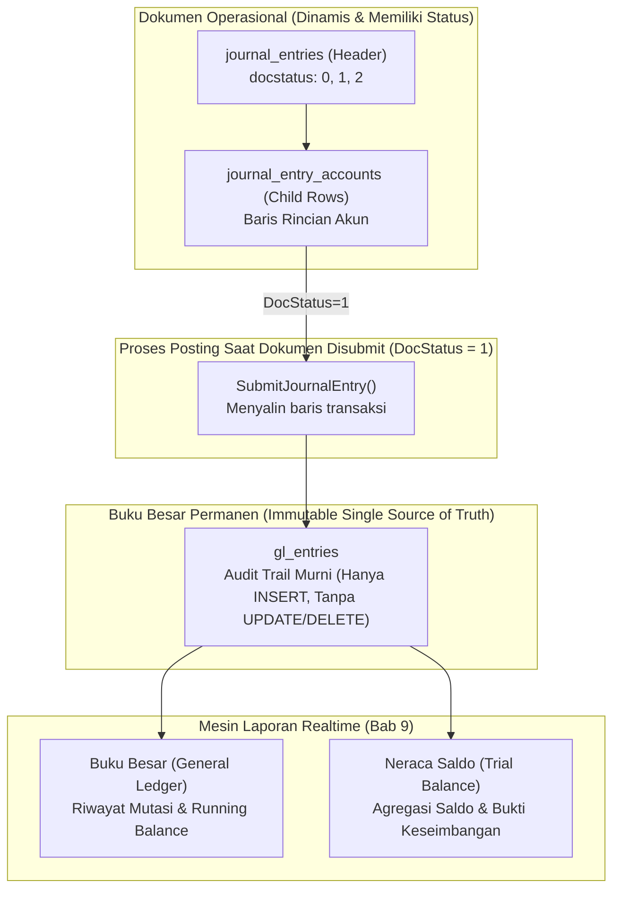

# BAB 9: MODUL 4 - GENERAL LEDGER & LAPORAN KEUANGAN REALTIME

Halo semuanya! Selamat datang di modul keempat SimpleNext. Jika pada [BAB 8](file:///home/sandi/workspace/simplenext/docs/ebook/BAB_08_JOURNAL_ENTRY.md) kita telah berhasil membangun mesin transaksi *Journal Entry*, maka di bab ini kita akan menjawab pertanyaan paling penting dari setiap pemilik bisnis atau direktur keuangan (*CFO*): **"Bagaimana kondisi kesehatan keuangan perusahaan kita saat ini?"**

Apa gunanya mencatat ratusan voucher transaksi setiap hari jika manajemen tidak bisa membaca hasilnya? 

Di bab ini, kita akan mengubah data mentah (*raw immutable records*) di tabel `gl_entries` menjadi dua instrumen pelaporan finansial standar akuntansi internasional:
1. **Buku Besar (General Ledger):** Catatan historis mutasi arus uang masuk dan keluar pada satu akun spesifik, lengkap dengan perhitungan **Saldo Berjalan (Running Balance)**.
2. **Neraca Saldo (Trial Balance):** Laporan rekapitulasi ringkas seluruh akun perusahaan untuk membuktikan secara matematis bahwa pembukuan berada dalam posisi **Seimbang (Balanced)**.

Mari kita bedah arsitektur kode backend Golang dan visualisasi frontend Vue 3 langkah demi langkah!

---

## 9.1 Anatomi Data: Dokumen Operasional vs Buku Besar Murni

Sebelum menulis baris kode pertama, mari kita pahami mengapa sistem ERP kelas dunia memisahkan tabel transaksi dokumen dari tabel buku besar:



### Mengapa Laporan Keuangan Hanya Membaca dari `gl_entries`?
1. **Kecepatan Query Agregasi:** Tabel `journal_entries` memiliki logika status yang rumit (draft, submitted, cancelled). Jika query laporan harus memfilter dan melakukan `JOIN` dokumen berulang kali, database akan lambat saat data mencapai jutaan transaksi. Tabel `gl_entries` dirancang datar (*flat*), terindeks rapi, dan siap dihitung secara instan.
2. **Auditabilitas & Integritas:** Ketika dokumen dibatalkan (*Cancelled*), tabel `gl_entries` mencatat baris pembalik (*Reversal Entry*). Laporan keuangan tinggal menjumlahkan seluruh baris apa adanya tanpa perlu logika percabangan kondisi yang rumit.

Model data [GLEntry](file:///home/sandi/workspace/simplenext/internal/accounting/model.go#L46-L58) didefinisikan pada [internal/accounting/model.go](file:///home/sandi/workspace/simplenext/internal/accounting/model.go):

```go
// GLEntry merepresentasikan baris buku besar permanen (General Ledger)
type GLEntry struct {
	ID          string    `json:"id"`
	PostingDate time.Time `json:"posting_date"`
	Account     string    `json:"account"`
	Debit       float64   `json:"debit"`
	Credit      float64   `json:"credit"`
	VoucherType string    `json:"voucher_type"` // Contoh: "Journal Entry"
	VoucherNo   string    `json:"voucher_no"`   // Nomor voucher: "JV-2026-00001"
	IsCancelled bool      `json:"is_cancelled"` // TRUE jika ini baris pembalik
	Remarks     string    `json:"remarks"`
	CreatedAt   time.Time `json:"created_at"`
}
```

---

## 9.2 Backend: Repository Query Buku Besar (`repository.go`)

Mari buka berkas [internal/accounting/repository.go](file:///home/sandi/workspace/simplenext/internal/accounting/repository.go) dan perhatikan method [GetGeneralLedger](file:///home/sandi/workspace/simplenext/internal/accounting/repository.go#L348-L374):

```go
package accounting

import (
	"context"
	"fmt"
)

// GetGeneralLedger mengambil daftar transaksi buku besar berdasarkan akun
func (r *Repository) GetGeneralLedger(ctx context.Context, account string) ([]GLEntry, error) {
	// Query fleksibel: dapat memfilter akun spesifik ATAU menampilkan semua akun
	query := `
		SELECT 
			id, posting_date, account, debit, credit, 
			voucher_type, voucher_no, is_cancelled, COALESCE(remarks, ''), created_at
		FROM gl_entries
		WHERE ($1 = '' OR account = $1)
		ORDER BY posting_date ASC, created_at ASC;
	`
	rows, err := r.db.Query(ctx, query, account)
	if err != nil {
		return nil, fmt.Errorf("gagal query gl_entries: %w", err)
	}
	defer rows.Close()

	var entries []GLEntry
	for rows.Next() {
		var e GLEntry
		err := rows.Scan(
			&e.ID, &e.PostingDate, &e.Account, &e.Debit, &e.Credit,
			&e.VoucherType, &e.VoucherNo, &e.IsCancelled, &e.Remarks, &e.CreatedAt,
		)
		if err != nil {
			return nil, fmt.Errorf("gagal scan gl_entry: %w", err)
		}
		entries = append(entries, e)
	}
	return entries, nil
}
```

### 🔍 Mengapa Query SQL Ini Ditulis Seperti Ini?

1. **Trik Klausa `WHERE ($1 = '' OR account = $1)`:**
   - Ini adalah teknik query SQL yang sangat elegan dan fleksibel!
   - Jika pengguna memanggil API tanpa filter akun (parameter `account = ""`), maka kondisi `$1 = ''` bernilai `TRUE`. Seluruh baris transaksi dari semua akun akan dikembalikan.
   - Jika pengguna memilih akun tertentu (misal `account = "1111 - Kas Kecil"`), maka kondisi `$1 = ''` bernilai `FALSE`, dan database akan mengeksekusi filter `account = $1` dengan memanfaatkan indeks database.
   - Kita tidak perlu menulis dua query SQL terpisah dengan kode `if-else` yang bertele-tele di Go!
2. **Klausa `ORDER BY posting_date ASC, created_at ASC`:**
   - Urutan kronologis waktu dari masa lalu ke masa kini sangat krusial! Menghitung saldo berjalan (*Running Balance*) menuntut agar transaksi paling awal berada di baris paling atas, diikuti transaksi berikutnya secara berurutan.
3. **Fungsi SQL `COALESCE(remarks, '')`:**
   - Menghindari kegagalan (*error scan*) pada driver `pgx` jika kolom keterangan bernilai `NULL`.
4. **Pernyataan `defer rows.Close()`:**
   - Mengembalikan koneksi database ke dalam pool segera setelah pembacaan baris data selesai dilakukan.

Di lapisan service ([internal/accounting/service.go](file:///home/sandi/workspace/simplenext/internal/accounting/service.go#L183-L185)), kita meneruskan pemanggilan ini:

```go
// GetGeneralLedger mengambil transaksi buku besar
func (s *Service) GetGeneralLedger(ctx context.Context, account string) ([]GLEntry, error) {
	return s.repo.GetGeneralLedger(ctx, account)
}
```

---

## 9.3 Konsep Saldo Berjalan (Running Balance) di Frontend

Apa itu **Running Balance**?
Bayangkan buku rekening bank Anda. Di setiap baris transaksi, ada kolom nominal masuk (Debit), keluar (Kredit), dan di ujung kanan terdapat **Saldo Akhir pada Detik Itu**.

```text
Tanggal    | Keterangan          | Debit      | Kredit     | Saldo Berjalan (Balance)
----------------------------------------------------------------------------------
01/10/2026 | Saldo Awal Kas      | Rp 1.000.000| Rp 0       | Rp 1.000.000
05/10/2026 | Beli Kertas Kantor  | Rp 0        | Rp 200.000 | Rp   800.000  (1.000.000 - 200.000)
10/10/2026 | Terima Jasa Konsul  | Rp 500.000  | Rp 0       | Rp 1.300.000  (800.000 + 500.000)
```

### Keputusan Arsitektur: Menghitung di Frontend vs Window Function SQL
- Kita *bisa saja* menggunakan Window Function PostgreSQL: `SUM(debit - credit) OVER (ORDER BY posting_date)`.
- Namun, menyerahkan kalkulasi akumulasi ini ke Frontend Vue 3 memiliki keuntungan besar:
  1. **Menghemat Beban CPU Database:** Database cukup melakukan pembacaan murni (*I/O sequential read*) tanpa harus menghitung jendela kumulatif.
  2. **Reaktivitas Instan:** Dengan fitur *Computed Property* Vue 3, filter tanggal atau pencarian teks di tabel langsung menghitung ulang saldo seketika di memori browser pengguna!

Berikut implementasi komponen Buku Besar di Vue 3:

`frontend/src/views/GeneralLedgerView.vue`
```vue
<template>
  <div class="max-w-6xl mx-auto p-6">
    <div class="mb-6 flex justify-between items-center">
      <div>
        <h1 class="text-2xl font-bold text-slate-900">Laporan Buku Besar (General Ledger)</h1>
        <p class="text-slate-500 text-sm">Lihat riwayat mutasi debit, kredit, dan saldo berjalan akun</p>
      </div>

      <!-- Filter Dropdown Akun -->
      <div class="w-72">
        <select 
          v-model="selectedAccount" 
          @change="fetchLedger"
          class="w-full border border-slate-300 rounded-lg px-3 py-2 text-sm focus:ring-2 focus:ring-indigo-500"
        >
          <option value="">Semua Akun</option>
          <option v-for="acc in ledgerAccounts" :key="acc.name" :value="acc.name">
            {{ acc.name }}
          </option>
        </select>
      </div>
    </div>

    <!-- Tabel Buku Besar -->
    <div class="bg-white rounded-xl shadow-sm border border-slate-200 overflow-hidden">
      <div v-if="loading" class="text-center py-12 text-slate-400">
        Memuat riwayat transaksi...
      </div>
      <div v-else-if="entries.length === 0" class="text-center py-12 text-slate-400">
        Belum ada mutasi buku besar untuk akun ini.
      </div>
      <table v-else class="w-full text-left border-collapse text-sm">
        <thead class="bg-slate-50 border-b border-slate-200 text-xs font-bold text-slate-500 uppercase">
          <tr>
            <th class="py-3 px-4">Tanggal</th>
            <th class="py-3 px-4">Nomor Voucher</th>
            <th class="py-3 px-4">Akun</th>
            <th class="py-3 px-4">Keterangan</th>
            <th class="py-3 px-4 text-right">Debit (Rp)</th>
            <th class="py-3 px-4 text-right">Kredit (Rp)</th>
            <th class="py-3 px-4 text-right">Saldo Berjalan (Rp)</th>
          </tr>
        </thead>
        <tbody>
          <tr 
            v-for="row in ledgerWithRunningBalance" 
            :key="row.id"
            :class="row.is_cancelled ? 'bg-rose-50/50 line-through text-slate-400' : 'hover:bg-slate-50/80'"
            class="border-b border-slate-100 transition-colors"
          >
            <td class="py-3 px-4 font-mono text-xs">{{ row.posting_date.slice(0, 10) }}</td>
            <td class="py-3 px-4 font-mono font-medium text-indigo-600">{{ row.voucher_no }}</td>
            <td class="py-3 px-4 font-medium">{{ row.account }}</td>
            <td class="py-3 px-4 text-slate-600 max-w-xs truncate">{{ row.remarks }}</td>
            <td class="py-3 px-4 text-right font-mono text-emerald-600">
              {{ row.debit > 0 ? row.debit.toLocaleString('id-ID') : '-' }}
            </td>
            <td class="py-3 px-4 text-right font-mono text-rose-600">
              {{ row.credit > 0 ? row.credit.toLocaleString('id-ID') : '-' }}
            </td>
            <td class="py-3 px-4 text-right font-mono font-bold text-slate-900">
              {{ row.running_balance.toLocaleString('id-ID') }}
            </td>
          </tr>
        </tbody>
      </table>
    </div>
  </div>
</template>

<script setup>
import { ref, computed, onMounted } from 'vue'

const entries = ref([])
const ledgerAccounts = ref([])
const selectedAccount = ref('')
const loading = ref(false)

// Ambil data akun buku besar untuk dropdown filter
onMounted(async () => {
  try {
    const res = await fetch('/api/v1/accounts')
    const json = await res.json()
    ledgerAccounts.value = (json.data || []).filter(a => !a.is_group)
    fetchLedger()
  } catch (err) {
    console.error(err)
  }
})

// Mengambil riwayat mutasi dari backend
const fetchLedger = async () => {
  loading.value = true
  try {
    const url = selectedAccount.value 
      ? `/api/v1/reports/general-ledger?account=${encodeURIComponent(selectedAccount.value)}`
      : '/api/v1/reports/general-ledger'
    const res = await fetch(url)
    const json = await res.json()
    entries.value = json.data || []
  } catch (err) {
    console.error(err)
  } finally {
    loading.value = false
  }
}

// KALKULASI SALDO BERJALAN (Computed Property Reaktif)
const ledgerWithRunningBalance = computed(() => {
  let currentBalance = 0
  return entries.value.map(entry => {
    // Tambah jika Debit, Kurang jika Kredit
    currentBalance = currentBalance + Number(entry.debit) - Number(entry.credit)
    return {
      ...entry,
      running_balance: currentBalance
    }
  })
})
</script>
```

---

## 9.4 Laporan Neraca Saldo (Trial Balance) & Agregasi SQL

Jika Buku Besar menampilkan mutasi per lembar transaksi, maka **Neraca Saldo (Trial Balance)** adalah laporan rekapitulasi ringkasan.

Struktur model [TrialBalanceRow](file:///home/sandi/workspace/simplenext/internal/accounting/model.go#L75-L82) didefinisikan pada [internal/accounting/model.go](file:///home/sandi/workspace/simplenext/internal/accounting/model.go):

```go
// TrialBalanceRow merepresentasikan baris dalam laporan Neraca Saldo
type TrialBalanceRow struct {
	Account     string  `json:"account"`      // Contoh: "1111 - Kas Kecil"
	AccountName string  `json:"account_name"`  // "Kas Kecil"
	RootType    string  `json:"root_type"`     // "Asset", "Liability", "Equity", "Income", "Expense"
	TotalDebit  float64 `json:"total_debit"`   // Total seluruh mutasi debit
	TotalCredit float64 `json:"total_credit"`  // Total seluruh mutasi kredit
	NetBalance  float64 `json:"net_balance"`   // Saldo akhir berdasarkan jenis saldo normal akun
}
```

Buka [internal/accounting/repository.go](file:///home/sandi/workspace/simplenext/internal/accounting/repository.go) dan teliti method [GetTrialBalance](file:///home/sandi/workspace/simplenext/internal/accounting/repository.go#L377-L412):

```go
// GetTrialBalance menghitung neraca saldo seluruh akun dari gl_entries
func (r *Repository) GetTrialBalance(ctx context.Context) ([]TrialBalanceRow, error) {
	query := `
		SELECT 
			a.name AS account,
			a.account_name,
			a.root_type,
			COALESCE(SUM(g.debit), 0) AS total_debit,
			COALESCE(SUM(g.credit), 0) AS total_credit
		FROM accounts a
		LEFT JOIN gl_entries g ON a.name = g.account
		WHERE a.is_group = FALSE
		GROUP BY a.name, a.account_number, a.account_name, a.root_type
		HAVING COALESCE(SUM(g.debit), 0) > 0 OR COALESCE(SUM(g.credit), 0) > 0
		ORDER BY a.account_number ASC, a.name ASC;
	`
	rows, err := r.db.Query(ctx, query)
	if err != nil {
		return nil, fmt.Errorf("gagal kalkulasi trial balance: %w", err)
	}
	defer rows.Close()

	var results []TrialBalanceRow
	for rows.Next() {
		var row TrialBalanceRow
		err := rows.Scan(&row.Account, &row.AccountName, &row.RootType, &row.TotalDebit, &row.TotalCredit)
		if err != nil {
			return nil, fmt.Errorf("gagal scan trial balance row: %w", err)
		}

		// Kalkulasi Saldo Bersih (Net Balance) sesuai aturan Saldo Normal Akuntansi
		row.NetBalance = CalculateNetBalance(row.RootType, row.TotalDebit, row.TotalCredit)

		results = append(results, row)
	}
	return results, nil
}
```

### 🔍 Bedah Query Agregasi SQL Baris demi Baris:

1. **`FROM accounts a LEFT JOIN gl_entries g ON a.name = g.account`:**
   - Kita menggabungkan tabel master bagan akun dengan tabel mutasi buku besar. Menggunakan `LEFT JOIN` memastikan bahwa informasi tipe akun (`root_type`, `account_name`) dari tabel induk tetap terbawa.
2. **`WHERE a.is_group = FALSE`:**
   - Masih ingat aturan emas di Bab 7? Akun grup (`is_group = true`) tidak boleh menampung transaksi langsung. Kita hanya menghitung saldo akun buku besar transaksional (*leaf accounts*).
3. **`COALESCE(SUM(g.debit), 0)`:**
   - Jika sebuah akun belum pernah memiliki transaksi apa pun, fungsi agregasi `SUM()` di SQL akan menghasilkan nilai `NULL`. Fungsi SQL `COALESCE` secara otomatis mengubah nilai `NULL` menjadi angka `0`, mencegah aplikasi *panic* saat memetakan hasil ke tipe data `float64` di Go.
4. **`GROUP BY a.name, a.account_number, a.account_name, a.root_type`:**
   - Mengelompokkan seluruh mutasi ke dalam satu baris ringkasan per satu akun.
5. **Klausa `HAVING COALESCE(SUM(g.debit), 0) > 0 OR COALESCE(SUM(g.credit), 0) > 0`:**
   - *Mengapa kita menyertakan klausa HAVING ini?*
   - Bayangkan jika perusahaan Anda memiliki 5.000 bagan akun, namun di bulan berjalan baru ada 50 akun yang aktif bertransaksi. Tanpa klausa `HAVING`, laporan Neraca Saldo akan dipenuhi oleh 4.950 baris kosong bernilai Rp 0! Klausa ini menyaring agar hanya akun yang pernah bergerak yang ditampilkan di laporan.
6. **`ORDER BY a.account_number ASC, a.name ASC`:**
   - Menjamin urutan akun tersusun rapi sesuai standar akuntansi: diawali deretan Aset (1xxx), Kewajiban (2xxx), Modal (3xxx), Pendapatan (4xxx), dan diakhiri Beban (5xxx).

---

## 9.5 Rahasia Akuntansi: Aturan "Saldo Normal" (Normal Balance Engine)

Perhatikan baris berikut pada fungsi repository di atas:
```go
row.NetBalance = CalculateNetBalance(row.RootType, row.TotalDebit, row.TotalCredit)
```

Mengapa kita tidak bisa sekadar menghitung `Debit - Kredit` untuk semua akun?
Jawabannya terletak pada **Aturan Saldo Normal (Normal Balance)** dalam ilmu akuntansi:

| Kategori Akun (*Root Type*) | Bertambah Pada Sisi | Saldo Normal | Rumus Perhitungan Saldo Bersih (*Net Balance*) |
| :--- | :---: | :---: | :--- |
| **Asset (Aset / Harta)** | **Debit** | **Debit** | $\text{Net Balance} = \text{Total Debit} - \text{Total Kredit}$ |
| **Expense (Beban / Biaya)** | **Debit** | **Debit** | $\text{Net Balance} = \text{Total Debit} - \text{Total Kredit}$ |
| **Liability (Kewajiban / Utang)** | **Kredit** | **Kredit** | $\text{Net Balance} = \text{Total Kredit} - \text{Total Debit}$ |
| **Equity (Ekuitas / Modal)** | **Kredit** | **Kredit** | $\text{Net Balance} = \text{Total Kredit} - \text{Total Debit}$ |
| **Income (Pendapatan)** | **Kredit** | **Kredit** | $\text{Net Balance} = \text{Total Kredit} - \text{Total Debit}$ |

Buka [internal/accounting/service.go](file:///home/sandi/workspace/simplenext/internal/accounting/service.go) dan amati fungsi murni [CalculateNetBalance](file:///home/sandi/workspace/simplenext/internal/accounting/service.go#L80-L86):

```go
// CalculateNetBalance menghitung saldo bersih (Net Balance) akun berdasarkan jenis root normal balance
func CalculateNetBalance(rootType string, totalDebit, totalCredit float64) float64 {
	// Aset dan Beban bertambah di sisi Debit. (Saldo = Debit - Kredit)
	if rootType == "Asset" || rootType == "Expense" {
		return totalDebit - totalCredit
	}
	// Kewajiban, Ekuitas, dan Pendapatan bertambah di sisi Kredit. (Saldo = Kredit - Debit)
	return totalCredit - totalDebit
}
```

### 🔍 Mengapa Logika Ini Diletakkan di Go, Bukan di SQL `CASE WHEN`?
- **Testability:** Karena fungsi ini adalah fungsi murni (*Pure Function*), kita dapat menulis *Unit Test* super cepat yang menguji seluruh cabang kondisi logika tanpa menyentuh koneksi database.
- **Portabilitas:** Logika bisnis saldo normal tetap berada di tangan kode backend aplikasi kita, bukan tersebar di dalam dialek query SQL database.

---

## 9.6 Backend: HTTP Handler & JSON Envelope Laporan (`handler.go`)

Mari kita tinjau bagaimana data ini dibungkus dan dikirim ke browser. Buka [internal/accounting/handler.go](file:///home/sandi/workspace/simplenext/internal/accounting/handler.go) pada method [GetGeneralLedger](file:///home/sandi/workspace/simplenext/internal/accounting/handler.go#L109-L118) dan [GetTrialBalance](file:///home/sandi/workspace/simplenext/internal/accounting/handler.go#L120-L139):

```go
package accounting

import (
	"net/http"
)

// 1. GET /api/v1/reports/general-ledger?account=...
func (h *Handler) GetGeneralLedger(w http.ResponseWriter, r *http.Request) {
	account := r.URL.Query().Get("account")
	entries, err := h.service.GetGeneralLedger(r.Context(), account)
	if err != nil {
		respondError(w, http.StatusInternalServerError, err.Error())
		return
	}

	respondJSON(w, http.StatusOK, map[string]interface{}{"data": entries})
}

// 2. GET /api/v1/reports/trial-balance
func (h *Handler) GetTrialBalance(w http.ResponseWriter, r *http.Request) {
	report, err := h.service.GetTrialBalance(r.Context())
	if err != nil {
		respondError(w, http.StatusInternalServerError, err.Error())
		return
	}

	// Hitung Grand Total seluruh debit dan kredit perusahaan
	var totalDebit, totalCredit float64
	for _, row := range report {
		totalDebit += row.TotalDebit
		totalCredit += row.TotalCredit
	}

	// Kembalikan amplop JSON lengkap dengan ringkasan status keseimbangan
	respondJSON(w, http.StatusOK, map[string]interface{}{
		"data":         report,
		"total_debit":  totalDebit,
		"total_credit": totalCredit,
		"is_balanced":  totalDebit == totalCredit,
	})
}
```

### 🔍 Mengapa Respons Trial Balance Menyertakan `is_balanced`?
Perhatikan baris 137: `"is_balanced": totalDebit == totalCredit`.
Keputusan desain API ini sangat memudahkan pengembang Frontend! Alih-alih menghitung ulang apakah total debit sama dengan total kredit di Javascript, backend langsung memberikan konfirmasi status `true/false`. Frontend tinggal menyalakan lencana hijau *"SEIMBANG"* atau lencana merah *"TIDAK SEIMBANG"*.

---

## 9.7 Unit Testing Saldo Normal (`service_test.go`)

Mari kita uji keakuratan fungsi penentuan saldo normal kita. Buka [internal/accounting/service_test.go](file:///home/sandi/workspace/simplenext/internal/accounting/service_test.go) dan amati [TestCalculateNetBalance](file:///home/sandi/workspace/simplenext/internal/accounting/service_test.go#L118-L171):

```go
package accounting

import (
	"testing"
)

func TestCalculateNetBalance(t *testing.T) {
	tests := []struct {
		name        string
		rootType    string
		totalDebit  float64
		totalCredit float64
		expectedNet float64
	}{
		{
			name:        "Asset normal balance is Debit",
			rootType:    "Asset",
			totalDebit:  1000000,
			totalCredit: 250000,
			expectedNet: 750000, // 1.000.000 - 250.000 = +750.000
		},
		{
			name:        "Expense normal balance is Debit",
			rootType:    "Expense",
			totalDebit:  500000,
			totalCredit: 50000,
			expectedNet: 450000, // 500.000 - 50.000 = +450.000
		},
		{
			name:        "Liability normal balance is Credit",
			rootType:    "Liability",
			totalDebit:  200000,
			totalCredit: 800000,
			expectedNet: 600000, // 800.000 - 200.000 = +600.000
		},
		{
			name:        "Equity normal balance is Credit",
			rootType:    "Equity",
			totalDebit:  0,
			totalCredit: 5000000,
			expectedNet: 5000000, // 5.000.000 - 0 = +5.000.000
		},
		{
			name:        "Income normal balance is Credit",
			rootType:    "Income",
			totalDebit:  100000,
			totalCredit: 1500000,
			expectedNet: 1400000, // 1.500.000 - 100.000 = +1.400.000
		},
	}

	for _, tc := range tests {
		t.Run(tc.name, func(t *testing.T) {
			got := CalculateNetBalance(tc.rootType, tc.totalDebit, tc.totalCredit)
			if got != tc.expectedNet {
				t.Errorf("expected net balance %.2f, got %.2f", tc.expectedNet, got)
			}
		})
	}
}
```

### Eksekusi Unit Test di Terminal:
Jalankan perintah berikut:

```bash
go test -v -run TestCalculateNetBalance ./internal/accounting
```

### Hasil Log Terminal:
```text
=== RUN   TestCalculateNetBalance
=== RUN   TestCalculateNetBalance/Asset_normal_balance_is_Debit
=== RUN   TestCalculateNetBalance/Expense_normal_balance_is_Debit
=== RUN   TestCalculateNetBalance/Liability_normal_balance_is_Credit
=== RUN   TestCalculateNetBalance/Equity_normal_balance_is_Credit
=== RUN   TestCalculateNetBalance/Income_normal_balance_is_Credit
--- PASS: TestCalculateNetBalance (0.00s)
PASS
ok      simplenext/internal/accounting    0.004s
```

Kelima pilar akuntansi terbukti memberikan arah perhitungan saldo yang akurat 100%!

---

## 9.8 Frontend: Komponen Neraca Saldo (`TrialBalanceView.vue`)

Sekarang, mari kita bangun halaman antarmuka pengguna untuk menampilkan Neraca Saldo perusahaan:

`frontend/src/views/TrialBalanceView.vue`
```vue
<template>
  <div class="max-w-6xl mx-auto p-6">
    <div class="mb-6 flex justify-between items-center">
      <div>
        <h1 class="text-2xl font-bold text-slate-900">Laporan Neraca Saldo (Trial Balance)</h1>
        <p class="text-slate-500 text-sm">Rekapitulasi saldo debit, kredit, dan pembuktian keseimbangan buku besar</p>
      </div>

      <!-- Lencana Status Keseimbangan -->
      <div 
        class="flex items-center gap-2 px-4 py-2 rounded-lg text-sm font-semibold border shadow-sm"
        :class="reportData.is_balanced 
          ? 'bg-emerald-50 border-emerald-200 text-emerald-700' 
          : 'bg-rose-50 border-rose-200 text-rose-700'"
      >
        <span class="w-2.5 h-2.5 rounded-full" :class="reportData.is_balanced ? 'bg-emerald-500' : 'bg-rose-500'"></span>
        {{ reportData.is_balanced ? 'BUKU BESAR SEIMBANG (BALANCED)' : 'PERINGATAN: TIDAK SEIMBANG' }}
      </div>
    </div>

    <!-- Tabel Neraca Saldo -->
    <div class="bg-white rounded-xl shadow-sm border border-slate-200 overflow-hidden">
      <div v-if="loading" class="text-center py-12 text-slate-400">
        Menghitung neraca saldo...
      </div>
      <div v-else-if="rows.length === 0" class="text-center py-12 text-slate-400">
        Belum ada mutasi transaksi yang diposting ke Buku Besar.
      </div>
      <table v-else class="w-full text-left border-collapse text-sm">
        <thead class="bg-slate-50 border-b border-slate-200 text-xs font-bold text-slate-500 uppercase">
          <tr>
            <th class="py-3 px-4">Nama Akun</th>
            <th class="py-3 px-4">Kategori Akar</th>
            <th class="py-3 px-4 text-right">Total Debit (Rp)</th>
            <th class="py-3 px-4 text-right">Total Kredit (Rp)</th>
            <th class="py-3 px-4 text-right">Saldo Bersih (Net)</th>
          </tr>
        </thead>
        <tbody>
          <tr 
            v-for="row in rows" 
            :key="row.account" 
            class="border-b border-slate-100 hover:bg-slate-50/80 transition-colors"
          >
            <td class="py-3 px-4 font-medium text-slate-900">{{ row.account }}</td>
            <td class="py-3 px-4">
              <span 
                class="text-xs px-2.5 py-0.5 rounded-full font-medium"
                :class="{
                  'bg-blue-50 text-blue-700': row.root_type === 'Asset',
                  'bg-amber-50 text-amber-700': row.root_type === 'Liability',
                  'bg-purple-50 text-purple-700': row.root_type === 'Equity',
                  'bg-emerald-50 text-emerald-700': row.root_type === 'Income',
                  'bg-rose-50 text-rose-700': row.root_type === 'Expense'
                }"
              >
                {{ row.root_type }}
              </span>
            </td>
            <td class="py-3 px-4 text-right font-mono text-slate-700">
              {{ row.total_debit.toLocaleString('id-ID') }}
            </td>
            <td class="py-3 px-4 text-right font-mono text-slate-700">
              {{ row.total_credit.toLocaleString('id-ID') }}
            </td>
            <td class="py-3 px-4 text-right font-mono font-bold text-slate-900">
              Rp {{ row.net_balance.toLocaleString('id-ID') }}
            </td>
          </tr>
        </tbody>

        <!-- Baris Grand Total (Footer Pembuktian Akuntansi) -->
        <tfoot class="bg-slate-100/80 border-t-2 border-slate-300 font-bold text-slate-900">
          <tr>
            <td colspan="2" class="py-4 px-4 uppercase tracking-wider text-xs text-slate-600">
              Grand Total Seluruh Akun:
            </td>
            <td class="py-4 px-4 text-right font-mono text-base text-indigo-700">
              Rp {{ reportData.total_debit?.toLocaleString('id-ID') || 0 }}
            </td>
            <td class="py-4 px-4 text-right font-mono text-base text-indigo-700">
              Rp {{ reportData.total_credit?.toLocaleString('id-ID') || 0 }}
            </td>
            <td class="py-4 px-4 text-right text-xs">
              <span 
                class="px-2 py-1 rounded text-white"
                :class="reportData.is_balanced ? 'bg-emerald-600' : 'bg-rose-600'"
              >
                {{ reportData.is_balanced ? '100% MATCH' : 'SELISIH' }}
              </span>
            </td>
          </tr>
        </tfoot>
      </table>
    </div>
  </div>
</template>

<script setup>
import { ref, onMounted } from 'vue'

const reportData = ref({})
const rows = ref([])
const loading = ref(true)

const loadTrialBalance = async () => {
  loading.value = true
  try {
    const res = await fetch('/api/v1/reports/trial-balance')
    const json = await res.json()
    reportData.value = json
    rows.value = json.data || []
  } catch (err) {
    console.error('Gagal mengambil laporan Trial Balance:', err)
  } finally {
    loading.value = false
  }
}

onMounted(() => {
  loadTrialBalance()
})
</script>
```

---

## 9.9 Pengujian & Verifikasi Output API via cURL

Pastikan backend Anda sedang berjalan (`make run`). Mari kita uji kedua endpoint laporan ini:

### 1. Uji Endpoint Buku Besar (General Ledger):
```bash
curl -s "http://localhost:8080/api/v1/reports/general-ledger?account=1111%20-%20Kas%20Kecil" | jq .
```

**Hasil Keluaran JSON:**
```json
{
  "data": [
    {
      "id": "e4c195ba-7836-4fc7-bf98-6a56e72901a1",
      "posting_date": "2026-10-10T00:00:00Z",
      "account": "1111 - Kas Kecil",
      "debit": 0,
      "credit": 500000,
      "voucher_type": "Journal Entry",
      "voucher_no": "JV-2026-00001",
      "is_cancelled": false,
      "remarks": "Pembayaran Listrik Maret 2026",
      "created_at": "2026-10-10T14:30:00Z"
    }
  ]
}
```

---

### 2. Uji Endpoint Neraca Saldo (Trial Balance):
```bash
curl -s "http://localhost:8080/api/v1/reports/trial-balance" | jq .
```

**Hasil Keluaran JSON:**
```json
{
  "data": [
    {
      "account": "1111 - Kas Kecil",
      "account_name": "Kas Kecil",
      "root_type": "Asset",
      "total_debit": 0,
      "total_credit": 500000,
      "net_balance": -500000
    },
    {
      "account": "5130 - Beban Listrik dan Air",
      "account_name": "Beban Listrik dan Air",
      "root_type": "Expense",
      "total_debit": 500000,
      "total_credit": 0,
      "net_balance": 500000
    }
  ],
  "is_balanced": true,
  "total_credit": 500000,
  "total_debit": 500000
}
```

Perhatikan baris metadata respons paling bawah:
`"total_debit": 500000`, `"total_credit": 500000`, `"is_balanced": true`.
Keseimbangan finansial terbukti secara valid dan realtime!

---

## 9.10 Checklist Pemahaman Mandiri (Self-Check)

Sebelum melangkah ke modul visualisasi dasbor di Bab 10, pastikan Anda telah menguasai hal-hal berikut:

- [ ] Mengapa laporan keuangan membaca data dari tabel `gl_entries`, bukan langsung dari `journal_entries`?
- [ ] Bagaimana cara kerja trik query SQL `WHERE ($1 = '' OR account = $1)` untuk melayani pencarian umum maupun spesifik?
- [ ] Mengapa penghitungan *Running Balance* lebih menguntungkan dilakukan di sisi Frontend (*Computed Property*) dibandingkan Window Function SQL?
- [ ] Apa peran klausa `HAVING` pada query agregasi Neraca Saldo?
- [ ] Mengapa rumus *Net Balance* untuk akun Aset berbeda dengan akun Kewajiban/Pendapatan?
- [ ] Mengapa endpoint `/api/v1/reports/trial-balance` langsung menyertakan properti boolean `is_balanced`?

---

➡️ **Langkah Berikutnya:** Data keuangan kita telah tersusun rapi dalam laporan buku besar dan neraca saldo. Namun, angka-angka dalam tabel akan jauh lebih mudah dipahami oleh pemilik bisnis jika divisualisasikan dalam bentuk grafik, kartu metrik (*KPI Cards*), dan diagram arus kas. Di bab selanjutnya, kita akan membangun Dashboard visual yang menawan.

Lanjutkan ke [**BAB 10: MODUL 5 - DASHBOARD FINANSIAL & VISUALISASI METRIK**](file:///home/sandi/workspace/simplenext/docs/ebook/BAB_10_DASHBOARD_METRICS.md).
