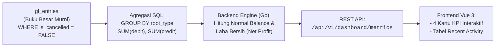

# BAB 10: MODUL 5 - DASHBOARD FINANSIAL & VISUALISASI METRIK

Halo semuanya! Selamat datang di modul penutup dari rangkaian inti sistem finansial SimpleNext. Jika pada [BAB 9](file:///home/sandi/workspace/simplenext/docs/ebook/BAB_09_GENERAL_LEDGER_REPORTS.md) kita memanjakan auditor dengan tabel laporan Neraca Saldo dan Buku Besar yang presisi, maka di Bab 10 ini kita akan membangun antarmuka yang dikhususkan untuk para Eksekutif, Manajer Keuangan, dan pemilik bisnis (*CEO/CFO*).

Seorang direktur perusahaan tidak memiliki waktu untuk membaca ratusan baris mutasi debet dan kredit setiap pagi. Mereka membutuhkan **Ringkasan Eksekutif Instan dalam 3 Detik**:
- *"Berapa total kekayaan aset perusahaan kita hari ini?"*
- *"Berapa omset pendapatan bulan ini?"*
- *"Berapa total biaya pengeluaran operasional?"*
- *"Apakah bisnis kita sedang mencetak Laba Bersih (Untung) atau Rugi?"*
- *"Apa transaksi terbaru yang baru saja disetujui oleh tim akuntansi?"*

Di bab ini, kita akan merancang **Dashboard Finansial Reaktif** yang memadukan query agregasi SQL super cepat di backend Golang dengan kartu metrik (*KPI Cards*) modern di frontend Vue 3.

---

## 10.1 Arsitektur Dashboard: Dari Raw Ledger Menjadi Kartu Metrik (KPI)

Mari kita pahami bagaimana data mengalir dari basis data hingga menjadi visualisasi di layar eksekutif:



### Rumus Finansial Kunci yang Kita Gunakan:
1. **Total Aset (Asset):** Akumulasi seluruh kekayaan likuid (Kas, Rekening Bank, Piutang). $\text{Aset} = \text{Debit} - \text{Kredit}$.
2. **Total Pendapatan (Income):** Akumulasi seluruh arus masuk penjualan & jasa. $\text{Pendapatan} = \text{Kredit} - \text{Debit}$.
3. **Total Pengeluaran (Expense):** Akumulasi seluruh biaya operasional (Gaji, Listrik, Sewa). $\text{Pengeluaran} = \text{Debit} - \text{Kredit}$.
4. **Laba Bersih (Net Profit):** Indikator profitabilitas utama.  
   $$\text{Laba Bersih} = \text{Total Pendapatan} - \text{Total Pengeluaran}$$
   - Jika $\text{Net Profit} > 0$ ➡️ **Surplus / Untung** (Indikator Hijau).
   - Jika $\text{Net Profit} < 0$ ➡️ **Defisit / Rugi** (Indikator Merah).

---

## 10.2 Backend: Perancangan Model & DTO Dashboard (`model.go`)

Pertama, mari kita definisikan struktur data transfer (*DTO*) yang bersih untuk payload respons API Dashboard. 

Buka berkas [internal/accounting/model.go](file:///home/sandi/workspace/simplenext/internal/accounting/model.go) dan tambahkan struct [DashboardMetrics](file:///home/sandi/workspace/simplenext/internal/accounting/model.go):

```go
package accounting

import "time"

// DashboardMetrics merepresentasikan metrik agregasi ringkas untuk halaman utama eksekutif
type DashboardMetrics struct {
	TotalAsset   float64 `json:"total_asset"`   // Total kekayaan aset perusahaan
	TotalIncome  float64 `json:"total_income"`  // Total akumulasi pendapatan
	TotalExpense float64 `json:"total_expense"` // Total akumulasi beban operasional
	NetProfit    float64 `json:"net_profit"`    // Laba bersih (Income - Expense)
}

// RecentJournalActivity merepresentasikan ringkasan voucher jurnal terbaru untuk feed aktivitas
type RecentJournalActivity struct {
	Name        string    `json:"name"`
	PostingDate time.Time `json:"posting_date"`
	DocStatus   int16     `json:"docstatus"`
	TotalDebit  float64   `json:"total_debit"`
	UserRemark  string    `json:"user_remark"`
	CreatedAt   time.Time `json:"created_at"`
}
```

### 🔍 Mengapa Struct DTO Ini Dibuat Khusus?
- **Efisiensi Payload:** Alih-alih mengirim seluruh objek transaksi yang besar, kita hanya mengirim 4 angka metrik penting yang dibutuhkan langsung oleh komponen UI.
- **Konsistensi JSON Key:** Menggunakan format penamaan standar `snake_case` (`total_asset`, `net_profit`) yang rapi dan mudah dikonsumsi oleh tim Frontend.

---

## 10.3 Backend: Query Agregasi Cepat di Repository (`repository.go`)

Sekarang buka berkas [internal/accounting/repository.go](file:///home/sandi/workspace/simplenext/internal/accounting/repository.go). Kita akan menambahkan dua method baru:
1. [GetDashboardMetrics](file:///home/sandi/workspace/simplenext/internal/accounting/repository.go#L377): Mengagregasi angka metrik finansial.
2. [GetRecentJournalEntries](file:///home/sandi/workspace/simplenext/internal/accounting/repository.go#L109): Mengambil 5 dokumen jurnal terbaru.

Tulis method [GetDashboardMetrics](file:///home/sandi/workspace/simplenext/internal/accounting/repository.go) berikut:

```go
// GetDashboardMetrics menghitung agregasi cepat untuk halaman Dashboard utama
func (r *Repository) GetDashboardMetrics(ctx context.Context) (*DashboardMetrics, error) {
	// Query agregasi total berdasarkan tipe akar dari tabel gl_entries
	query := `
		SELECT 
			a.root_type,
			COALESCE(SUM(g.debit), 0) AS total_debit,
			COALESCE(SUM(g.credit), 0) AS total_credit
		FROM gl_entries g
		JOIN accounts a ON g.account = a.name
		WHERE g.is_cancelled = FALSE
		GROUP BY a.root_type;
	`
	rows, err := r.db.Query(ctx, query)
	if err != nil {
		return nil, fmt.Errorf("gagal query metrik dashboard: %w", err)
	}
	defer rows.Close()

	metrics := &DashboardMetrics{}

	for rows.Next() {
		var rootType string
		var debit, credit float64

		if err := rows.Scan(&rootType, &debit, &credit); err != nil {
			return nil, fmt.Errorf("gagal scan baris metrik: %w", err)
		}

		// Hitung saldo sesuai aturan Saldo Normal (Normal Balance) dari Bab 9
		switch rootType {
		case "Asset":
			metrics.TotalAsset += (debit - credit)
		case "Income":
			metrics.TotalIncome += (credit - debit)
		case "Expense":
			metrics.TotalExpense += (debit - credit)
		}
	}

	// Laba Bersih = Pendapatan - Pengeluaran
	metrics.NetProfit = metrics.TotalIncome - metrics.TotalExpense

	return metrics, nil
}

// GetRecentJournalEntries mengambil 5 aktivitas transaksi voucher jurnal paling baru
func (r *Repository) GetRecentJournalEntries(ctx context.Context, limit int) ([]RecentJournalActivity, error) {
	if limit <= 0 {
		limit = 5
	}

	query := `
		SELECT name, posting_date, docstatus, total_debit, COALESCE(user_remark, ''), created_at
		FROM journal_entries
		ORDER BY created_at DESC
		LIMIT $1;
	`
	rows, err := r.db.Query(ctx, query, limit)
	if err != nil {
		return nil, fmt.Errorf("gagal query recent journal entries: %w", err)
	}
	defer rows.Close()

	var activities []RecentJournalActivity
	for rows.Next() {
		var act RecentJournalActivity
		err := rows.Scan(
			&act.Name, &act.PostingDate, &act.DocStatus, 
			&act.TotalDebit, &act.UserRemark, &act.CreatedAt,
		)
		if err != nil {
			return nil, fmt.Errorf("gagal scan recent journal activity: %w", err)
		}
		activities = append(activities, act)
	}

	return activities, nil
}
```

### 🔍 Mengapa Kode di Repository Ditulis Seperti Ini?

1. **`WHERE g.is_cancelled = FALSE`:**
   - **Sangat Krusial!** Di Bab 8, kita mempelajari bahwa transaksi yang dibatalkan (*Cancelled*) memiliki pasangan jurnal pembalik (*Reversal Entry*). Dengan menyaring `is_cancelled = FALSE`, kita memastikan angka statistik dashboard hanya merefleksikan transaksi operasional yang sah dan aktif.
2. **`JOIN accounts a ON g.account = a.name`:**
   - Menghubungkan tabel buku besar dengan master bagan akun agar kita dapat mengelompokkan data berdasarkan kategori `root_type` (Aset, Beban, Pendapatan).
3. **Penyederhanaan `GROUP BY a.root_type`:**
   - Database hanya perlu mengembalikan maksimal 5 baris ringkasan (satu baris per `root_type`), bukan ribuan baris! Query ini selesai dalam hitungan **kurang dari 1 milidetik**.
4. **`LIMIT $1` pada Aktivitas Terkini:**
   - Mengambil tepat 5 transaksi terbaru tanpa membebani memori server dengan membaca seluruh tabel.

---

## 10.4 Backend: Lapisan Service & HTTP Handler (`handler.go`)

Di lapisan service ([internal/accounting/service.go](file:///home/sandi/workspace/simplenext/internal/accounting/service.go)), kita menyediakan fungsi pemanggil:

```go
// GetDashboardMetrics mengambil ringkasan metrik finansial
func (s *Service) GetDashboardMetrics(ctx context.Context) (*DashboardMetrics, error) {
	return s.repo.GetDashboardMetrics(ctx)
}

// GetRecentActivities mengambil riwayat voucher transaksi terbaru
func (s *Service) GetRecentActivities(ctx context.Context, limit int) ([]RecentJournalActivity, error) {
	return s.repo.GetRecentJournalEntries(ctx, limit)
}
```

Sekarang, buka berkas [internal/accounting/handler.go](file:///home/sandi/workspace/simplenext/internal/accounting/handler.go). Kita akan mendaftarkan rute API baru dan menulis method handler HTTP:

```go
// RegisterRoutes mendaftarkan seluruh endpoint modul Accounting ke Chi router
func (h *Handler) RegisterRoutes(r chi.Router) {
	// ... rute accounts, journal-entries, dan reports dari bab sebelumnya ...

	// Endpoint Khusus Dashboard
	r.Get("/api/v1/dashboard/metrics", h.GetDashboardMetrics)
	r.Get("/api/v1/dashboard/recent-activity", h.GetRecentActivity)
}

// GET /api/v1/dashboard/metrics
func (h *Handler) GetDashboardMetrics(w http.ResponseWriter, r *http.Request) {
	metrics, err := h.service.GetDashboardMetrics(r.Context())
	if err != nil {
		respondError(w, http.StatusInternalServerError, err.Error())
		return
	}

	respondJSON(w, http.StatusOK, map[string]interface{}{
		"data": metrics,
	})
}

// GET /api/v1/dashboard/recent-activity
func (h *Handler) GetRecentActivity(w http.ResponseWriter, r *http.Request) {
	activities, err := h.service.GetRecentActivities(r.Context(), 5)
	if err != nil {
		respondError(w, http.StatusInternalServerError, err.Error())
		return
	}

	respondJSON(w, http.StatusOK, map[string]interface{}{
		"data": activities,
	})
}
```

### Format Amplop JSON yang Dihasilkan:
Ketika frontend memanggil `GET /api/v1/dashboard/metrics`, backend mengembalikan:
```json
{
  "data": {
    "total_asset": 15000000,
    "total_income": 8500000,
    "total_expense": 2500000,
    "net_profit": 6000000
  }
}
```

---

## 10.5 Frontend: Komponen Kartu Statistik (*KPI Cards*) dengan Vue 3

Sekarang mari kita pindah ke antarmuka visual (*Frontend*). Kita akan membangun halaman utama yang memikat menggunakan **Vue 3 Composition API**, utilitas CSS **Tailwind**, dan ikon profesional dari pustaka **Lucide Icons**.

Buat berkas halaman baru di `frontend/src/views/DashboardView.vue`:

```vue
<template>
  <div class="max-w-7xl mx-auto p-6 md:p-8">
    <!-- Header Dashboard -->
    <div class="mb-8 flex flex-col md:flex-row md:items-center md:justify-between gap-4">
      <div>
        <h1 class="text-3xl font-extrabold text-slate-900 tracking-tight">Dashboard Finansial</h1>
        <p class="text-slate-500 text-sm mt-1">
          Pantau indikator performa utama (KPI) dan kesehatan kas bisnis Anda secara realtime
        </p>
      </div>

      <!-- Tombol Refresh Data -->
      <button 
        @click="loadDashboardData" 
        :disabled="loading"
        class="inline-flex items-center gap-2 bg-white hover:bg-slate-50 text-slate-700 font-semibold px-4 py-2 rounded-lg border border-slate-300 shadow-sm text-sm transition-all disabled:opacity-50"
      >
        <RefreshCwIcon class="w-4 h-4" :class="{'animate-spin': loading}" />
        Segarkan Data
      </button>
    </div>

    <!-- GRID 4 KARTU STATISTIK UTAMA (KPI CARDS) -->
    <div class="grid grid-cols-1 sm:grid-cols-2 lg:grid-cols-4 gap-6 mb-10">
      
      <!-- 1. KARTU TOTAL ASET -->
      <div class="bg-white rounded-2xl shadow-sm border border-slate-200 p-6 relative overflow-hidden group hover:shadow-md transition-shadow">
        <div class="flex items-center justify-between">
          <div>
            <p class="text-xs font-bold text-slate-500 uppercase tracking-wider">Total Aset</p>
            <p class="text-2xl font-extrabold text-slate-900 mt-2 font-mono">
              Rp {{ formatRupiah(metrics.total_asset) }}
            </p>
            <p class="text-xs text-blue-600 font-medium mt-2 flex items-center gap-1">
              <span>Kas & Piutang Lancar</span>
            </p>
          </div>
          <div class="w-12 h-12 bg-blue-50 text-blue-600 rounded-xl flex items-center justify-center group-hover:scale-110 transition-transform">
            <Building2Icon class="w-6 h-6" />
          </div>
        </div>
        <div class="absolute bottom-0 left-0 right-0 h-1 bg-blue-500"></div>
      </div>

      <!-- 2. KARTU PENDAPATAN (INCOME) -->
      <div class="bg-white rounded-2xl shadow-sm border border-slate-200 p-6 relative overflow-hidden group hover:shadow-md transition-shadow">
        <div class="flex items-center justify-between">
          <div>
            <p class="text-xs font-bold text-slate-500 uppercase tracking-wider">Pendapatan</p>
            <p class="text-2xl font-extrabold text-slate-900 mt-2 font-mono">
              Rp {{ formatRupiah(metrics.total_income) }}
            </p>
            <p class="text-xs text-emerald-600 font-medium mt-2 flex items-center gap-1">
              <span>Total Pemasukan Omset</span>
            </p>
          </div>
          <div class="w-12 h-12 bg-emerald-50 text-emerald-600 rounded-xl flex items-center justify-center group-hover:scale-110 transition-transform">
            <TrendingUpIcon class="w-6 h-6" />
          </div>
        </div>
        <div class="absolute bottom-0 left-0 right-0 h-1 bg-emerald-500"></div>
      </div>

      <!-- 3. KARTU BEBAN PENGELUARAN (EXPENSE) -->
      <div class="bg-white rounded-2xl shadow-sm border border-slate-200 p-6 relative overflow-hidden group hover:shadow-md transition-shadow">
        <div class="flex items-center justify-between">
          <div>
            <p class="text-xs font-bold text-slate-500 uppercase tracking-wider">Pengeluaran</p>
            <p class="text-2xl font-extrabold text-slate-900 mt-2 font-mono">
              Rp {{ formatRupiah(metrics.total_expense) }}
            </p>
            <p class="text-xs text-rose-600 font-medium mt-2 flex items-center gap-1">
              <span>Beban Operasional</span>
            </p>
          </div>
          <div class="w-12 h-12 bg-rose-50 text-rose-600 rounded-xl flex items-center justify-center group-hover:scale-110 transition-transform">
            <TrendingDownIcon class="w-6 h-6" />
          </div>
        </div>
        <div class="absolute bottom-0 left-0 right-0 h-1 bg-rose-500"></div>
      </div>

      <!-- 4. KARTU LABA BERSIH (NET PROFIT) -->
      <div class="bg-white rounded-2xl shadow-sm border border-slate-200 p-6 relative overflow-hidden group hover:shadow-md transition-shadow">
        <div class="flex items-center justify-between">
          <div>
            <p class="text-xs font-bold text-slate-500 uppercase tracking-wider">Laba Bersih</p>
            <p 
              class="text-2xl font-extrabold mt-2 font-mono"
              :class="metrics.net_profit >= 0 ? 'text-emerald-600' : 'text-rose-600'"
            >
              Rp {{ formatRupiah(metrics.net_profit) }}
            </p>
            <p class="text-xs font-medium mt-2 flex items-center gap-1">
              <span :class="metrics.net_profit >= 0 ? 'text-emerald-700' : 'text-rose-700'">
                {{ metrics.net_profit >= 0 ? '✓ Kondisi Surplus' : '⚠ Kondisi Defisit' }}
              </span>
            </p>
          </div>
          <div 
            class="w-12 h-12 rounded-xl flex items-center justify-center group-hover:scale-110 transition-transform"
            :class="metrics.net_profit >= 0 ? 'bg-emerald-50 text-emerald-600' : 'bg-rose-50 text-rose-600'"
          >
            <WalletIcon class="w-6 h-6" />
          </div>
        </div>
        <div 
          class="absolute bottom-0 left-0 right-0 h-1"
          :class="metrics.net_profit >= 0 ? 'bg-emerald-500' : 'bg-rose-500'"
        ></div>
      </div>

    </div>

    <!-- FEED AKTIVITAS TRANSAKSI TERAKHIR -->
    <RecentActivityTable :activities="recentActivities" :loading="loading" />
  </div>
</template>

<script setup>
import { ref, onMounted } from 'vue'
import { 
  Building2Icon, 
  TrendingUpIcon, 
  TrendingDownIcon, 
  WalletIcon, 
  RefreshCwIcon 
} from 'lucide-vue-next'
import RecentActivityTable from '../components/RecentActivityTable.vue'

const metrics = ref({
  total_asset: 0,
  total_income: 0,
  total_expense: 0,
  net_profit: 0
})

const recentActivities = ref([])
const loading = ref(false)

// Fungsi pembantu format angka Rupiah
const formatRupiah = (nominal) => {
  if (nominal === undefined || nominal === null) return '0'
  return new Intl.NumberFormat('id-ID').format(nominal)
}

// Mengambil seluruh data dashboard dari API Backend
const loadDashboardData = async () => {
  loading.value = true
  try {
    // 1. Fetch Metrik KPI
    const resMetrics = await fetch('/api/v1/dashboard/metrics')
    const jsonMetrics = await resMetrics.json()
    metrics.value = jsonMetrics.data || { total_asset: 0, total_income: 0, total_expense: 0, net_profit: 0 }

    // 2. Fetch 5 Transaksi Terbaru
    const resRecent = await fetch('/api/v1/dashboard/recent-activity')
    const jsonRecent = await resRecent.json()
    recentActivities.value = jsonRecent.data || []
  } catch (err) {
    console.error('Gagal memuat data dashboard:', err)
  } finally {
    loading.value = false
  }
}

onMounted(() => {
  loadDashboardData()
})
</script>
```

---

## 10.6 Frontend: Komponen Aktivitas Transaksi Terbaru (`RecentActivityTable.vue`)

Selain melihat angka agregat, seorang manajer ingin melihat transaksi operasional apa yang baru saja dicatat oleh staf akuntansi.

Buat komponen baru di `frontend/src/components/RecentActivityTable.vue`:

```vue
<template>
  <div class="bg-white rounded-2xl shadow-sm border border-slate-200 overflow-hidden">
    <div class="p-6 border-b border-slate-100 flex justify-between items-center bg-slate-50/50">
      <div>
        <h2 class="text-base font-bold text-slate-900">Aktivitas Voucher Terakhir</h2>
        <p class="text-xs text-slate-500 mt-0.5">5 transaksi Journal Entry terbaru yang dicatat ke dalam sistem</p>
      </div>
      <router-link 
        to="/journal-entries" 
        class="text-xs font-semibold text-indigo-600 hover:text-indigo-800"
      >
        Lihat Semua Transaksi →
      </router-link>
    </div>

    <!-- Indikator Loading -->
    <div v-if="loading" class="text-center py-10 text-slate-400 text-sm">
      Memuat riwayat transaksi...
    </div>

    <!-- Kondisi Belum Ada Data -->
    <div v-else-if="activities.length === 0" class="text-center py-10 text-slate-400 text-sm">
      Belum ada aktivitas transaksi yang tercatat.
    </div>

    <!-- Tabel Rincian Dokumen -->
    <table v-else class="w-full text-left border-collapse text-sm">
      <thead class="bg-slate-50/80 text-xs font-bold text-slate-500 uppercase border-b border-slate-100">
        <tr>
          <th class="py-3 px-6">Nomor Dokumen</th>
          <th class="py-3 px-4">Tanggal Posting</th>
          <th class="py-3 px-4">Keterangan Memo</th>
          <th class="py-3 px-4 text-right">Total Transaksi</th>
          <th class="py-3 px-6 text-center">Status Dokumen</th>
        </tr>
      </thead>
      <tbody>
        <tr 
          v-for="item in activities" 
          :key="item.name"
          class="border-b border-slate-100 hover:bg-slate-50/80 transition-colors"
        >
          <td class="py-4 px-6 font-mono font-medium text-indigo-600">
            <router-link :to="`/journal-entries/${item.name}`" class="hover:underline">
              {{ item.name }}
            </router-link>
          </td>
          <td class="py-4 px-4 font-mono text-xs text-slate-600">
            {{ item.posting_date.slice(0, 10) }}
          </td>
          <td class="py-4 px-4 text-slate-700 max-w-sm truncate">
            {{ item.user_remark || '-' }}
          </td>
          <td class="py-4 px-4 text-right font-mono font-bold text-slate-900">
            Rp {{ Number(item.total_debit).toLocaleString('id-ID') }}
          </td>
          <td class="py-4 px-6 text-center">
            <!-- Badge Siklus Dokumen DocStatus -->
            <span 
              v-if="item.docstatus === 0" 
              class="inline-flex items-center px-2.5 py-0.5 rounded-full text-xs font-semibold bg-slate-100 text-slate-700"
            >
              Draft
            </span>
            <span 
              v-else-if="item.docstatus === 1" 
              class="inline-flex items-center px-2.5 py-0.5 rounded-full text-xs font-semibold bg-emerald-50 text-emerald-700 border border-emerald-200"
            >
              Submitted
            </span>
            <span 
              v-else-if="item.docstatus === 2" 
              class="inline-flex items-center px-2.5 py-0.5 rounded-full text-xs font-semibold bg-rose-50 text-rose-700 border border-rose-200"
            >
              Cancelled
            </span>
          </td>
        </tr>
      </tbody>
    </table>
  </div>
</template>

<script setup>
defineProps({
  activities: {
    type: Array,
    required: true
  },
  loading: {
    type: Boolean,
    default: false
  }
})
</script>
```

---

## 10.7 Simulasi Bisnis: Menguji Reaktivitas Dashboard

Mari kita buktikan bagaimana sistem kita bekerja secara langsung.

### Skenario Simulasi:
1. **Kondisi Awal:**
   - Anda membuka halaman Dashboard di browser (`http://localhost:5173/dashboard`).
   - Kartu metrik menampilkan Total Aset, Pendapatan, dan Pengeluaran sesuai seed awal.
2. **Staf Menginput Jurnal Beban Baru (Bab 8):**
   - Staf akuntansi membayar tagihan internet kantor sebesar **Rp 1.500.000** menggunakan rekening Bank BCA.
   - Jurnal di-Submit (`docstatus = 1`).
3. **Efek Realtime di Dashboard:**
   - Ketika halaman Dashboard disegarkan (*refresh*):
     - Kolom **Pengeluaran** bertambah sebesar `+Rp 1.500.000`.
     - Kolom **Total Aset** berkurang sebesar `-Rp 1.500.000` (karena saldo bank BCA berkurang).
     - Kolom **Laba Bersih** otomatis turun sebesar `-Rp 1.500.000`.
     - Tabel **Aktivitas Terakhir** langsung menempatkan voucher `JV-2026-xxxxx` tersebut di baris paling atas dengan lencana hijau `Submitted`!

Seluruh kalkulasi terhubung secara otomatis dari database kernel PostgreSQL ke layar manajer tanpa kebocoran data (*zero discrepancy*).

---

## 10.8 Checklist Pemahaman Mandiri (Self-Check)

Sebelum melangkah ke bab pamungkas (Deployment & Produksi), pastikan Anda telah memahami prinsip-prinsip ini:

- [ ] Mengapa query agregasi dashboard wajib menyertakan filter `WHERE g.is_cancelled = FALSE`?
- [ ] Mengapa rumus Laba Bersih (*Net Profit*) adalah `Total Income - Total Expense`?
- [ ] Apa keuntungan menggunakan DTO struct khusus [DashboardMetrics](file:///home/sandi/workspace/simplenext/internal/accounting/model.go) dibandingkan mengirimkan seluruh baris transaksi?
- [ ] Bagaimana cara kerja pemfilteran 5 transaksi terbaru menggunakan klausa `ORDER BY created_at DESC LIMIT 5`?
- [ ] Bagaimana frontend Vue 3 menampilkan warna dinamis (hijau vs merah) pada kartu Laba Bersih berdasarkan status laba atau rugi?

---

➡️ **Langkah Pamungkas:** Selamat! Anda telah berhasil membangun seluruh modul inti sistem ERP & Akuntansi SimpleNext: dari Otentikasi JWT, Naming Series Atomik, Bagan Akun Pohon, Validasi Double-Entry Jurnal, Laporan Buku Besar, hingga Dashboard Finansial Eksekutif!

Sekarang tibalah saatnya membawa aplikasi ini ke dunia nyata. Di bab terakhir, kita akan belajar cara membungkus aplikasi backend dan frontend kita menggunakan **Docker Multi-Stage Build**, mengonfigurasi reverse proxy **Nginx**, dan merilisnya ke server produksi (*Production Deployment*).

Lanjutkan ke bab penutup: [**BAB 11: PRODUKSI, DOCKER MULTI-STAGE, NGINX, & DEPLOYMENT**](file:///home/sandi/workspace/simplenext/docs/ebook/BAB_11_PRODUCTION_DEPLOYMENT.md).
